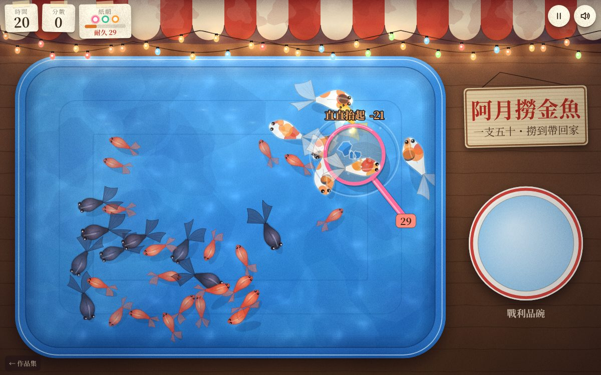

# 遊戲櫃 01 夜市撈金魚

> [!NOTE]
> **這一頁是什麼**  
> [遊戲櫃](../README.md)第 01 個遊戲的完整開發紀錄：玩法、視覺、聲音、技術、取捨、測試與已知問題。內容由製作這個遊戲的 AI 代理在 2026-10-15 寫成，數字都對應目前的程式。
> - 線上玩：[https://echofrommoney-oss.github.io/game-cabinet/g01/](https://echofrommoney-oss.github.io/game-cabinet/g01/)（網址加 `?demo=1` 看精華）
> - 原始檔：`index.html`（要和根目錄的 `lib/` 一起用本機伺服器開，例如 `npm run dev`，直接雙擊可能載不到函式庫）

## 1. 一句話與作品集亮點

**一句話**：在台灣夜市的燈泡串底下，用一支會越泡越爛的紙網，在 60 秒內把金魚撈進碗裡。

**亮點**
- **紙網耐久度模型**：浸泡、拖動速度、入水角度、抬起角度、魚的重量、魚的掙扎都會扣耐久，每一項都有清楚的參數，扣多少也會直接顯示在畫面上（例如「斜斜入水 ✓」、「直直抬起 -8」）。玩家能從回饋裡學會「慢慢斜斜入水、順手斜斜抬起」。
- **魚群行為**：魚群用 boids 演算法（分離、對齊、聚集），加上漫游、避牆和往中央的拉力。網子動得快，魚會受驚逃走；網子靜止時，魚會好奇靠過來。被撈起時魚會翻身掙扎、亂跳，掙扎也會扣耐久。
- **水彩手繪質感，完全不用圖檔**：可無縫重複的紙紋用 overlay 疊在整個畫面上；水面光斑（caustics）每格用 96×64 的低解析度即時計算再放大；暖黃燈泡的光暈用 lighter 疊加；水盆是藍色塑膠，碗是白底紅邊。
- **聲音全部即時合成**：夜市的人聲嘈雜是四條帶通噪音隨機起伏，再加上低頻轟鳴和遠處碗盤的叮噹聲。另外還有水花、紙破的高頻碎裂顆粒、魚落碗、受力時紙張的細碎聲。

## 2. 玩法與規則

- **目標**：在時限內撈最多分。一般模式 60 秒，展示模式 30 秒。
- **紙網**：共三支，顏色依序是粉紅、薄荷、橘。耐久度 D 從 100 開始，歸零就破。破掉後過 1 秒自動換下一支，三支都破就提早結束。
- **結束條件**：時間到，或三支紙網都破了。

**魚種**（身長以紙網半徑 R 為單位，速度單位是 R/秒）

| 魚 | 分數 | 重量 w | 身長 | 巡游／最高速 | 數量（一般／展示） |
|---|---|---|---|---|---|
| 小紅 | 10 | 1.0 | 0.88 | 0.85 / 2.7 | 14 / 20 |
| 黑出目金 | 25 | 1.8 | 1.06 | 0.6 / 1.9 | 6 / 9 |
| 大花 | 50 | 3.2 | 1.46 | 0.48 / 1.5 | 4 / 6 |
| 金元寶（稀有） | 150 | 1.4 | 1.0 | 1.05 / 3.3 | 一場 2 隻 |

每隻魚的大小會隨機乘上 0.92～1.08，重量也跟著乘。

**計分**
- 一網的分數 = round(Σ魚的分數 × 一網多隻倍率)。倍率：1 隻 ×1、2 隻 ×1.3、3 隻 ×1.6、4 隻以上 ×2。
- 惜網獎勵只在「時間到」時才給：每支沒用到的紙網 +30，加上手上那支剩餘耐久 ÷ 4。
- 稱號：未滿 100「見習撈手」、未滿 300「夜市常客」、未滿 600「撈魚達人」，600 以上「金魚傳說」。
- 最高分存在 localStorage 的 `g01-best`。

**事件與難度曲線**
- 稀有金魚：一般模式在 12–22 秒和 34–44 秒各出現一次，展示模式在 2.5 秒和 16 秒。牠會從深處浮上來，只停留 13 秒（展示模式 11 秒），時間到就沉下去游走。
- 老闆補魚：每 5 秒（展示模式 3.5 秒）檢查一次。一般魚少於初始數量的 65% 時，從水盆上緣放進最多 4 隻，機率是紅 55%、黑 28%、大花 17%，會有水花和「老闆補魚囉！」的提示。
- 難度主要來自三件事互相牽制：紙網越泡越濕、扣得越快；撈越多隻越重；魚群受驚就散開。
- 最後 10 秒倒數會發出提示音，最後 3 秒音調更高。

**紙網耐久度模型**（程式中的 `NET` 常數）

| 項目 | 公式／參數 |
|---|---|
| 濕度 wet | 在水裡每秒 +0.45，出水每秒 -0.06，範圍 0～1 |
| 浸泡 | 每秒 -(1.1 + 2.6 × wet) |
| 拖動 | 速度 v（R/秒）> 3 時，每秒 -1.5 × (v-3)^1.6 × (0.6+0.8×wet) |
| 入水 | 入水後 0.16 秒內的最高速 ve：ve < 0.6 算「直直拍水」-7；0.6～5 算「斜斜入水 ✓」不扣；> 5 算「衝太快」-(ve-5)×3，最多 -30 |
| 受驚撞網 | 驚慌度 > 0.35、且在網內的魚：每秒 -Σ(w × 驚慌度 × 2.5) |
| 抬起水重 | 放開瞬間的速度 v：< 0.6「直直抬起」-8；0.6～5「斜斜抬起」-2；> 5「甩太快」-2-(v-5)×3 |
| 抬起魚重 | -Σw × 2.8 × (0.5+wet) |
| 掙扎 | 撈起後的 0.5 秒內，每秒 -Σw × 4 × (0.5+wet) |
| 撈到的判定 | 魚的中心離網心 < 0.82R，而且深度 z ≤ 0.85 |
| 破洞 | 耐久低於 76、52、30、14 時各多一個破洞，破洞會隨耐久下降最多長大到 2.4 倍 |

## 3. 操作

- **桌機**：滑鼠就是紙網（遊戲中游標會隱藏）。按住左鍵＝網子入水，放開＝抬起。也可以先在盆外按住，再滑進水裡，這就是最標準的「斜斜入水」。Esc 或 P 暫停，M 開關聲音，在標題或結算畫面按 Enter 或空白鍵開始。
- **手機**：手指按住拖曳。紙網畫在手指上方 0.95R 的位置，避免被手指擋住。放開就抬起。右上角有暫停和聲音按鈕。
- **技巧**：入水時一邊移動（約每秒 1～4 個網徑）；在魚附近靜止等牠游過來；放開前順手滑一下。

## 4. 視覺設計

**色票**

| HEX | 用途 |
|---|---|
| #2a1d3a → #2d1f2e → #1b1320 | 夜空漸層 |
| #c8392b / #f2e3c6 | 遮雨棚紅白條紋；#c8392b 也是主標題和主按鈕的紅色 |
| #6b4632 → #3d2618 | 木頭台面 |
| #4ea6e8 → #2f88d6 → #2370c0 | 水盆底的塑膠藍 |
| #5fb0f2 / #3a8fe0 / #1d5cab | 盆緣的亮部、中間調、暗部 |
| #ffd27a（另有 #ffb070、#ff8f7a、#a6e6ff、#c9ff9e） | 燈泡；暖黃為主，夾雜節慶彩色 |
| #ec4a2c / #ffa070 / #a8261a | 小紅的身體、亮部、邊線 |
| #2c2633 / #7a6a8c | 黑出目金的身體、亮部 |
| #f4ede2 + #ef7b2d、#2b2428、#d9412b | 大花的白底和三色斑 |
| #f5b82e / #fff3b0 | 金元寶的身體、亮部，另加金色光暈 |
| #ff6f9f / #3fbf95 / #ff9a2e | 三支紙網的塑膠框顏色 |
| #f5ecd8 ＋紙紋 | HUD 紙籤、卡片底色 |
| #4caf6e / #e0a020 / #d9412b | 耐久條：高（> 60）、中（> 30）、低 |

**字型**：Google Fonts 的「LXGW WenKai TC」（霞鶩文楷，手寫楷書感）。離線時依序退回 Kaiti TC、STKaiti、BiauKai、DFKai-SB、KaiTi、Noto Serif TC、PingFang TC、微軟正黑體、serif。字級：主標 clamp(40px, 11vw, 58px)、HUD 數字 27px（窄螢幕 23px）、浮動回饋字 R×0.36（限制在 15～24px）× 倍率。

**質感做法**
- **紙紋**：12 組整數週期的正弦波疊出低頻暈染，再加像素雜訊、1.2% 的暗點和細纖維筆觸。因為週期是整數，貼圖可以無縫重複。整張以 overlay、透明度 0.5 疊在整個畫面上。DOM 卡片用同樣的做法，只是換成米色版本（data URI）。
- **水彩邊**：每條魚先用身體色、透明度 0.22、線寬 0.07L 描一圈暈邊，再填放射漸層，最後用邊線色、透明度 0.55 描細邊（模擬顏料在邊緣堆積）。背景用不規則的 blob 疊色。
- **水**：靜態盆底加暈染斑和模具紋 → caustics 以 lighter、透明度 0.3 疊上 → 魚影（越接近水面，影子偏移越大）→ 魚（深的先畫，越深越透明、越小）→ 燈泡倒影 → 慢慢移動的光澤帶 → 漣漪（亮環加暗環）。
- **紙網**：紙的顏色隨 wet 從 rgba(252,250,240,.74) 變成 rgba(196,212,220,.42)，濕的時候再疊一層暗色暈染。破洞用 evenodd 挖空，加白色毛邊。耐久低於 40 會出現裂痕。在水裡時會有反光弧和水線；懸空時會在水面投下影子，網子也放大 7%。

**版面**
- 橫式：水盆在左（約佔寬度 72%），右側上方是木招牌，下方是碗。
- 直式：水盆在上，碗在下，「戰利品碗 →」的字放在碗的左邊。
- HUD 是三張用膠帶貼著的紙籤（時間、分數、紙網），掛在燈泡串下方。

**動畫參數**
- 網子跟隨指標：在空中用 1-exp(-dt×28) 平滑，在水裡改成 1-exp(-dt×16)，做出水的阻力感。
- 入水：dip 用 dt×14 逼近目標值。
- 魚飛進碗：0.55 秒，easeInOutQuad，拋物線高度 1.8R，每隻之間錯開 0.09 秒。
- 大字幕：1.5 秒，cubic-bezier(.2,1.3,.4,1)，先彈出再淡出。
- 分數跳動：.35 秒放大 1.45 倍後回彈。
- 漣漪：半徑以 1-(1-k)^2.2 擴張，透明度以 (1-k)² 衰減。
- 紙破時畫面震動 0.35 秒，幅度 14px × 剩餘比例。
- **reduced-motion**：關掉畫面震動和燈泡閃爍，caustics 速度降到 0.25，閃光粒子減為 1/3，大字幕只淡入淡出。

## 5. 聲音設計（Web Audio，全部即時合成）

- **主輸出**：主音量 0.9 → DynamicsCompressor（threshold -16、ratio 4）。
- **夜市底噪**：
  - 棕噪經 lowpass 170Hz，增益 0.5。
  - 四條帶通噪音（280、520、900、1600Hz，Q 2.2，白噪和棕噪交錯），每 0.18～0.48 秒用 setTargetAtTime(0.2) 隨機改變增益，並讓頻率在 ±15% 內漂移，聽起來像人聲嘈雜。
  - 每 1.5～5.5 秒有一聲遠處的叮噹：1.8–3.4kHz 正弦波，0.25 秒，增益 0.012–0.024。
- **水中拖動**：持續的白噪經 bandpass（Q 0.9），頻率 500 + v×90 Hz，增益 min(v/9, 1) × 0.32，只在網子入水時有聲音。
- **入水水花**：
  - 帶通噪音 2600→500Hz 指數下滑，0.18 + 0.15k 秒，增益 0.12 + 0.18k。
  - 加一聲正弦「咕嚕」：340→120Hz，0.14 秒。
- **抬起**：帶通噪音 900→3200Hz 上滑，0.35 秒，再加 4 個 900–1800Hz 的小水滴音。
- **紙破**：
  - 16 顆高通噪音顆粒（2.2–4.7kHz，每顆 12–42ms），每顆間隔 12–32ms。
  - 撕裂聲：帶通 1200→600Hz，0.32 秒。
  - 一聲低的 triangle 180→90Hz。
- **紙受力的細碎聲**：扣血速率超過每秒 6 時，隨機播放 2～4 顆高通顆粒（3–5kHz，10–25ms）。
- **魚落碗**：正弦 950/身長 → 230/身長 Hz，0.13 秒，再加一點帶通噪音。另配一個小和弦（triangle，C 大調五聲音階）。
- **魚掙扎**：帶通 2.6–3.6kHz，35ms 的拍打聲。
- **金魚出現**：triangle 琶音 0, 4, 7, 12, 16, 19 半音（從 C5 起），每音間隔 60ms，再疊高八度的正弦。
- **倒數**：方波 1000Hz（最後 3 秒改成 1400Hz），40ms。
- **結束鑼聲**：triangle G4 的 0/4/7/12 半音琶音，加 98Hz 正弦，1.4 秒。
- **啟動時機**：音訊在第一次 pointerdown 或 keydown 才初始化。暫停或切走分頁時 suspend，聲音開關存在 localStorage 的 `g01-sound`。

## 6. 技術架構

只有一個 `index.html`，Canvas 2D 加 Web Audio，沒有用任何函式庫。

**主要模組與函式**
- `layout()`：依橫式或直式計算水盆、碗、招牌、燈泡串的位置，以及紙網半徑 R = clamp(min(水寬, 水高) × 0.1, 30, 68)。視窗縮放時魚的座標會按比例重新對應。
- `buildStatic()`：產生兩張靜態圖層。
  - bgLayer：夜空、散景、木台、水盆陰影、盆底、碗、招牌、遮雨棚、電線。
  - fgLayer：盆內壁陰影、盆緣、碗緣、暗角。
  - 同時產生紙紋 pattern。每格只要 drawImage 兩次。
- `updateCaustics(t)`：96×64 的 ImageData，迭代 3 次的 caustic 函式（一種常見的水紋算法改寫），每 2 格算一次，再用 lighter 放大貼上。
- `updateFish(dt)`：boids 加上各種力，詳細參數見下方。轉向有速率上限（2.6 + 驚慌度 × 5 rad/s），所以魚只能轉彎，不會瞬間倒退。身體彎曲 `bend` 由角速度推得，擺尾頻率隨速度變化。
- `drawFish()`：沿 7 個脊椎點建立身體輪廓。脊椎的側向位移 = sin(phase - 2.4t) × amp × t² + bend × t²，寬度用 PROF 表內插。接著畫雙尾鰭（三段二次曲線加鰭條）、胸鰭、背脊高光、眼睛（出目金的眼睛是外凸的）、大花的斑塊（clip 在身體裡）、金魚的光暈。
- `updateNet()`、`liftNet()`、`evalEntry()`、`damage()`、`breakNet()`：紙網的狀態機 `air → water → lifting → air`，或任何時候進入 `broken`，破掉後換下一支。
- `SDF`：`sdRR()` 計算點到圓角矩形的有號距離，用在魚避牆、網子限制在水內、生成位置。
- `AU`：音效引擎，包含 `noiseBurst` 和 `tone` 兩個合成基本元件。
- 畫面狀態：`title / play / paused / ending / over`。

**boids 參數**（sp = 巡游速度 × R）

| 力 | 參數 |
|---|---|
| 鄰居半徑 | 2.6R |
| 分離 | 距離小於兩魚身長和 × 0.5 時，sp × 7 |
| 對齊 | 0.5 × school；異種魚權重 0.25 |
| 聚集 | sp × 0.45 × school |
| 漫游 | 角度每秒隨機走 ±2.4，sp × 1.1 |
| 往中央的拉力 | sp × 0.7 |
| 避牆 | 邊界 1.4R 內，k² × sp × 9 |
| 怕網 | 網速 > 1.8R/s、且在 (2 + 0.45v)R 內：受驚 |
| 好奇 | 網速 < 1.2R/s、5R 內：curious × sp × 1.15 |

**自動畫質**：開頭量 60 格。平均低於 40fps 就切到省電模式（LITE）：紙紋直接烤進背景、燈泡（不閃爍）烤進前景，DPR 上限改成 1.5。`?hq=1` 強制高畫質，`?lite=1` 強制省電。

**其他規則**
- DPR 最多 2，粒子最多 260 個，漣漪最多 60 個，浮動字最多 14 個。
- 切走分頁時暫停並停止更新。
- 測試用的唯讀介面掛在 `window.__g01`。
- 沒有用 lib/ 裡的任何函式庫。

## 7. 取捨與原因（對照原企劃）

- **撈起後自動飛進碗，不必手動移到碗上**：60 秒的小品，節奏比擬真重要。撈起後保留 0.5 秒的「掙扎期」，用來呈現「太重會破」的緊張感。
- **「斜斜入水」改用入水時的移動速度判斷**：滑鼠和觸控都沒有角度資訊。用「入水後 0.16 秒內的速度」代表角度：靜止拍下＝垂直，滑動入水＝斜，衝太快＝暴力。抬起時同理，看放開瞬間的速度。
- **魚的深度 z 主要用在視覺**：影子偏移、透明度、大小都依深度變化。只有 z > 0.85 的魚撈不到（例如正在沉下去離開的金魚），避免玩家覺得判定不公平。
- **觸控點往上偏移 0.95R**：犧牲一點直覺，換來手指不會擋住紙網和魚。
- **加了「老闆補魚」**：魚被撈少之後畫面會變空，補魚讓後半場還有東西可撈，也多一個夜市感的事件。
- **加了往水盆中央的拉力**：第一版魚群容易全擠在牆邊，中間空空的不好看也不好撈，加上拉力後分布自然許多。
- **Google Fonts 只用一個字型**：測試環境連不到外網，所以 test.mjs 把字型請求換成空的樣式表（遊戲本身有完整的系統字型 fallback）。

## 8. 測試結果

`node g01/test.mjs`：自己架 node http 伺服器（port 8101，根目錄是 games/），用 Playwright Chromium 跑，**17/17 通過**。

- **桌機 1440×900**：
  - 開始 → Esc 暫停 → 繼續 → 機器人模擬約 17 秒的完整操作（斜斜滑入、追魚、斜斜抬起），分數或耐久有變化。
  - 猛甩會讓紙網破掉，玩到時間結束出現結算，最高分有寫入 localStorage。
  - console error 和 pageerror 都是 0。
- **手機 375×812**（isMobile、hasTouch、DPR 2）：用 CDP 送 touchStart、touchMove、touchEnd，觸控撈魚有效、沒有捲軸破版、沒有錯誤。
- **`?demo=1`**：載入後直接開始，魚 35 隻，10 秒截圖。手機版展示模式 30 秒後正常結算，沒有錯誤。
- **縮圖**：1200×750、`?demo=1&hq=1`，在網上有魚掙扎的瞬間拍，JPEG 品質 82。
- **看截圖時發現並修好的問題**：
  - 卡片紙紋有接縫方塊（貼圖不能無縫重複）→ 改成整數週期的正弦波紙紋。
  - 手機上提示膠囊蓋住「戰利品碗」→ 提示改放在水盆底部，碗的標籤移到碗左邊。
  - 魚群擠在牆邊 → 加往中央的拉力。
  - 撈太多魚時沒拿分就破 → 魚重係數從 4 調到 2.8、掙扎係數從 6 調到 4、好奇心從 1.6 調到 1.15。
  - 暫停時提示還露出來 → 暫停時隱藏提示。
  - 延遲加分可能加到下一局 → 用 roundId 防止。
- **無頭 Chromium 的效能**：沒有 GPU 時，DPR 2 全螢幕只有約 6fps，因此加了自動省電模式，切換後約 19fps。真機有 GPU 加速，overlay 合成的成本很低。
- 截圖放在 `g01/shots/`。

## 9. 已知問題與下一步

- 無頭 Chromium（軟體繪圖）會自動進入省電模式，所以 `shots/` 的截圖是省電畫質，沒有每格重新疊紙紋、燈泡不閃爍。thumb.jpg 是高畫質。
- 只有一支紙網可以操作，不支援多指。
- 沒有連續撈魚的 combo、也沒有成就系統。之後可以加「整場沒拍水」、「單網撈大花」之類的挑戰。
- 魚不會在網子底下「被網面頂到」而改變方向，網子對魚只有心理上的影響（驚嚇和好奇）。
- 下一步：加入老闆的語音泡泡（例如「少年耶慢慢來」）、碗滿時的特殊動畫，以及每日挑戰種子。

## 10. 可以重複利用的做法

- **可無縫重複的程式紙紋**：用整數週期的正弦波（sin(2π·kx·x/w + 2π·ky·y/h + φ)），把 x、y 分開預先計算後相加，再加上雜訊和纖維。用 overlay 疊在任何畫面上，就有手繪紙感。
- **低解析度 caustics**：96×64 像素算完後用 lighter 放大貼上。成本很低，水的質感立刻出來。
- **用脊椎點畫會擺動的魚**：sin 擺尾、bend 從角速度推得、寬度用查表內插。可以套用在蛇、蝌蚪、龍等任何長條生物。
- **圓角矩形 SDF 加數值梯度**：同時解決避牆、限制範圍、生成位置三件事。
- **「看速度判斷手勢品質」的耐久模型**：入水、移動、抬起三個階段分開計分，每次都即時顯示文字回饋，玩家不用看教學也能學會。
- **靜態圖層快取**（bgLayer、fgLayer）加上**自動畫質偵測**，可以直接搬到其他 Canvas 2D 遊戲。
- **Web Audio 小工具** `noiseBurst` 和 `tone`：用帶通噪音隨機調變做出「人群嘈雜聲」，用高通噪音顆粒串做出「紙張撕裂聲」。
