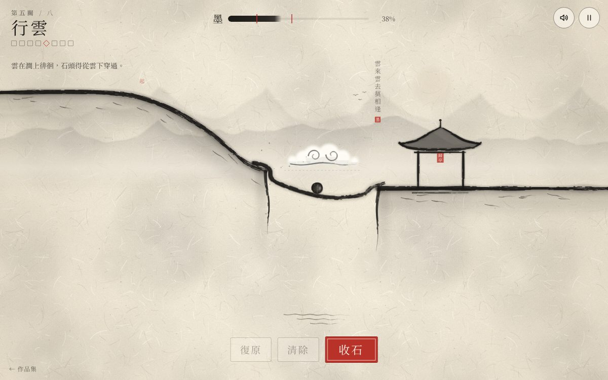

# 遊戲櫃 02 墨橋

> [!NOTE]
> **這一頁是什麼**  
> [遊戲櫃](../README.md)第 02 個遊戲的完整開發紀錄：玩法、視覺、聲音、技術、取捨、測試與已知問題。內容由製作這個遊戲的 AI 代理在 2026-10-15 寫成，數字都對應目前的程式。
> - 線上玩：[https://echofrommoney-oss.github.io/game-cabinet/g02/](https://echofrommoney-oss.github.io/game-cabinet/g02/)（網址加 `?demo=1` 看精華）
> - 原始檔：`index.html`（要和根目錄的 `lib/` 一起用本機伺服器開，例如 `npm run dev`，直接雙擊可能載不到函式庫）

## 1. 一句話與作品集亮點

**一句話**：用有限的墨在宣紙上畫線，墨線落紙後變成有重量的實體，讓一顆石頭從山頂滾進山下的亭子。

**亮點**
- **筆速決定物理**：同一個手勢，畫得快，線就細、淡、輕、省墨；畫得慢，線就粗、濃、重。這不只是外觀，線的密度、碰撞厚度、耗墨量都跟著變。風關卡因此變成「要慢慢寫」的書法題。
- **程式畫出的水墨**：每一筆由 5～16 根「毛」各自沿筆跡偏移，用雜訊決定斷續，所以會有飛白；收筆時暈開層從 35% 淡入到 100%（650ms），看起來像墨在紙上滲開。
- **整套水墨美術**：宣紙纖維紋理、兩層遠山、霧帶、懸崖往下淡出、祥雲、亭子、題畫詩（每關一句自創七言直排加小朱印）、印章評分，全部由程式即時繪製，沒有任何圖檔。
- **古琴般的過關音**：Karplus-Strong 撥弦，加上 1/7 撥弦位置的梳狀濾波、琴身峰值濾波、尾音微微上滑（吟）與一個高八度泛音。
- **關卡經過驗證**：每關的示範解在 headless 模擬中一定過關，不畫線一定失敗；另外跑過「高度 ±14、粗細 8/12/16」的擾動掃描，確認解法不是只有剛好那一條線才行。

## 2. 玩法與規則

**目標**：石頭（半徑 15）從「起」字處出發，滾進亭子的判定框並停留 120ms，就算過關。

**流程**：編輯（畫線）→ 按「放石」開始模擬 → 過關（蓋印）或失敗（1.3 秒後自動回到編輯，已畫的線都保留）。

**失敗條件**
- `fall`：石頭 y > 800、x < -80 或 x > 1080，顯示「石落深澗」
- `stall`：速度 < 0.12 持續 2 秒，或 4 秒內最遠 x 沒有前進超過 6，顯示「石停半途」
- 模擬超過 30 秒也算 stall

**墨量與計分**
- 每段耗墨 = 長度 × (0.45 + 0.55 × 筆寬/16)。最細的線（寬 5）每單位耗 0.62，最粗的（寬 16）耗 1.0。
- 剩餘比例 r = 餘墨 / 關卡墨量。r ≥ stars[1] 得三印「妙」，r ≥ stars[0] 得二印「佳」，其他得一印「過」。
- 每關取最佳成績，總分 24 印。過關會解鎖下一關。
- 同一關失敗 3 次後，會用淡墨虛線畫出示範解，並提示「淡墨處，是一種畫法」。第 1 關在落下第一筆之前也會顯示這條虛線，當作教學。

**筆寬與物理（核心參數）**
| 項目 | 公式／值 |
|---|---|
| 筆速 v（世界單位/ms）→ 目標寬 | `w = 16 − 11·clamp((v−0.12)/1.2, 0, 1)` |
| 寬度平滑 | 速度 lerp 0.3、寬度 lerp 0.22（每個取樣點） |
| 密度 | `0.0008 + 0.0022·(w−5)/11`（0.0008～0.003） |
| 碰撞厚度 | `max(平均寬, 9)` |
| 墨色濃度 tone | `0.64 + 0.32·(w−5)/11` |
| 乾筆程度 dry | `0.22 + 0.42·(1 − (w−5)/11)` |
| 石頭 | density 0.004、friction 0.5、restitution 0.12、frictionAir 0.0006、初速 x=1.6 |
| 風 | 加速度 = k·1e-6 / 密度，方向 (fx,fy)。k=2 時，寬度約 10.5 以下的線會被吹走；石頭只受約 0.5g，看起來會有點飄 |

**難度曲線與關卡（關卡資料是 `<script type="application/json" id="levels">`）**
| # | 名稱 | 墨 | 印門檻 | 新元素 | 題畫詩 |
|---|---|---|---|---|---|
| 1 | 初筆 | 420 | .25/.5 | 單一斷崖；有淡墨虛線教學 | 一筆橫斜過澗來 |
| 2 | 雙澗 | 460 | .25/.5 | 兩道澗，要畫兩筆；教「復原」 | 兩澗分流石自行 |
| 3 | 深谷 | 380 | .2/.45 | 寬 240 的谷；要拿三印就得快筆、用細線省墨 | 谷深墨淡亦成橋 |
| 4 | 山風 | 480 | .2/.45 | 谷中有上升氣流（k=2）；細線會被吹走 | 風起空山墨要沉 |
| 5 | 行雲 | 560 | .2/.45 | 雲左右來回飄（振幅 38、週期 4.2s）；直橋會撞雲，要畫下凹的弧橋，讓石頭從雲下過 | 雲來雲去莫相逢 |
| 6 | 方寸 | 360 | .25/.5 | 只能在框內落墨；V 形谷的斜壁之間可以卡住一道墨 | 方寸之間見天地 |
| 7 | 風雲 | 560 | .2/.4 | 第一道澗有斜向風，第二道澗有雲 | 風雲過處石無聲 |
| 8 | 歸亭 | 520 | .15/.35 | 框限加卡谷、寬澗加上升氣流，墨量偏緊 | 一石歸亭墨未乾 |

**規則細節**
- 不能畫進山體、雲的整個掃過範圍、石頭附近、亭子裡面，也不能畫在框外（有框限的關卡）。筆經過禁區時，筆跡會在那裡斷開。
- 同一筆（一次按下到放開）畫出的所有段落，會合成同一個剛體；不同筆畫如果彼此碰到，也會合併成同一個剛體。
- 一筆的末端如果落在平緩的地面上（下方 34 單位內，坡度 < 0.75），物理形狀會做成楔形（底面平、頂面斜向細尖），讓石頭能滾上去，不會被線頭卡住。

## 3. 操作

| | 桌機 | 手機 |
|---|---|---|
| 畫線 | 滑鼠按住拖曳 | 手指按住拖曳 |
| 復原上一筆 | Z（或按鈕） | 「復原」 |
| 清除全部 | R | 「清除」 |
| 放石／收石 | 空白鍵、Enter | 「放石」 |
| 暫停 | Esc、右上 ‖ | 右上 ‖ |
| 過關後下一關 | Enter、空白鍵 | 「下一關」 |

- 使用 Pointer Events 與 `getCoalescedEvents()`，觸控筆跡比較順。canvas 設 `touch-action:none`。
- 桌機游標停在畫面上時，會顯示一個小圈：可以落墨是墨色；禁區是紅色，加一道斜線。

## 4. 視覺設計

**色票**
| HEX / RGBA | 用途 |
|---|---|
| `#f1e9d8` | 宣紙底色（CSS `--paper`、紙紋 tile 底） |
| `#fbf6ec` | 卡片與按鈕底 |
| `#1c1a18`／`rgb(28,26,24)` | 墨（所有筆觸、文字主色） |
| `#4a4641` | 次要文字 |
| `rgba(52,56,60,.10~.14)` | 遠山兩層（偏冷的灰墨） |
| `rgba(46,44,40,.15)`、`rgba(40,38,34,.17)` | 山體表面暈染帶 |
| `#b8322a`／`#8f241e` | 朱砂印章、主按鈕、印章評分、框限角標、進度方塊 |
| `rgba(214,200,175,.3)` | 淡月 |
| `rgba(255,253,247,.95)` | 雲（留白色，比紙更白） |
| `#8a6a43` | 示範模式的毛筆桿 |

**字型**：`LXGW WenKai TC`（標題、關名、按鈕；Google Fonts）→ `Noto Serif TC` → `Noto Serif CJK TC` → `Songti TC`／`STKaiti`／`KaiTi`／`PMingLiU` → serif。離線時會退到系統宋體或楷體。標題 clamp(76px, 13vw, 138px)、關名 34px（手機 28px）、提示 14px、題畫詩 clamp(17·scale, 12, 19)px（手機 15px）。

**質感做法**
- 宣紙：512² 的 tile。先畫 46 個低對比的雲狀團塊，再加逐像素 ±4.5 的雜訊、1100 根二次曲線纖維（深纖維 alpha 0.05～0.16、亮纖維 0.3～0.7）和 160 個樹皮細點。纖維與團塊都畫 3×3 份，讓 tile 可以無縫拼接。最後疊暗角。
- 筆觸 `brushPath()`：① 暈開層：寬 0.78w 的帶狀多邊形，加 blur(2.8·scale)、alpha 0.22·tone；② 筆芯淡墨：寬 0.3w、alpha 0.5·tone；③ N=clamp(平均寬×0.95, 5, 16) 根毛，每根沿法線偏移 f∈[−0.93, 0.93]，各有自己的含墨量 load 0.72～1。乾的程度 `d = dry·(0.18 + 1.15·t²) + dry·0.55·f²`（t 是筆畫進度，所以越往筆尾、越靠筆緣越乾），雜訊值乘 load 小於 d 時，那根毛在那裡就斷開，形成飛白；④ 起筆位置畫一個壓筆的橢圓。收筆最後 7 點的寬度會縮到 0.35（快筆）或 0.62（慢筆），起筆前 3 點則用 0.78／0.88／0.96 倍。
- 山：地表墨線用 Catmull-Rom 平滑，寬度 8～14 隨雜訊變化。地表下方有兩層模糊暈染（寬 120 blur 18、寬 34 blur 5），斷崖則是往下 240 單位漸層淡出，加上會晃動、逐漸變細的崖壁筆觸。山體裡畫稀疏的皴筆（每 55 單位一筆，大致順著坡向）。澗底有三道淡墨水紋。
- 遠山：第一個八度用 ridged noise（`1−|2n−1|` 再平方）做出尖峰，另外疊兩個平滑八度；兩層分別 blur 3 和 1.6。y=250～360 有一條霧帶，把遠山和前景分開。
- 雲：6 個圓模糊成雲團，加上兩個反向的祥雲捲（螺旋），底下一道波浪墨線；下方虛線標出雲的移動範圍。
- 亭：屋頂先用模糊淡墨填色，再用 brush 畫上翹的簷口、兩條垂脊、寶頂、樑、兩柱、台基，掛一面朱紅「歸亭」匾。
- 印章 `makeSeal()`：外框邊緣抖動、陰刻文字與內框、70 個隨機缺點、6 個邊緣崩口。標題印是「墨橋」，評分印是「過／佳／妙」。

**版面**：世界座標 1000×760 等比縮放後置中。上方保留給 HUD 的高度與下方按鈕的位置，在每次 layout 時從 DOM 實測。左右兩端的山體會延伸到螢幕邊緣，所以看不到畫框。直式手機上，世界放在中段，上方留白放直排題畫詩，像一幅立軸。

**動畫參數**
- 印章蓋下：0.42s `cubic-bezier(.2,1.5,.45,1)`，從 scale 1.9、rot −12° 到 1、±2～5°；三枚間隔 380ms，每枚落下時有 230ms 延遲的蓋印聲，加 3px 畫面震動。
- 暈開淡入：650ms easeOutCubic。
- 撞擊震動：Δv > 4 時，震幅 min(6, Δv·0.7)px，每幀衰減 ×0.86。
- 石頭待放時，外圈有一圈朱紅呼吸環（2.4 rad/s）。
- 粒子：撞擊墨滴每次最多 14 顆，總數上限 160；過關時噴出 28 顆，其中 25% 是朱紅。落澗時有三圈水紋（1.3s）。
- `prefers-reduced-motion`：不震動、粒子減半、呼吸環不縮放、印章直接出現。

## 5. 聲音設計（全部用 Web Audio 即時合成，第一次互動後才建立 AudioContext）

- **總線**：master gain 0.9 → DynamicsCompressor（threshold −16、ratio 4）。殘響 send 0.32 進 ConvolverNode，脈衝響應是 2.4s 的立體聲雜訊，以 (1−t)^3.2 衰減。
- **毛筆沙沙**：2 秒白雜訊循環 → highpass 900Hz → bandpass（Q 0.7），頻率 1700 + 速度×1600Hz → gain = 0.03 + 速度×0.16（上限 0.3），setTargetAtTime τ=30ms。放開時淡出 τ=50ms。
- **石頭滾動**：雜訊循環 → lowpass（Q 2.5），頻率 120 + 速度×55Hz；只有石頭碰到東西時才發聲，gain = 速度×0.045（上限 0.42）。
- **撞擊**：sine 170→70Hz、0.12s 指數下滑，包絡 0.16s；加 bandpass 900Hz 的雜訊 60ms。音量 = clamp(Δv/8, 0.05, 0.5)。
- **風**：雜訊 → bandpass 420Hz Q 0.6，gain 0.05 ± 0.03（約 5.6s 週期的正弦起伏），只在有風的關卡出現。
- **古琴撥弦（Karplus-Strong）**：延遲長度 N = sr/f；激發訊號是低通過的雜訊（bright 0.45），再做撥弦位置的梳狀濾波 `x[i] − 0.8·x[i+N/7]`；回授 `decay·0.5·(a+b)`，decay 0.9965；2ms 淡入、正規化到 0.9；輸出接 peaking 210Hz +5dB（琴身）→ lowpass 2600Hz。音階 D 五聲：146.83、164.81、196、220、246.94、293.66、329.63、392、440Hz。
  - 過關：D3、A3、D4，間隔 0.17s，最後一音 playbackRate 在 0.9s 內 +1.2%（吟）；再加一個 D5×2 的泛音（bright 0.9、decay 0.998、lowpass 5kHz、音量 0.22）。
  - 通關（第 8 關／結局）：六音上行琶音，間隔 0.2s。
  - 失敗：A2（110Hz）撥弦，1.1s 內往下滑 6%。
- **蓋印**：sine 110→48Hz（0.14s，起始 gain 0.55）加 lowpass 700Hz 雜訊 70ms。
- **UI 點擊**：bandpass 1500Hz、Q 9 的雜訊 70ms（像木魚聲）。
- **復原／收石**：bandpass 雜訊掃頻 3800→1400Hz、0.25s。
- 標題畫面背景的自動示範設成靜音（`AU.quiet`）。切換分頁時 `ctx.suspend()`。

## 6. 技術架構

單一 `index.html`，CSS 與 JS 都 inline，只引用 `../lib/matter.min.js`（Matter.js 0.20）。

- **utils**：mulberry32 PRNG、hash 與 value noise、`densify`、`catmull`、點到線段距離、點在多邊形內。
- **save**：`localStorage['inkbridge.g02.v1'] = {best[8], unlocked, sound}`，讀寫都包 try/catch；`?demo=1` 時不寫入。
- **audio**：`audioInit`、`setLoop`、`ksBuffer`（依 頻率|長度|亮度 快取）、`pluck` 與各種 sfx。
- **art**：`brushPath`、`makePaperTile`、`makeSeal`、`makeStoneSprite`、`makeCloudSprites`、`renderBackground`、`renderLevelLayer`、`drawPavilion`。
- **繪製管線**：`bgC`（紙與遠山，只在 resize 時重畫）→ 複製進 `lvC`（加上地形、亭、框限、題畫詩，換關時重畫）→ 主 canvas 每幀只 blit `lvC` 一次，再畫風線、雲、筆觸 sprite（各自有 core 與 bleed 兩張 canvas，畫在剛體的 transform 上）、正在畫的筆（即時 brushPath）、石頭、粒子與水紋、游標。DPR 上限 2。
- **輸入 → 筆畫**：`beginGesture`／`addPoint`（算速度與寬度，每 3.5 單位細分一次）→ `place`（扣墨、檢查禁區、遇到禁區就斷筆）→ `closeStroke`（太短就退墨，否則做收筆漸細、算 tone 與 dry、建 sprite）。
- **物理 `buildWorld()`**：
  - 地形：每段地表做成一個 T=40 的靜態矩形，往法線內側偏移 T/2，讓矩形頂面剛好貼齊地表；崖壁另外加直立矩形；左右各一道邊界牆，亭子右柱也是靜態體。
  - 筆畫：用 union-find 合併「同一個手勢」或「彼此碰觸」的筆畫，每組做成一個 compound body。筆跡每 13 單位重新取樣，每段一個矩形，每個節點一個 8 邊形圓；落在地面上的端點改成楔形（`Bodies.fromVertices` 的凸四邊形）。
  - **修正 Matter 的 compound 慣量**：`Body._totalProperties` 只把各部件自身的慣量相加，沒有加平行軸項，長線會轉得像紙片。這裡自己算 `I = Σ(part.inertia + 4·m·d²)` 再 `Body.setInertia`（4 是 Matter 的 `_inertiaScale`）。
  - 雲：`isStatic` 加 `Body.setPosition(b, p, true)`，這樣碰撞會帶到雲的速度。
  - 風：每個子步對區域內的物體施加 `force = k·1e-6·mass/平均密度·dir`。
- **固定步長**：STEP = 1000/120ms，每幀最多 8 步，accumulator 落後太多就丟棄。同樣的筆跡一定得到同樣的結果，所以 headless 驗證有意義。
- **流程**：狀態有 `title | edit | sim | won | failed`，另外有 `paused`、`hiddenPause`。`demo` 物件同時負責標題背景的自動示範（第 1 關，靜音、無限循環）和 `?demo=1` 展示模式（第 3 關開始自動畫線、放石，過關約 1.9 秒後自動進下一關，到第 8 關後回到第 3 關）。示範筆跡用合成時間戳餵進和玩家一樣的 `addPoint`，所以筆寬也是由「速度」決定的。
- **除錯與測試 API**：`window.__ink = { simulate(i, spec?), state, start(i), toScreen(x,y), demoOf(i), drawDemo(), release(), levels }`。`simulate` 會同步跑完整個物理並回傳結果，不影響目前的遊戲狀態。

## 7. 取捨與原因（對照原企劃）

- **「畫越快越細越輕」**：照企劃做，而且延伸到物理：細線密度只有粗線的 27%，在風關卡會被吹走。另外把耗墨量也綁在粗細上，讓「快筆省墨」和「慢筆抗風」互相拉扯，這是本作主要的策略張力。
- **把筆畫切成小剛體**：企劃寫「一串小剛體或 compound body」，實作選了 compound（矩形加節點圓）。理由是一串用約束連起來的剛體會晃，墨線應該是硬的；compound 也比較穩定、成本低。
- **會動的雲**：一開始考慮做成可以搭乘的平台，但時間判定太脆弱，玩家會覺得「上次可以這次不行」。最後改成在澗上來回飄的障礙物，整個掃過範圍都禁止落墨，解法是畫下凹的弧橋從雲下穿過，不管雲在什麼相位都成立。
- **只能畫在某些區域**：做成框限，搭配 V 形谷斜壁「卡墨」的機制，讓框限本身成為解題提示，而不只是限制。
- **楔形線頭**：原企劃沒有。測試時發現躺在地上的線頭會像門檻一樣擋住石頭（第 7 關一度只有示範解剛好能過），所以加上這個處理。只在下方是平緩地面時才做楔形，因為卡在斜壁間的線需要圓頭才咬得住。
- **同一筆斷開的段落視為同一剛體**：畫弧橋繞過崖角時，筆跡很容易被禁區切成兩段。合併之後，崖上那一段可以當支點撐住後面的弧，符合玩家「我畫的是一筆」的直覺。
- **字型**：Google Fonts（霞鶩文楷 TC）只是加分項，測試環境沒有外網，fallback 會用系統的 Noto Serif CJK TC。
- **題畫詩、淡月、飛鳥、水紋、落澗漣漪**：企劃沒寫，加上去是為了補足「打開 10 秒的記憶點」，也讓直式手機的大片留白有內容。

## 8. 測試結果（`node g02/test.mjs`，27/27 通過）

1. **headless 驗證 8 關**：示範解全部過關，餘墨分別為 66／44／47／57／38／68／31／41%；不畫線全部失敗。開發時另外跑過擾動掃描（高度 −14／−6／0 × 寬度 8／12／16，每關 9 組）：第 1～3 關 9/9 過關；第 4 關除了寬度 8（刻意設計成會被吹走）其餘全過；第 5～8 關多數組合過關，失敗的都是太粗撞到雲、太細卡太深這類合理情況。
2. **桌機 1440×900**：開始 → 畫一筆扣墨 → Z 復原退墨 → 不畫放石，得到「石落深澗」→ 照示範用滑鼠畫，第 1 關過關（三印）→ 第 2 關兩筆過關 → Esc 暫停 → 第 3 關過關 → localStorage 寫入 `best:[3,2,2,…], unlocked:4`。console 與 page error 都是 0。
3. **手機 375×812**（isMobile、hasTouch、DPR 2）：用 CDP 送真實 touch 事件畫線，第 1 關過關。沒有捲動，0 error。
4. **`?demo=1`**：10 秒內完成第 3 關畫線、放石、過關，進到第 4 關。0 error。
5. **截圖觀察**（`g02/shots/`）：標題的大字、印章與背景示範互不打架；HUD 在兩種尺寸下都沒有截字；過關卡片不會擋住亭子；手機版題畫詩不壓到亭子。修過的問題：山體暈染一開始像灰色石板，改成只沿地表暈開；遠山的鋸齒太規律，改成 ridged 加 fbm；第 8 關亭子在手機上被切到，往左移；結局畫面的暫停鍵會誤導，已隱藏；細線太淡像鉛筆，把 tone 下限從 0.5 調到 0.64。
6. **縮圖**：`thumb.jpg`（1200×750，q82），第 5 關石頭正從雲下的弧橋穿過。

## 9. 已知問題與下一步

- headless（軟體繪圖）下，blur filter 與 CSS 動畫會讓幀率掉到 20～30fps；有 GPU 的瀏覽器沒有這個問題。如果低階手機不夠順，可以先關掉筆觸的 bleed blur，改用預先模糊的 sprite。
- 直式手機上世界只有 375×285，畫細部比較吃力。下一步可以加雙指縮放，或改用直式專用的關卡版面。
- Matter 的圓在平地上會慢慢減速，地形刻意都帶一點坡度；如果要做長距離的平地關卡，要另外處理滾動阻力。
- 雲的相位從編輯時就持續走，放石時不歸零（避免畫面跳動），所以極少數「剛好閃過雲」的直橋偶爾會成功。這是刻意保留的運氣成分。
- 下一步：每日一關（固定種子產生地形）、把最佳筆跡存成「拓本」可回放、更多機制（會被墨壓垮的薄冰、會吸墨的濕紙區）。

## 10. 可以重複利用的做法

- **`brushPath(ctx, pts[{x,y,w}], {tone, dry, seed, bleed})`**：任何「手繪、水墨、乾筆」風格的線都能直接用，包括 UI 底線、地圖路徑、簽名動畫。
- **可拼接的紙紋 tile**：雜訊加纖維，每個元素畫 3×3 份。同樣做法也適用帆布、牛皮紙、和紙。
- **`makeSeal(text)`**：程式產生印章圖片（`toDataURL`），可以當成就徽章或 favicon。
- **Karplus-Strong 加撥弦位置梳狀濾波與琴身 EQ**：幾十行就能做出可信的撥弦樂器（古琴、吉他、豎琴）。
- **Matter compound body 慣量修正**：只要用 `Body.create({parts})` 做長形物體都該補這一步。
- **楔形端點**：讓躺在地上的使用者繪製物件，不會變成滾動物的門檻。
- **固定步長加 `simulate()` 同步 API**：讓物理關卡可以用自動測試驗證「可解、且不是空白可解」，也可以做參數擾動掃描，量化關卡的容錯度。
- **同一手勢斷開的片段合成同一剛體**：讓有禁區的繪圖遊戲維持「一筆就是一個東西」的直覺。

---
執行測試：在 `games/` 底下執行 `node g02/test.mjs`。`g02/node_modules/playwright` 是指向全域 playwright 的符號連結，所以 `import { chromium } from 'playwright'` 能直接解析。測試自帶靜態伺服器（port 8102，根目錄 games/）；Google Fonts 的請求會以空 CSS 回應，模擬離線。
