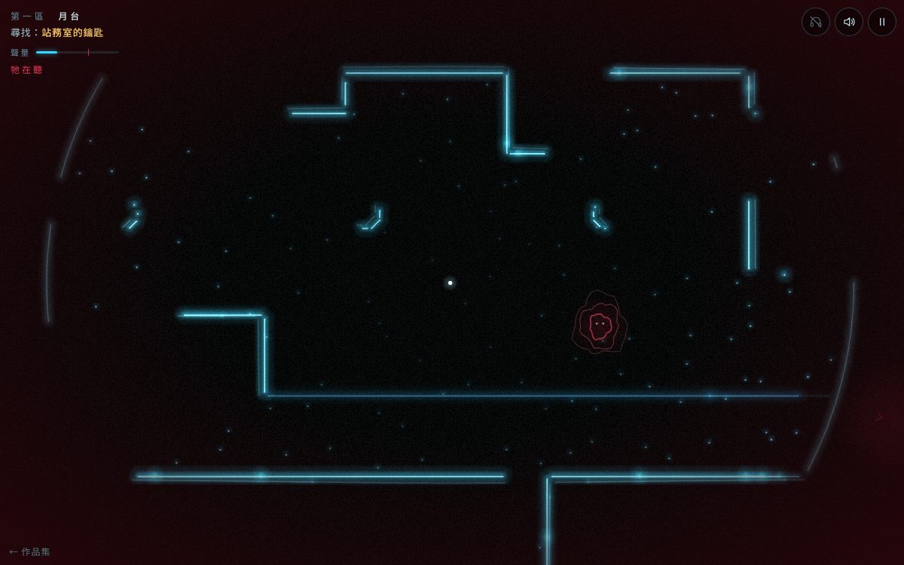

# 遊戲櫃 03 回聲

> [!NOTE]
> **這一頁是什麼**  
> [遊戲櫃](../README.md)第 03 個遊戲的完整開發紀錄：玩法、視覺、聲音、技術、取捨、測試與已知問題。內容由製作這個遊戲的 AI 代理在 2026-10-15 寫成，數字都對應目前的程式。
> - 線上玩：[https://echofrommoney-oss.github.io/game-cabinet/g03/](https://echofrommoney-oss.github.io/game-cabinet/g03/)（網址加 `?demo=1` 看精華）
> - 原始檔：`index.html`（要和根目錄的 `lib/` 一起用本機伺服器開，例如 `npm run dev`，直接雙擊可能載不到函式庫）

## 1. 一句話與作品集亮點

**一句話**：在全黑的廢棄地下車站裡，你只能拍手；回聲碰到的牆會亮一下，耳機裡的左右聲告訴你方向，你得在「聲音的主人」找到你之前走出去。

**亮點**
- **用聲音「看」**：畫面平常全黑，只有拍手時，從玩家位置往外擴散的聲波環碰到牆的瞬間，該段牆才亮起再慢慢淡掉。260 條 2D 射線對牆線段求交，亮點依「到達時間＝距離 ÷ 聲速」依序點亮，所以你會看到「波前掃過房間」。
- **真的立體聲定位**：Web Audio `PannerNode`（HRTF）把鑰匙鈴聲、出口鐘聲、水滴、追逐者低鳴放在世界座標裡；拍手時另外從 8 個方位最近的牆送回「回聲 tick」，在牆亮起的同一刻從那個方向傳來。
- **空間大小聽得出來**：拍手殘響長度＝射線平均距離算出來的，窄通道約 0.4 秒、大廳可到 3 秒。
- **追逐者只在被照到時現形**：它是三圈抖動的紅色輪廓＋兩個白點，只在聲波（拍手、腳步、水滴）掃過它、且中間沒有牆擋住時，以「被照到那一刻的位置」顯影再淡掉——你看到的永遠是它「剛才」在哪。
- 塵埃粒子會在波前經過時閃一下，讓空曠的空間也有「體積感」；牆會畫出雙線（表面＋厚度）像建築圖。

## 2. 玩法與規則

- **目標**：通過三個區域：①月台 → ②轉乘通道 → ③出口大廳。每區先找到物件（鑰匙／電源開關／緊急開門拉桿），拿到後門會打開，走到出口格就進下一區；第三區出口＝通關。
- **拍手**：冷卻 0.5 秒。每次 `聲量 +30`（上限 100），聲量每秒 `-7`。
- **追逐者「聲音的主人」**
  - 狀態：`dormant`（在巢穴沉睡，無聲）→ `hunt`（往目標移動）→ `search`（到達後在附近 1.2–3.5 m 亂晃 4.5 秒）→ `return`（回巢，速度 ×0.5）→ `dormant`。
  - 喚醒條件：拍手後聲量 ≥ 62；或已醒著時任何一次拍手都會把目標改成「你最後拍手的位置」。
  - 腳步：正常行走時，若它在 2.8 m（沉睡）／4.5 m（醒著）內、且有視線，它會把目標改成你的位置。放輕腳步（Shift／搖桿輕推）不會被聽見。
  - 移動速度（m/s）：月台 1.75、轉乘通道 2.0、出口大廳 2.25（search 時 ×0.45）。玩家 3.0、放輕 1.45。
  - 被抓（距離 < 0.5 m）：「牠聽見你了」＋雜訊畫面 1.8 秒，回到本區起點；已拿到的物件保留；追逐者回巢沉睡、聲量歸零。
  - 安全節奏：大約每 4 秒拍一次永遠不會喚醒它；每 2 秒拍一次，第 3 下就會醒。
- **計分／結局**（結束畫面顯示時間、拍手次數、被抓次數與稱號）
  - 被抓 0 且拍手 ≤ 30：「無聲之人」
  - 被抓 0：「謹慎的回聲」
  - 被抓 1–2：「被聽見的人」
  - 被抓 ≥ 3：「喧鬧的旅人」
  - 最佳時間存 localStorage（`g03.best`）。
- **難度曲線**：月台（長而開闊、軌道坑可透視、追逐者在終點的站務室旁）→ 轉乘通道（2 m 寬迷宮、迴路可繞開追逐者、殘響短）→ 出口大廳（36×19 m 柱廊、殘響長、追逐者就在大廳中央、速度最快）。
- **關卡內容**
  | 區 | 尺寸(m) | 起點 → 物件 → 出口路徑長 | 物件 | 門 | 水滴 |
  |---|---|---|---|---|---|
  | 月台 | 44×22 | 34.9 m + 39.2 m | 站務室的鑰匙（在桌子後面） | 樓梯口鐵柵門 | 3 |
  | 轉乘通道 | 36×28 | 43.4 m + 40.9 m | 電源開關（左下房間） | 出口鐵捲門 | 4 |
  | 出口大廳 | 40×30 | 33.6 m + 31.3 m | 緊急開門拉桿（左下角） | 剪票閘門 | 4 |
  純走路約 75 秒，加上摸索一輪約 3–5 分鐘。
- **教學提示**（非 demo，依時序出現）：「按空白鍵拍手」→ 第一次拍手後「用方向鍵移動」→ 11 秒「仔細聽，鈴聲來自鑰匙的方向」（無耳機版改「畫面邊緣的金光」）→ 聲量 > 45「拍太多，會有東西聽見」→ 第一次被追「有東西往你最後拍手的地方去了」→ 第一次看見它「那是什麼……？」→ 34 秒或第一次被抓後「按住 Shift 放輕腳步」。撞到鎖著的門：門的方向傳來金屬晃動聲＋提示。
- **展示模式 `?demo=1`**：直接開始、預設無耳機模式（邊緣提示）、開局 0.7 s 與 1.9 s 自動拍手、閒置 3.5 秒後每 2.6 秒自動拍手、追逐者一開始就在起點附近徘徊（search）、速度 ×0.6、玩家速度 ×1.15、跳過教學提示、記錄不寫入最佳。

## 3. 操作

| | 桌機 | 手機 |
|---|---|---|
| 移動 | WASD／方向鍵 | 左半邊任意處按下拖曳（浮動搖桿，半徑 52 px） |
| 放輕腳步 | 按住 Shift | 搖桿推不到 62% |
| 拍手 | 空白鍵 | 點右半邊任意處（右下有「拍手」圓鈕視覺） |
| 暫停 | Esc／P／右上 ‖ | 右上 ‖ |
| 聲音開關 | M／右上喇叭 | 右上喇叭 |
| 耳機模式切換 | H／右上耳機 | 右上耳機 |

開始畫面兩個按鈕：「戴好了，開始」與「沒有耳機：用畫面邊緣提示方向」。切到別的分頁自動暫停（AudioContext 也 suspend）。

## 4. 視覺設計

**色票**
| HEX / RGB | 用途 |
|---|---|
| `#000000` | 背景 |
| `rgb(206,249,255)` 核心 / `rgb(57,213,255)` 光暈 | 一般牆的回聲線 |
| `rgb(86,165,205)` / `rgb(30,110,160)` | 低矮邊緣（月台邊、剪票線，射線可穿過） |
| `rgb(255,214,150)` / `rgb(255,140,50)` | 鎖著的門 |
| `rgb(255,238,196)` / `rgb(255,190,80)` | 拿到物件時的金色大脈衝 |
| `rgb(170,236,255)` | 塵埃粒子 |
| `#ffcf6b` | 物件圖示、HUD 目標文字 |
| `#7dffc4` | 出口標記、出口鐘聲光環 |
| `#ff3b5c` | 追逐者輪廓、危險邊框、聲量超標 |
| `#cfeaf2` / `#5f8794` | UI 文字／次要文字 |
| 結局漸層 `rgb(40,70,120)` → `rgb(120,120,150)` → `rgb(255,186,140)` | 地面上的黎明 |

**字型**：標題「回聲」Noto Serif TC 300（Google Fonts，用 `&text=` 只抓用到的字），fallback Songti TC／PMingLiU／serif；UI 用 PingFang TC／微軟正黑體／Noto Sans TC／system-ui。標題 `clamp(68px,15vw,136px)`、字距 .32em；HUD 12–13 px、提示 15 px、字距 .12em。

**質感做法**
- 線條三層：quarter-res 光暈畫布上畫「bloom」（寬 `max(10, 0.42·SC)`、α×0.22，只畫亮度前 2/3 的桶）與「glow」（寬 `max(4, 0.15·SC)`）；主畫布畫核心線（寬 `max(1.5, 0.032·SC)`）。光暈畫布以 1/4 解析度繪製後放大，雙線性插值等於免費模糊。全部用 `lighter` 加色混合。
- 亮度以 12 級量化分桶，同一桶一次 `stroke(Path2D)`，一幀只有十幾次 stroke。
- 牆的「厚度」：同一段牆相鄰射線的命中點連線後，再沿射線方向往後 0.16 m 畫一條 30% 亮度的平行線。
- 塵埃：每個可走／坑格 75% 機率一顆，拍手時一次算好有視線的那些，被波前經過時閃 0.04 s、以 τ=0.32 s 衰減。
- 底片顆粒＋暗角：一個靜態 CSS 層（顆粒 6% α 烘進 data URI＋radial-gradient），危險紅框與被抓紅色雜訊是另外兩個平常 opacity 0 的 CSS 層（只改 opacity，合成器處理）。
- 版面：比例尺 `SC = clamp(min(W,H)/14, 24, 80)` px/m（1440×900 約 64，375×812 約 27）。鏡頭以 `1-e^(-5dt)` 平滑跟隨並帶 0.35 s 的速度前視。

**動畫參數**
- 聲速（視覺）：拍手 15 m/s、最大 17 m；腳步 9 m/s、2.6 m（放輕 1.5 m）；水滴 7 m/s、3.2 m；金色 18 m/s、24 m。
- 命中亮度 `bright(t)`：0.05 s 線性升到 1，之後 `0.72·e^(-u/0.5) + 0.28·e^(-u/slow)`；slow：拍手 3.4 s、腳步 0.7 s、水滴 1.2 s。距離衰減 `1/(1+0.05·d)`。
- 波前透明度 `0.85·(1-r/R)^1.2`，三層（寬光暈／中光暈／白色 1.3 px 核心）。
- 追逐者顯影：同 bright 曲線、slow 1.1 s；三圈輪廓用 3、7、13 倍角頻正弦擾動，半徑 0.26/0.41/0.56 m。
- 被抓：畫面震動 14 px×（1→0，2.2/s）、雜訊層 1.6 s 淡出。轉場：黑幕 1.0 s 淡入、0.6 s 淡出。結局：4 s 黑轉黎明＋「地面上，天快亮了。」
- 標題「回聲」三層描邊外擴 1→1.45 倍、3.2 s、cubic-bezier(.2,.6,.3,1)，錯開 1.06 s。
- `prefers-reduced-motion`：無震動、無標題外擴、亮度上升改 0.22 s 且峰值降到 0.7、波前亮度減半、追逐者輪廓不抖、紅框不脈動、被抓雜訊減弱。

## 5. 聲音設計（全部 Web Audio 即時合成）

聆聽者放在玩家位置、面向畫面上方（forward = −z、up = +y），世界 (x, y) → 音訊 (x, 0, y)。所有 PannerNode：HRTF、inverse、refDistance 1.6、rolloff 1.1、maxDistance 60。總線：master → DynamicsCompressor（−12 dB、4:1、attack 3 ms）。

| 音效 | 合成方式 |
|---|---|
| 拍手 | 3 個白噪音脈衝（0／9／19 ms）→ bandpass 1050/1290/1530 Hz（±90）Q 0.85；前兩下 0.02 s 衰減、最後一下 0.13 s；再加 lowpass 420 Hz 的「掌心悶聲」0.05 s。乾聲＋ConvolverNode，IR 長度 `clamp(0.3 + 平均射線距離×0.14×區域倍率, 0.3, 3.4)` s（倍率：月台 1.0、通道 0.65、大廳 1.6），送出 0.6。 |
| 方向回聲 | 把 260 條射線分 8 個扇區，各取最近的牆，在「波前到達該牆」的時間（d/15 s）於牆的位置用 Panner 播 bandpass 1500 Hz Q 1.4 的 70 ms 噪音 tick，音量 `0.6/(1+0.16d)`。 |
| IR 產生 | 立體聲白噪音 ×`(1-x)²·e^(-3.2x)`，一階低通係數從 0.81 漸降到 0.06（尾巴越來越暗），前 90 ms 撒 7 個早期反射尖峰；以 0.1 s 量化快取。 |
| 腳步 | 噪音 → lowpass 240–380 Hz Q 1.2，4 ms 起音、80 ms 衰減，峰值 0.28（放輕 0.07）＋ highpass 2.6 kHz 的 18 ms 鞋底 tick；送 0.35 到區域殘響。 |
| 水滴 | 正弦 1500–2100 Hz → 520–700 Hz 指數滑 70 ms、衰減 0.16 s；0.11 s 後 2.5–2.9 kHz 的小「滴」；Panner 在水滴位置、殘響送 1.0。每 2.6–6.5 s 一次。 |
| 物件鈴聲 | 鐘：基頻 B5 987.8 Hz，分音 ×1、×2.76、×5.4（音量 1/.35/.12、衰減 1.8/0.81/0.36 s）；0.18 s 後 F#6 1480 Hz 小鐘；每 2.7 s，Panner 在物件位置。 |
| 出口鐘聲 | 車站「叮—咚」：E5 659.3 → C5 523.3（間隔 0.42 s），三角波＋八度正弦，衰減 1.3 s；每 2.5 s，Panner 在出口。 |
| 開門 | 在門的位置：噪音 bandpass 380 Hz 1.2 s ＋ 正弦 95→42 Hz 0.9 s ＋ 金屬泛音 1250/1873/2810 Hz 1.4 s。 |
| 門鎖晃動 | 5 個 bandpass 2.3 kHz Q 9 的 40 ms 噪音，間隔 55 ms。 |
| 撿到物件 | 三角波琶音 B5-E6-G#6-B6（間隔 75 ms、衰減 0.9 s）＋ 123.5 Hz 低音膨脹。 |
| 追逐者低鳴 | 鋸齒 43 Hz＋43.7 Hz（拍頻）、正弦 21.6 Hz、三角 86.9 Hz → lowpass 170 Hz Q 7，0.23 Hz LFO ±70 Hz 掃濾波器；再疊一層 bandpass 760 Hz Q 5 的「耳語」噪音，0.7 Hz 調幅。音量：沉睡 0、回巢 0.22、搜尋 0.55、追捕 0.9（setTargetAtTime τ 0.4 s）。 |
| 被喚醒 | 在追逐者位置：噪音 bandpass 260→900 Hz 1.1 s 漸強（倒轉吸氣感）＋ 鋸齒 38→52 Hz 經 lowpass 200 Hz。 |
| 心跳 | 追逐者醒著且 7 m 內：兩下正弦 58→38 Hz（第二下 0.17 s 後、65%），間隔 1.05 s（遠）→ 0.42 s（貼身）。 |
| 被抓 | 白噪音 lowpass 7 kHz→160 Hz 1 s ＋ 鋸齒 240→30 Hz。 |
| 轉場 | 噪音 bandpass 180→1800 Hz 1.5 s 呼嘯。 |
| 結局 | 風：循環噪音 lowpass 500 Hz（0.13 Hz LFO ±260 Hz）；和弦 C4-E4-G4-B4-D5 正弦逐一淡入；6 組三連音鳥叫（2.8–3.6 kHz ×1.45 上滑 60 ms）。 |
| 環境底噪 | 褐噪音循環 → lowpass（月台 140、通道 220、大廳 90 Hz），音量 0.06。 |

音訊在第一次按鍵／點擊（開始按鈕）後才建立 AudioContext；靜音存 `g03.muted`。

## 6. 技術架構

單一 `index.html`（約 78 KB），無外部 lib，純 Canvas 2D＋Web Audio。

- **地圖**：每區用 `C(x0,y0,x1,y1,ch)` 挖洞／`P(x,y,ch)` 放點建出字元格（`#` 牆、`.` 地、`_` 坑／低矮欄杆、`D` 門、`X` 出口、`S` 起點、`K` 物件、`M` 巢穴、`W` 水滴、`o` 圓柱）。
- **`regen(z)`**：掃每條格線，兩側格子分類（F 地／W 牆／P 坑／D 門）組合成線段類型：F|W、P|W → 牆；F|P → 低矮邊緣（射線穿過、只畫暗線）；F|D、P|D → 門。同類連續的單位邊合併成長線段。圓柱是 8 邊形（半徑 0.38 m）。開門時把 D 改成 `.` 再 regen 一次。
- **射線**（`emitPulse`）：n 條（拍手桌機 260、手機 200）方向預先快取 cos/sin；對所有線段做參數式求交 `t = (w×e)/(d×e)`、`u = (w×d)/(d×e)`；記錄最近的牆／門（停止）與途中穿過的低矮邊緣。每個 pulse 存 Float32Array：距離、命中點、線段 id、類型。
- **繪製**（`render`）：波前＝相鄰兩條都還沒撞牆的射線在半徑 r 處連線；命中＝`d ≤ r` 時依 `bright(age - d/speed)` 算亮度，相鄰射線打到同一線段就連線、否則畫點，丟進亮度桶，最後每桶一次 Path2D stroke（主畫布核心＋1/4 畫布光暈）。
- **顯影偵測**（`updatePulses`）：每幀檢查物件／出口／追逐者到脈衝中心的距離是否落在 `(prevR, r]`，且 `los()`（線段相交）沒被牆擋，就記錄顯影時間（追逐者存一份「當時位置」的快照）。
- **追逐者尋路**：0.5 m 導航格（每格中心離任何線段 ≥ 0.3 m 才可走），8 方向 BFS、禁止切角；目標格不可走就找最近可走格。
- **碰撞**：玩家半徑 0.22 m 的圓對所有線段做最近點推出，3 次迭代；推出來源若是門 → 觸發「門鎖著」。
- **狀態機**：`title`（吸引模式：自動拍手的大廳）→ `play` ↔ `caught` → `trans`（換區）→ `outro` → `end`；`G.paused` 獨立。時間用遊戲時間 `G.now`（dt 上限 0.05 s），暫停時凍結。
- **主要函式**：`buildZone / regen / buildNav / navPath / emitPulse / clap / footstep / chaserHear / updateChaser / pickup / caughtStart / respawn / render / drawGhost / drawEdge / audioInit / sfx*`。測試掛鉤 `window.__g03 = G`。

## 7. 取捨與為什麼（對照原企劃）

- **地圖用字元格而不是手寫線段**：保證沒有縫隙、好改，也能直接生成導航格；用圓柱八邊形、列車車廂、剪票線、站務室桌子打破方格感。
- **加了「低矮邊緣」類型**（月台邊、剪票線）：擋人不擋聲，所以在月台上能「看到」軌道對面的列車、在大廳能看到閘門後的樓梯——比單純的牆更有空間層次。
- **腳步也會發出微弱回聲**（半徑 2.6 m）：完全只靠拍手太難導航，而且會逼玩家一直拍；腳步回聲讓貼牆走路可行，拍手留給「看遠方」。代價是腳步會被近距離的追逐者聽到 → 因此加了「放輕腳步」。
- **追逐者顯影是「快照」不是即時位置**：更符合「只在聲波照到時看得見」，也更可怕。
- **被抓不收回物件**：小品長度 3–5 分鐘，重拿一次挫折感太大。
- **無耳機模式**：在畫面邊緣（方向從玩家指向聲源）亮光暈＋小箭頭：金＝物件、薄荷綠＝出口、紅＝追逐者（醒著時持續、越近越亮）、淡青＝水滴；聲源在畫面內時亮度降到 30%，避免誤導。
- **效能**：原本整面顆粒每幀 fillRect、寬線 bloom 都畫在全解析度，軟體繪圖只有 5–7 fps；改成 1/4 解析度光暈畫布＋CSS 靜態層後明顯改善（同負載下 23–32 fps，正常 GPU 應穩 60）。
- **Google Fonts 只抓標題用到的字**（`text=` 參數），離線時用系統襯線字，畫面不會壞。

## 8. 測試結果

`node g03/test.mjs`（在 games/ 執行，內建 node http 靜態伺服器 port 8103，Google Fonts 請求以空 CSS 回應以便離線穩定）：**24/24 通過**。
- 1440×900：開始 → 拍手、四段路走到 x≈26 m、連拍讓追逐者醒來（hunt）、Shift 放輕、互動 >15 秒；Esc 暫停／繼續；接著用 `__g03` 傳送到每區物件旁、按方向鍵實際踩上去撿起 → 傳送到出口 → 三區依序通關 → outro → 結束畫面 → 「再走一次」重置。console/page error 0。
- 375×812（isMobile、hasTouch、DPR 2）：用 CDP `Input.dispatchTouchEvent` 真實觸控：右半邊點擊拍手 4 次、左半邊拖曳搖桿移動 ~8 m、兩指同時（移動中拍手）；暫停鈕；結束畫面版面。error 0。
- `?demo=1`：自動開始、2 次自動拍手、閒置自動拍手、追逐者追上並觸發一次被抓。error 0。
- 另外用 nav BFS 驗證三區「起點→物件→出口」都有路（一開始月台站務室桌子留下的走道只有 1 m，追逐者導航過不去，改小桌子後修正）。
- 截圖檢查（`g03/shots/`）：標題的吸引模式背景、第一次拍手的波前與塵埃、追逐者顯影＋紅色危險框、轉乘通道金色脈衝、大廳、黎明結局、手機搖桿／拍手鈕、手機暫停——無破版、文字未被切。區域標題卡原本壓在玩家身上，已移到畫面上方 15vh。
- 備註：本機同時有多個代理在跑測試（load average 11–14 / 2 核），headless 軟體繪圖 fps 數字僅供相對比較。

## 9. 已知問題與下一步

- 沙箱網路擋 Google Fonts 時，瀏覽器會記一條 `Failed to load resource`（遊戲本身無錯，字型自動 fallback）；正式上線網路正常就不會出現。
- HRTF 的前後分辨本來就弱（畫面上方／下方的聲音較難分），目前靠左右＋距離音量；可以加「背後的聲源稍微 lowpass」強化前後感。
- 追逐者路徑是格子 BFS 沒有平滑，因為大多時候看不見所以影響不大。
- 下一步：每區隨機化物件位置（3 個候選點）、加入可丟的小石子（遠處製造聲音引開追逐者）、拍手力道（長按＝大聲、看更遠、更吵）。

## 10. 可以重複利用的做法

- **「量化亮度桶＋Path2D 批次 stroke」**：數千條不同透明度的線段，一幀只要十幾次 stroke。
- **1/4 解析度光暈畫布放大**：便宜的 bloom，不用 `ctx.filter` 或 WebGL。
- **字元格 → 合併線段 → 導航格**：一份資料同時供射線、碰撞、尋路、粒子分布使用。
- **「波前到達時間」同步視覺與聲音**：亮點與方向 tick 都用 `d / speed` 排程，視聽一致。
- **用射線平均距離決定殘響長度**：任何 2D 遊戲都能用的「空間聽感」。
- **動態生成 IR 並以 0.1 s 量化快取**。
- **顯影快照**：只在事件（脈衝經過）時記錄敵人位置，天然製造「看到的是過去」的恐怖感。
- 測試技巧：CDP `Input.dispatchTouchEvent` 做真實多點觸控；在高負載環境用 `waitForFunction` 依遊戲狀態推進，而不是固定 sleep。
