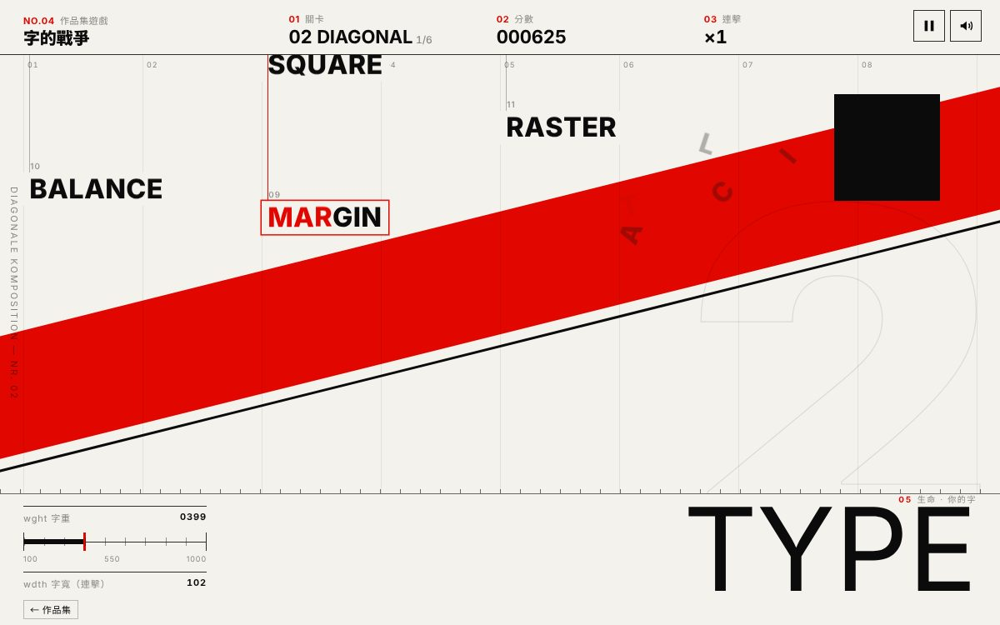

# 遊戲櫃 04 字的戰爭

> [!NOTE]
> **這一頁是什麼**  
> [遊戲櫃](../README.md)第 04 個遊戲的完整開發紀錄：玩法、視覺、聲音、技術、取捨、測試與已知問題。內容由製作這個遊戲的 AI 代理在 2026-10-15 寫成，數字都對應目前的程式。
> - 線上玩：[https://echofrommoney-oss.github.io/game-cabinet/g04/](https://echofrommoney-oss.github.io/game-cabinet/g04/)（網址加 `?demo=1` 看精華）
> - 原始檔：`index.html`（要和根目錄的 `lib/` 一起用本機伺服器開，例如 `npm run dev`，直接雙擊可能載不到函式庫）

## 1. 一句話與作品集亮點
**一句話**：打出落下的英文單字，你畫面底部的巨大「TYPE」就變粗；打錯或漏接，它就變細，細到字重 100 就斷了。

**亮點**
- **血量就是字重**：生命值不是血條，而是可變字型的 `wght` 軸（100–1000）。連擊會撐開 `wdth` 軸（100→150），字真的會「變胖、變寬」。
- **每一關都是一張瑞士海報**：12／8／6 欄網格、紅圓／斜帶／黑底紅柱／紅底宣言，生命字的對齊與資訊欄位置也跟著換。
- **全 DOM + CSS**，沒有 canvas：字的落下用 `transform: translate3d`，命中時字拆成一個個字母、用 GSAP 拋物線炸開，外加一圈紅色細圓環與分數。
- **Boss 是一句宣言**：「ORDER IS NOT A CAGE IT IS THE SPACE WHERE EVERY LETTER CAN BREATHE」，一個字一個字從句子裡掉下來，打掉一個字就蓋上一個白色「章」。
- 手機改成**點字模式**：下方 6 格候選詞，裡面混著正確的字和誘餌。

## 2. 玩法與規則
- **目標**：撐過 3 張海報＋1 段宣言 Boss，而且字重不能掉到 100。
- **生命**：起始字重 600，範圍 100–1000。
  - 消滅一個字：+(12 + 字母數 × 3)。例如 GRID 加 24，TYPOGRAPHY 加 42。
  - 按錯一個鍵（或點錯候選詞）：−22，連擊歸零。
  - 一般字落地：−110；Boss 字落地：−120（那個字會回到句子原位重新落下）。
  - 字重 ≤ 100 就輸。
- **連擊與字寬**：`wdth = 100 + min(連擊, 25) × 2`。只要失誤或有字落地，連擊就歸零。
- **鎖定規則**：沒有鎖定目標時，打第一個字母會鎖定「開頭是這個字母、而且最接近地面」的字。生成新字時會避開和畫面上的字同一個開頭字母，所以不會鎖錯。`Backspace` 可以取消鎖定，不扣分；空白鍵和 Tab 會被忽略。
- **計分**
  - 一般字：`字母數 × 10 × (1 + min(連擊,20) × 0.1)`
  - Boss 字：`字母數 × 15 × (1 + min(連擊,20) × 0.1)`
  - 過關獎勵：一般關卡是目前字重 × 1，Boss 是 × 3。
  - 準確率 = 正確字元 ÷ 按鍵數。WPM = 正確字元 ÷ 5 ÷ 分鐘數（點字模式下，點對一次算整個字的字元數）。
  - 結局字重名稱：≥950 Black、≥850 ExtraBold、≥750 Bold、≥650 SemiBold、≥550 Medium、≥450 Regular、≥350 Light、≥250 ExtraLight，其餘是 Thin。
- **關卡表**（「生成」欄是線性變化，從第 1 個字到最後一個字；「落下」欄是從頂端落到地面所需的秒數）

| # | 名稱 | 版式 | 欄數（桌機／手機） | 字數 | 生成間隔 s | 落下時間 s | 字庫 |
|---|---|---|---|---|---|---|---|
| 01 | GRID 網格 | 米白底、右上紅圓、外框大「1」 | 12 / 4 | 14 | 2.4→1.7 | 9.5→7.6 | 3–5 字母 |
| 02 | DIAGONAL 斜線 | −14° 紅色斜帶＋黑細線、黑方塊、生命字靠右 | 8 / 4 | 16 | 2.6→1.95 | 9.6→7.6 | 5–7 字母 |
| 03 | CONTRAST 對比 | 黑底白字、紅色直柱、細線大圓、紅圓 | 6 / 3 | 16 | 3.1→2.4 | 10.5→8.4 | 7–10 字母 |
| 04 | MANIFESTO 宣言（Boss） | 紅底、黑色巨圓、句子排在上方 | 12 / 4 | 13 字句子 | 前一字打掉後 0.35 s | 8.6→5.8 | 句子 |

- 每關開始時，前 3 個字以 0.75 s 的間隔快速生成。同時在場的字最多 6 個（點字模式 5 個）。
- 預估一輪約 3–4 分鐘（含每關 2.6 s 的過場卡）。
- **展示模式 `?demo=1`**
  - 跳過開始畫面，0.25 s 後自動開局。
  - 第一個字出現後，自動打字示範 5 秒，速度是每字元 0.16–0.24 s（「較慢」的人類節奏）；點字模式每 0.85 s 點一次。
  - 示範結束時出現「換你了」橫幅。玩家在示範中按任何鍵，會立刻接手。
  - 關卡縮短為 7／6／5 字，Boss 句子縮短為 7 字。落下時間 ×1.15（較慢），生成間隔 ×0.62（節奏較快）。過場卡縮短為 0.9 s。

## 3. 操作
- **桌機**
  - 直接打字（a–z，大小寫皆可）。
  - `Backspace` 取消鎖定。
  - `Esc` 或右上角按鈕暫停／繼續。
  - 開始畫面按 `Enter` 或空白鍵開局；結算畫面按 `Enter` 重玩。
- **手機**
  - 偵測到 `(pointer: coarse)`，或有觸控且沒有 hover 時，會開啟點字模式（也可以用 `?tap=1`／`?tap=0` 強制開關）。
  - 下方 3×2 候選詞用 `pointerdown` 觸發，反應比較即時。
  - 點到跟上方落下的字相同的詞就消滅它；點到誘餌就算失誤。
  - 實體鍵盤在點字模式下仍然可以用。
  - 候選格的位置是固定的，字消失後 160 ms 才換上新的誘餌，避免手指點錯。

## 4. 視覺設計
**色票**

| HEX | 用途 |
|---|---|
| `#F4F2EC` | 紙白：L1/L2 底色、按鈕字、Boss 已打掉的字 |
| `#0B0B0B` | 墨黑：主要文字、L3 底色、Boss 落字底 |
| `#E10600` | 瑞士紅：強調、圓、斜帶、Boss 底色 |
| `#FF2E1F` | 亮紅：L3 黑底上的強調（黑底上的紅要提亮） |
| `#FF3B2C` | Boss 落字中已打的字母（黑底上） |
| `rgba(11,11,11,.075)` | 網格欄線 |
| `rgba(11,11,11,.48)` | 編號、次要字 |

**字型**
- 字型 stack：`"Roboto Flex"`（Google Fonts，軸 `opsz 8–144, wdth 25–151, wght 100–1000`）→ `Inter` → `Helvetica Neue` → `Arial` → CJK 字型（`Noto Sans CJK TC`／`PingFang TC`／`Microsoft JhengHei`）。
- 中文標題使用系統的 CJK 黑體。
- 字級：
  - 生命字：桌機 `min(26vw, 29vh)`，手機 `min(27vw, 15vh)`，`line-height .74`。
  - 落字：`clamp(22px, 2.7vw, 40px)`，wght 760 / wdth 92。
  - Boss 句子：`clamp(22px, 3.7vw, 60px)`，wght 900 / wdth 80。
  - HUD 數字：22 px。
  - 編號：9–11 px，字距 .1–.16em。

**版面**
- 上方 HUD 分成 4 格，用細線分隔，編號依序是 01 關卡／02 分數／03 連擊；生命區是 05。
- 遊戲區有欄線，頂端標 01–12 欄號。地面是一條 1 px 細線加上每 24 px 一個刻度的尺標。
- 每個落字有一條細「吊線」連到畫面頂端，左上角有流水號。字下面墊一塊與底色相同的色塊，蓋住海報裝飾，保證可讀。
- 生命區右側（L2／Boss 時在左側）是資訊欄：wght 數值、100–1000 的刻度條（黑色填滿＋紅色指標），以及 wdth 數值。
- 海報裝飾層（`#poster`）每次 resize 都由 JS 對齊到遊戲區，只在地面線以上出現，生命區保持乾淨。

**動畫參數**
- 生命字字重補間：GSAP `power3.out` 0.5 s（同時補間 wght 與 wdth）。
- 落地：最靠近落點的字母 `scaleY .72 / scaleX 1.14 → 1`，`elastic.out(1,.35)` 0.7 s。整個生命字 x 偏移 −10 px，`elastic.out(1.2,.3)`。遊戲區 y −6 px 回彈。落下的字本身被壓扁（`scaleY .25`，0.12 s `power3.in`）再淡出。
- 命中爆炸：每個字母先在 0.32 s 內往上拋 60–200 px（`power2.out`），再在 0.55 s 內落下 140–260 px 並淡出（`power2.in`），旋轉 ±130°＋±100°。紅色細圓環 `scale .2→1.5`，0.55 s。分數 `+N ×連擊` 往上飄 34 px，0.9 s。fx 元素上限 120 個。
- 打對一個字母：該字母 y −5 → 0，0.18 s。打錯：字左右抖 ±6 px（0.22 s），生命字閃紅 140 ms。
- 過場卡：從下方滑入（`yPercent 100→0`，`power4.inOut` 0.5 s），大數字和標題錯開 0.07 s 進場，底部紅條在 1.6 s 內由左往右填滿，最後往上滑出。
- 開始畫面的紅色 TYPE 以 CSS `@keyframes` 呼吸：`wght 100↔1000`、`wdth 60↔151`，4.2 s `cubic-bezier(.65,0,.35,1)` alternate。
- `prefers-reduced-motion`：關閉呼吸、晃動、爆炸與閃光；過場卡改成淡入淡出。

## 5. 聲音設計
全部用 Web Audio 即時合成。主輸出 gain 0.55，經過 compressor（threshold −14 dB、ratio 4）。所有包絡都是 exponential ramp。

| 音效 | 合成方式 |
|---|---|
| 鍵盤喀噠 | 白噪音 bandpass 2600–4400 Hz（Q 1.4），28 ms，峰值 0.5；sine 210–250 Hz 滑到 90 Hz，30 ms，0.22；12–18 ms 後再一記 highpass 5200 Hz 噪音，18 ms（模擬打字機回彈） |
| 命中 | 鈴聲：sine f = 1046 × 2^(連擊/24)（連擊越高越高音，上限 14），0.55 s；泛音 2.76f，0.22 s；triangle f/2；加一記 highpass 6.5 kHz 噪音 90 ms |
| 打錯 | 兩個 square 波 150→72 Hz 和 157→75 Hz（略微走音），lowpass 900/700 Hz，0.17 s；加 lowpass 噪音 |
| 落地 | sine 110→36 Hz，0.42 s，峰值 0.6；lowpass 500 Hz 噪音 0.25 s；bandpass 1.8 kHz 噪音 0.05 s |
| Boss 出現 | 三個鋸齒波 55／55.7／82.4 Hz，經 lowpass（Q 9）掃頻 140→2200→160 Hz，共 2.4 s；在 0／0.28／0.56 s 各蓋一記章（sine 90→40 Hz＋bandpass 噪音） |
| 蓋章（Boss 字完成） | sine 140→60 Hz，0.16 s，加 bandpass 1.5 kHz 噪音 |
| 過關 | triangle 琶音 C5–E5–G5–C6，間隔 85 ms，每個音加高八度 sine |
| 輸 | 鋸齒波 320→50 Hz，lowpass 1100 Hz，1.3 s；加 sine 80→30 Hz |
| 贏 | 6 音上行琶音，0.5 s 後接 C6–E6–G6 和弦，持續 1.4 s |

音訊在第一次 pointerdown 或 keydown 後才建立／resume。靜音狀態存在 `localStorage['g04.muted']`。

## 6. 技術架構
- 單一 `index.html`（約 61 KB），只依賴 `../lib/gsap.min.js`。沒有 GSAP 時有退路：直接設定數值、不做補間。
- **狀態** `S`（同時掛在 `window.__g04` 給測試用）：`mode`（start／card／play／pause／clear／dying／end）、`li`、`words[]`、`target`、`weight`、`width`、`disp`（顯示用的補間值）、`combo`、`score`、`keys`、`good`、`errs`、`boss`、`auto`。
- **主迴圈** `loop()`：rAF，`dt` 上限 0.05 s。只有 `mode === 'play'` 時才推進。
  - 先跑生成計時器（或 Boss 的下一字計時）。
  - 每個字執行 `y += v·dt`，再寫入 `transform`。
  - 判斷進入危險區（進度 > 74%）和落地。
- **落下速度**：`v = (PH + h) / fallTime`，跟遊戲區高度成比例，所以手機和桌機的「秒數手感」一樣。
- **主要函式**
  - `spawn()`：選字時排除畫面上的字、同開頭字母的字、最近 8 個字。選欄時避開最近 2–3 次用過的欄，以及頂端還有字的欄。
  - `typeChar()`：鎖定與比對。
  - `complete()`／`land()`／`miss()`：處理命中、落地、失誤的結果。
  - `changeWeight()`：調整字重、播補間、判斷輸。
  - `renderLife()`：同時寫入 `font-variation-settings`（wght／wdth／opsz）、`font-weight`（給靜態字型 fallback 用，四捨五入到百位）、`letter-spacing`（讓沒有 wdth 軸的 fallback 字型也看得出變寬）。
  - `fitLife()`：以 wdth 151 的最寬狀態估算寬度，必要時縮小字級，避免溢出。
  - `explode()`：用 `getBoundingClientRect` 取每個字母的位置，在 `#fx` 生成 fixed 的字母節點，再用 GSAP timeline 播放。
  - Boss：`bossStart()` 把句子排版成 span，`bossNext()` 從目前那個字的 span 位置生成落字，落地就回到原位。
  - 點字：`trayBuild()`、`trayAssign()`（如果某格已經顯示同一個字就直接綁定，避免重複）、`trayRelease()`、`decoyText()`（排除場上的字與其他格的字）。
  - `autoStep()`：示範模式的機器人。和玩家走同一條 `typeChar(ch, bot)` 路徑。
- **resize**：`ResizeObserver` 監看遊戲區，重算欄寬、網格線、海報層位置與高度，並把字的 x 夾回畫面內。
- **暫停**：`G.globalTimeline.pause()` 讓 GSAP 動畫一起停。`visibilitychange` 切走分頁時自動暫停。
- **存檔**：`localStorage['g04.best']` 存最高分，所有讀寫都包在 try/catch 裡。

## 7. 取捨與原因（對照原企劃）
- **wdth**：企劃寫「若字型支援」。Roboto Flex 支援 25–151，實際只用 100–150，避免太窄難讀。另外加了 letter-spacing 補償，確保 fallback 字型也有「變寬」的視覺。
- **候選詞 vs. 字母鍵盤**：手機選了候選詞（6 格）。字母鍵盤在 375 寬的螢幕上按鍵太小，而且一個字要點很多下，節奏會太慢。候選詞混入同關字庫的誘餌，仍然需要「讀」，不是無腦點。
- **Boss 機制**：沒有做「Boss 另外丟小字干擾」，改成整句宣言排成海報標題，一次只掉一個字，落地就扣 120 並重新掉，並且越後面的字掉得越快（8.6→5.8 s）。這樣「一個字一個字打」的感覺最清楚。
- **展示模式**：SPEC 要「加快節奏」，企劃要「速度較慢的自動示範」，兩者都做了。關卡字數縮短、生成加快，代表節奏較快；自動打字速度與落下速度則放慢。
- **背景音樂**：沒有做，只有音效。打字本身的喀噠聲就是節奏，再疊音樂會讓打字回饋變模糊。
- **防誤鎖**：生成字時會避開同開頭字母，代價是字庫的使用率稍微下降，換到的是「打第一個字母就知道鎖誰」的確定感。

## 8. 測試結果
`node g04/test.mjs`
- 自帶 node http 靜態伺服器，port 8104，根目錄 `games/`。
- 用 Playwright Chromium 1194 執行。
- 測試環境的代理會擋 Google Fonts（403），所以腳本用 `page.route` 回傳空 CSS，模擬離線、字型載不到的情況。截圖中看到的是 Inter 靜態字重的 fallback。

| 測試 | 內容 | 結果 |
|---|---|---|
| 桌機 1440×900 | 點開始，用 `keyboard.type` 打最低的字，約 15% 機率先故意打錯一個字母，持續 17 s；之後測鎖定半個字、Esc 暫停與繼續 | 分數 0→2251，消滅 17 字，進到第 2 關，失誤 1 次，字重 1000；暫停／繼續正常 |
| 手機 375×812（isMobile、hasTouch） | 自動進入點字模式；`tap` 候選詞 16 s，含 2 次故意點誘餌；之後放著不動 | 消滅 15 字；8 次落地後字重 100，進入「字斷了」結算 |
| `?demo=1`（1440） | 自動開局，第 6 s 時自動示範已得分；10 s 截圖；之後用鍵盤打完全場 | 3 張海報＋Boss 全部通過，進入「字撐住了」結算，分數約 9200，字重 1000 |
| `?demo=1`（375） | 10 s 截圖 | 自動點字得分正常 |
| console error／pageerror | 全部測試 | 0 |

**截圖觀察與修正**
- 開始畫面的紅圓原本壓在說明文字上，移到標題和說明之間。
- 海報裝飾原本會溢出到生命區，改成由 JS 把海報層對齊到遊戲區。
- 連擊數字的 class 名稱 `pop` 和分數飄字撞名，導致 HUD 的「×1」跑位，改名為 `cpop`。
- 手機 HUD 的「DIAGONAL 1/16」原本和分數重疊，調整欄寬並隱藏關卡編號。
- 點字模式出現過兩格同一個字（誘餌剛好等於新生成的字），改成直接綁定已經顯示的那一格。
- 結算頁上半部太空，加上紅圓與網格底紋。

`thumb.jpg`：1200×750，第 2 關斜線海報，畫面中有一個字正在炸開、一個字鎖定到一半。

## 9. 已知問題與下一步
- 測試環境載不到 Roboto Flex，fallback 的 Inter 是靜態字重：字重會一階一階跳（四捨五入到百位），沒有 wdth 軸。上線環境能連 Google Fonts 時才會是連續變化。若要離線也連續，可以自行託管 Roboto Flex 的子集（只含 A–Z），轉成 data URI（約 60–80 KB）。
- Boss 句子在超寬或超窄螢幕上的換行位置不固定；落字會從句子裡它原本的位置出發，所以不影響玩法。
- 只支援英文字母，沒有大小寫或標點挑戰；可以加一個「Hard」模式，納入小寫與標點。
- 下一步：每週固定一句宣言（以日期當 seed）並上排行榜；落地時讓生命字的單一字母永久變細（分字母血量）。

## 10. 可重複利用的做法
- **用可變字型軸當 UI 數值**：把狀態映射到 `font-variation-settings`，同時寫入四捨五入的 `font-weight` 和 letter-spacing，在靜態字型下也能降級。
- **顯示值和邏輯值分開**：邏輯值 `S.weight` 立即生效；顯示值 `S.disp` 用 GSAP `overwrite:true` 補間，讓連續事件不會互相打架。
- **DOM 文字爆炸**：取每個字母的 `getBoundingClientRect`，複製到 fixed 圖層，用兩段式 timeline（上拋 `power2.out` → 下墜 `power2.in`）做出重力感，並設節點上限。
- **打字遊戲的鎖定規則**：生成時避開同開頭字母，第一個字母鎖定最低的字，`Backspace` 解鎖。
- **手機候選詞**：格子位置固定，延遲換字；新字若已經以誘餌身分顯示，就直接綁定那一格。
- **海報裝飾層**：用 ResizeObserver 對齊到遊戲區，裝飾用 % 定位，換關只要切換 `data-theme`，CSS 變數就會整組換色。
- **測試技巧**：遊戲狀態掛在 `window.__g04`，測試讀出場上的字，再用 `keyboard.type` 真實打字；外部字型用 `page.route` 回傳空 CSS，模擬離線。
