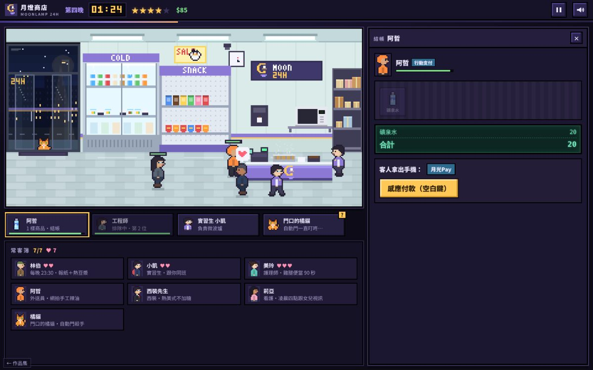

# 遊戲櫃 05 大夜班（長篇）

> [!NOTE]
> **這一頁是什麼**  
> [遊戲櫃](../README.md)第 05 個遊戲的完整開發紀錄：玩法、視覺、聲音、技術、取捨、測試與已知問題。內容由製作這個遊戲的 AI 代理在 2026-10-15 寫成、2026-10-16 擴充為 7 晚時改寫，數字都對應目前的程式。
> - 線上玩：[https://echofrommoney-oss.github.io/game-cabinet/g05/](https://echofrommoney-oss.github.io/game-cabinet/g05/)（網址加 `?demo=1` 看精華）
> - 原始檔：`index.html`（要和根目錄的 `lib/` 一起用本機伺服器開，例如 `npm run dev`，直接雙擊可能載不到函式庫）



> 版本說明：v1 是 3 晚、約 15 分鐘的版本；v2（本文件）擴充成 7 晚、約 45–60 分鐘的完整版。兩版差異集中整理在第 7 章「7.1 v1 → v2 改了什麼」。故事聖經（每晚劇本表）在第 11 章。

## 1. 一句話與作品集亮點

**一句話**：你是巷口 24 小時便利商店「月燈商店 MOONLAMP 24H」的大夜班店員，七個晚上從 23:00 顧到 07:00；結帳、補貨、微波、包裹之外，每晚都多一種新業務（關東煮、颱風停電、帶實習生、集點預購、醉漢與遺失物、改裝前盤點），六位常客加一隻橘貓的故事一路接到第七晚，最後由你決定下一步，走向五種結局之一。

**亮點**
- **七晚、七種新機制、難度逐晚上升**：每晚都有「新東西」，第 4 晚起客人生成更快、耐心流失更快，用機器人以不同手速模擬驗證（第 8 章）。
- **會犯錯的實習生**：可以把補貨、微波分派給實習生小凱，他會放錯層架、設錯秒數，你必須自己檢查——委派與信任變成玩法；你在第 4 晚怎麼教他，決定他之後的失誤率。
- **故事有記憶**：7 位角色 × 7 晚的 JSON 對話樹，旗標跨晚生效。例：第 4 晚教林伯用手機視訊，第 6 晚他被假孫子詐騙時才會出現「直接視訊給阿翔本人」這個選項。
- **五種結局 + 每人 3–4 種後日談**，第 7 晚 06:40 的「下一步」抉擇依前面累積的條件開放選項。
- **班表日報**：每晚結束是一張像素風的紙本日報（評價走勢圖、常客羈絆變化、今晚的事、店長紅色印章）。
- **16 位元像素場景全程式繪製**：字串陣列 + 自動描邊的人物/商品、量化色帶的黎明天空、颱風雨、停電遮罩、警車紅藍燈。
- **全部 Web Audio 合成**：自動門叮咚、條碼嗶、收銀機、微波叮、爆炸、雨聲、打雷、停電/復電。

## 2. 玩法與規則

### 2.1 目標與勝負
- 撐完七個大夜班。店長評價（0–100，起始 70，跨夜延續）掉到 0 會被開除，可重來那一晚。
- 每晚結束存檔；結局由第 7 晚 06:40 的選擇 + 總羈絆決定（2.7）。

### 2.2 時間
- 一晚 = 遊戲 480 分鐘 = 真實 **360 秒**（1.333 遊戲分/秒）。七晚遊玩約 42 分鐘，加上對話、日報約 **50–60 分鐘**。
- 對話與暫停時時間停止；工作台開著時間照走。
- `?ts=N` 時間倍率只給測試用；`?demo=1` 見 2.9。

### 2.3 基本業務（第 1 晚起）
| 業務 | 操作 | 規則 |
|---|---|---|
| 結帳 | 點商品掃條碼 → 用 1/5/10/50/100/500 湊找零 → 找零完成 | 客人付款：8% 剛好、12% 湊到 50、35% 湊到 100、30% 湊到 500、其餘 1000。應找金額不顯示。 |
| 補貨 | 紙箱拖到對應層架（或點紙箱再點層架），一箱補 4 格 | 4 層各 8 格；可用格 ≤2 出現補貨卡；客人要的層空了會站著等。 |
| 微波 | 照標籤設定秒數 → 開始；可提早停止；不夠熱可「再熱 30 秒」 | 顯示 5 秒 = 真實 1 秒。設定 > 建議+30 秒會在建議+30 秒爆炸；實際 < 建議−15 秒客人抱怨。 |
| 取包裹（01:30 起） | 依末三碼點包裹架上的箱子 | 干擾碼是同數字重排。 |

### 2.4 各晚新增機制
| 晚 | 新機制 | 規則細節 |
|---|---|---|
| 2 | 關東煮 | 6 種料（白蘿蔔 15、貢丸 10、魚板 12、玉米 18、豆腐 10、甜不辣 15），1–3 種、每種 1–2 個，夾錯 −2。 |
| 2 | 行動支付 | 約 35% 客人用，按「感應付款」。 |
| 2 | 即期品 | 定時讓鮮食 2–3 格過期（紅標），拖去垃圾桶 +0.5；賣出時掃描報錯 −3。 |
| 3 | 颱風搶購／停電 | 客人一次買 2–5 樣；02:58 停電 48 分：掃描器斷電要看價格標籤手算合計（錯 −1），微波停擺，耐心流失 ×0.6。 |
| 4 | 實習生 | 「實習生」卡：補貨（選一層，他走過去 3.5 秒後補 4 格）或「負責微波」（自動接下每份待加熱）。失誤率：第 4 晚 35%，被示範後 12%、被念 25%；第 5 晚起依旗標 10%／22%／33%。補貨失誤 → 4 格變「放錯（黃色問號）」不能賣，要拖去「丟棄／退回」(+0.5)；微波失誤 → 設定 = 建議+60（會爆）或建議−40（太冰），他 2 秒後自己取出交給客人。玩家打開微波爐看「小凱設定」與標籤，提早停止或再熱就能救回（+1）。 |
| 5 | 集點貼紙 | 約 60% 客人要集點：每滿 $50 一張，用＋／−設定；少給 −2、多給 −1。 |
| 5 | 蛋糕預購 | 4 款（草莓鮮奶油 880、生巧克力 980、芋頭千層 1080、重乳酪 780），選對品項登記預購簿、收訂金 $300（走一般找零流程）；選錯 −1。 |
| 5 | 預購取貨 | 在預購簿點客人的名字，鍵盤輸入尾款 = 售價 − 已付（已付 300／500／付清）；點錯人 −1、尾款錯 −2。尾款 > 0 再走結帳。 |
| 5 | 贈品兌換 | 客人一律說「集滿了」，實際 30% 只有 7–9 點：要婉拒（+1）；不滿點卻換 −3；滿點卻拒絕 −3；換錯款 −1。 |
| 6 | 醉漢 | 00:40 出現，在店內亂晃，每 7 秒（被激怒後 4 秒）撞倒 1–2 件商品，其他客人耐心流失 ×1.4。處理：熱茶（自掏 $25，60% 成功）、請他離開（35%，失敗會激怒）、報警（必定有效，26 秒後警察到）。放著 100 秒他自己走但 −6。成功 +2／報警 +1。 |
| 6 | 遺失物認領 | 撿到物品會登記（物品、顏色、特徵）。認領者說出顏色與特徵；冒領者會錯一項。還給本人 +1.5、拒絕冒領 +1.5、交給冒領者 −5、拒絕本人 −3。 |
| 6 | 反詐騙關懷 | 有人要買大量遊戲點數（林伯 3 萬、阿姨 2 萬），對話中選擇攔下（+2～+3）。 |
| 7 | 盤點 | 3 次限時（75 秒）盤點：一箱 15–22 件混在一起的相似商品，數出指定那一種；對 +1.5、錯 −2、逾時 −4。集點、預購、遺失物同時出現。 |

### 2.5 客人與難度曲線
- 狀態機：`enter → toShelf → browse →（waitStock）→ queue → 櫃台服務 →（microWait）→ leave`；另有 `linger`、`visit`、`drunk`、`drunkCalm`。
- 一般客人 8 種原型；常客 6 位＋貓。
- 生成間隔（真實秒）= 基礎表 × 該晚倍率 × 隨機 0.7–1.25。基礎表（23、00、01…06 點）：`[14,14,18,22,23,20,15,11]`；颱風夜 `[14,15,19,23,30,25,18,14]`。06:48 後不再生成；店內最多 7 人（颱風 6）。
- 耐心值 100，每秒流失：櫃台前等 2.1、被服務中 0.45、排隊 1.3、等補貨 2.4、等微波 1.0（正在熱 0.35）；乘上 常客 0.42、颱風 0.85、停電 0.6、醉漢在場 1.4、**該晚倍率**、輕鬆模式 0.5。

| 晚 | 生成倍率（越小越多人） | 耐心流失倍率 |
|---|---|---|
| 1 | 1.40 | 0.80 |
| 2 | 1.00 | 0.95 |
| 3 | 1.00（颱風表） | 1.05 |
| 4 | 0.80 | 1.22 |
| 5 | 0.76 | 1.30 |
| 6 | 0.72 | 1.38 |
| 7 | 0.65 | 1.48 |

### 2.6 店長評價（計分）
| 事件 | 變化 |
|---|---|
| 完成一位客人 | +1（耐心 > 60 再 +0.5） |
| 客人生氣離開 | −8 |
| 找零少找 / 多找 | −3 / −1（多找可能記入收銀短少） |
| 第一次發現貨架空 | −1 |
| 微波剛好 / 太冰 / 爆炸 | +1 / −2 / −6；抓到實習生設錯並救回 +1 |
| 包裹拿錯 | −1 |
| 關東煮夾錯 | −2 |
| 賣出過期品 / 主動下架 | −3 / +0.5；退回實習生放錯的 +0.5 |
| 停電手算錯 | −1 |
| 集點少給 / 多給 | −2 / −1 |
| 預購選錯 / 點錯人 / 尾款錯 | −1 / −1 / −2 |
| 兌換判斷錯 | −3（換錯款 −1） |
| 醉漢：成功勸離 / 報警 / 放著不管 | +2 / +1 / −6 |
| 遺失物：正確 / 交給冒領者 / 拒絕本人 | +1.5 / −5 / −3 |
| 盤點：對 / 錯 / 逾時 | +1.5 / −2 / −4 |
| 常客耐心歸零（一次） | −2 |
**輕鬆模式**：所有扣分 ×0.5、評價最低 10（不會被開除）、耐心流失 ×0.5。標題與暫停畫面都能切換。

### 2.7 結局判定
第 7 晚 06:40 的「下一步」對話，選項依條件出現：
- 接下儲備店長：需要 `chen_offer`（第 7 晚陳建民在 `chen_safe` 且評價 ≥70 且陳建民羈絆 ≥4 時給）
- 和阿哲開滷味攤：需要 `zhe_offer`（第 7 晚阿哲羈絆 ≥5 且有 `zhe_push` 或 `zhe_mild`）
- 繼續當大夜班：永遠可選

| 結局 | 條件 |
|---|---|
| D「月燈之下」（真結局，專屬 GRAND OPEN 插畫） | 選儲備店長 且 總羈絆 ≥30 |
| A「儲備店長」 | 選儲備店長 且 總羈絆 <30 |
| E「哲學滷味」（滷味攤插畫） | 選滷味攤 |
| B「街角的燈」 | 選繼續大夜班 且 總羈絆 ≥30 |
| C「早班交接」 | 選繼續大夜班 且 總羈絆 <30 |

總羈絆上限 51（林伯 8、小凱 7、美玲 7、阿哲 7、陳建民 7、莉亞 8、橘貓 7）。每位角色另有 3–4 種後日談（依旗標與羈絆）。

### 2.8 各晚事件清單
完整劇本（每位常客每晚的劇情、選項、旗標與影響）見第 11 章。時間軸摘要：
- **第 1 晚**：教學客人 23:03 → 林伯 23:20 → 便當客人 23:40 → 美玲 00:18 → 小凱 01:00 → 取包裹教學 01:30 → 橘貓 02:02 → 阿哲 02:32 → 西裝先生 03:02 → 物流車 03:40 → 莉亞 04:10。
- **第 2 晚**：關東煮教學 → 林伯忘錢包 23:36 → 行動支付 → 美玲 00:14 → 即期品 00:32 → 小凱 01:02 → 阿哲 01:44 → 橘貓 02:16 → 西裝先生掉皮夾 02:58 → 即期品 04:00 → 莉亞 04:18。
- **第 3 晚（颱風）**：林伯 23:28 → 小凱 00:32 → 美玲 01:30 → 阿哲 02:20 → **停電 02:58–03:46** → 神秘客揭露 03:04 → 莉亞衝進來 03:22 → 橘貓 04:30。
- **第 4 晚（實習生）**：小凱報到 23:02 → 林伯學視訊 23:25 → 美玲 00:20 → 第一次失誤或 01:30 的「教學」對話 → 貓 01:00 → 阿哲找到店面 02:00 → 陳建民透露改裝 03:00 → 莉亞 04:00。
- **第 5 晚（集點預購）**：集點教學 → 預購教學 23:18 → 林伯預購生日蛋糕 23:40 → 美玲兌換公仔 00:10 → 取貨教學 00:40 → 阿哲租約 01:50 → 小凱休息 02:10 → 貓 02:30 → 陳建民 03:00 → 點數不足的兌換 03:30 → 莉亞 04:10。
- **第 6 晚（醉漢與遺失物）**：撿到雨傘 23:10 → 美玲 23:20 → **醉漢 00:40** → 小凱被醉漢吼 00:55 → 撿到皮夾 01:10 → **林伯詐騙 01:30** → 阿哲忘手機 02:00 → 貓 02:20 → 冒領手機 02:35 → 阿哲認領 03:22 → 皮夾認領 03:40 → 陳建民 03:55 → 莉亞 04:20 → 阿姨詐騙 04:45 → 雨傘冒領 05:00、本人 05:40。
- **第 7 晚（最後一夜）**：便條 23:02 → 林伯（與阿翔）取蛋糕 23:30 → 盤點 23:40 → 撿到耳機 00:00 → 美玲道別 00:10 → 小凱的一碗麵 00:50 → 耳機認領 01:30 → 阿哲邀約 01:40 → 貓的去處 02:20 → 盤點 02:30 → 陳建民邀約 03:10 → 撿到鑰匙 03:20 → 莉亞道別 04:00 → 鑰匙冒領 04:20 → 盤點 04:35 → 鑰匙本人 05:20 → 06:00 羈絆 ≥4 的常客來訪 → **06:40 下一步**。

### 2.9 存檔、晚別選單、展示模式
- `localStorage['g05-nightshift-v1']`：`{v, unlocked, snaps:{1..7}, endings:[], mute, easy}`。每晚結束寫入下一晚的起點快照（評價、旗標、羈絆、累計業績）。所有讀寫包 try/catch。
- 標題畫面：「從第一晚重新開始」「繼續：第 N 晚」與 **7 格晚別選單**（已解鎖的晚可直接重玩，未解鎖顯示「未解鎖」），下方輕鬆模式勾選。
- **`?demo=1`**：直接第 4 晚 01:00（2.4 遊戲分/秒，生成 ×0.7）；實習生正在補飲料、他已把雞腿便當設成 2:30（建議 90 秒，會爆）、泡麵層有他放錯的黃色問號、零食快空、櫃台前有客人；阿哲一秒後進門。常客簿預先顯示全員。不寫存檔。

### 2.10 班表日報
每晚 07:00 顯示：營業額、服務人數、氣走人數、評價變化、找錯錢、收銀短少、微波爆炸、自掏腰包；評價走勢像素折線圖（每 30 遊戲分取樣）；常客羈絆變化（♥+n / ♥−n）；今晚的故事紀錄；店長留言與紅色「OK」像素印章。

## 3. 操作
**桌機**：點畫面上的客人、醉漢、微波爐、貨架、包裹架、門口/店內的貓，或下方工作卡開工作台；拖曳紙箱與問題商品。鍵盤：空白鍵＝主要動作，Enter＝找零完成/確定，1–6＝放入 1/5/10/50/100/500，Backspace＝拿回一枚，數字鍵＝停電手算，對話時 1–3 選擇、空白鍵快轉，Esc 暫停。
**手機**：直式重排（場景在上、工作卡橫向捲動、工作台在下，最底下留一條給「← 遊戲櫃」連結），全部用點擊；補貨可拖曳或「點紙箱→點層架」。

## 4. 視覺設計
### 色票
| HEX | 用途 |
|---|---|
| #0e0b18 | 頁面底色 |
| #1c1730 / #262041 | 面板 / 卡片 |
| #3e3461 | 面板外框光 |
| #efeaff / #a79fca | 主要文字 / 次要文字 |
| #a28df0 / #8a74d4 / #6b55c8 | 品牌薰衣草紫（招牌、櫃台、制服、Logo 陰影） |
| #ffc857 | 月亮琥珀色（Logo、金額、時鐘、重點按鈕） |
| #7ee08a / #ff5d73 | 正向 / 負向回饋、耐心條 |
| #dcebe9 / #c3d8db | 店內牆面 / 天花板（日光燈偏青白） |
| #bccdd1 / #c6d6da | 地磚棋盤格 |
| #ffffff + rgba(220,255,250,.7) | 日光燈管與光暈 |
| #070d24 → #1b2858 | 夜空（上→下） |
| #41509a → #f2a46e | 黎明天空 |
| #0d2621 / #79f0c3 | 收銀機 LCD |
| #5cff9d | 微波爐 LED |
| #1c142c | 像素圖自動描邊 |
| rgba(6,8,22,.86) | 停電遮罩 |

### 字型
系統字 `Noto Sans TC / PingFang TC / Microsoft JhengHei`（離線也能顯示，沒有用外部字型）。畫布上的數字/英文用自製 3×5 像素字型（0–9、A–Z 大部分、:+-$!?*），時鐘用同一套字型畫在 22×8 canvas 再放大 4 倍，背景墊「88:88」暗色做 LED 效果。標題「大夜班」用 clamp(46px,11vw,84px) 900 字重 + 兩層硬陰影（#6b55c8、#000）。

### 版面
- 橫式：HUD(50px) / 左欄＝場景（288×144 × 整數倍，1440×900 為 ×3）＋工作卡＋常客簿 / 右欄＝工作台（寬 34%，360–540px）。
- 直式（寬 < 760 或寬高比 < 1）：場景 ×2，視窗寬 = floor(可用寬/2)（375 寬約 181px），鏡頭在 288px 世界中平移跟隨重點（客人進門→門口；補貨→貨架；平時→櫃台）。

### 動畫參數
- 客人走路 2 影格、7 fps；店員 9 fps；客人速度 28–36 px/s、換道 26 px/s；店員 80 px/s。
- 自動門開合：`open += (目標-open)*min(1,dt*5)`。
- 鏡頭：`cam += (目標-cam)*min(1,dt*2.5)`，繪製時取整數。
- 浮字（像素字）：上升 12 px/s、壽命 1.4 秒、最後 0.4 秒淡出。
- 商品掃描：`transform .18s cubic-bezier(.2,.9,.3,1.4)`；便條 toast 彈出 .25s 同曲線。
- 對話打字機 38 字/秒，每 2 字一個方波 blip。
- 爆炸：26 顆煙/殘渣粒子、畫面晃動 0.4 秒、白閃 0.25 秒（reduced-motion 時關閉晃動與閃光）。
- 關東煮熱氣：每幀 35% 機率生 1 顆半透明白點，向上 6–12 px/s、壽命 0.9–1.6 秒；粒子上限 240。

### 4.x v2 新增的視覺
- **實習生小凱**：同一套人物模板換成店員制服（薰衣草背心＋白袖＋名牌），用 `moveActor()` 跟店員一樣能從櫃台後面繞到賣場；補貨時手上抱紙箱，犯錯後頭上冒藍色汗滴（閃爍 4–5 秒，是給細心玩家的提示）。
- **放錯的商品**：貨架上以黑底＋黃/白閃爍「?」標出；補貨面板裡是黃色格子，圖示刻意畫成「別層的商品」。
- **醉漢**：泛紅膚色、步速 16 px/s 慢慢晃，頭上橘色三點波浪泡泡；撞倒商品時 `CRASH` 像素字＋黃色碎屑＋0.15 秒小晃動；報警後窗外有 4 秒紅藍警燈閃爍（reduced-motion 時關閉）。
- **蛋糕／公仔**：4 款蛋糕同一張 10×10 字串圖換調色盤（草莓、巧克力、芋頭、乳酪）；4 款萬聖節公仔（南瓜、小幽靈、蝙蝠、黑貓）。
- **集點卡**：10 格虛線圓圈，蓋章的是橘色實心。預購簿／遺失物簿是米色帳本格線。
- **班表日報**：米色紙張（#f3ecd8）＋每 24px 一條格線、雙線標題、像素評價折線圖（120×30 畫布放大 2 倍，≥60 綠、≥30 黃、其餘紅）、紅色像素圓章（#c0394b，旋轉 −12°）。
- **結局插畫**：D 有紅底「GRAND OPEN」布條與所有羈絆 ≥3 的常客＋貓；E 是對街的紅色遮雨棚滷味攤（LUWEI 招牌）；C 的店面玻璃變灰、貼著「CLOSED」。
- **晚別選單**：7 格方塊（日期、天氣、該晚主題），未解鎖半透明。
- **手機直式**：`#main` 底部保留 26px，讓「← 遊戲櫃」連結在工作台下方自己的一條，不再蓋到工作區；對話框同樣往上留 26px。

## 5. 聲音設計（全部 Web Audio 即時合成，首次互動後才建立 AudioContext）
| 音效 | 做法 |
|---|---|
| 自動門叮咚 | 兩個「鐘」：880 Hz、0.38 秒後 698.5 Hz；每個鐘 = 正弦基頻 + 2.01 倍(0.32) + 3.03 倍(0.12) 泛音，4 ms 起音、指數衰減 1.3/1.7 秒 |
| 貓在門口時的叮咚 | 同上但音量 0.07、每 2.5 秒一次 |
| 條碼嗶 | 方波 1960 Hz、75 ms、低通 5 kHz |
| 收銀機 | 帶通噪音 900 Hz 120 ms（抽屜）+ 2637/3136 Hz 鐘 + 4 個 3.2–5.2 kHz 三角波硬幣 + 低通 320 Hz 噪音 |
| 出單 | 6 個 900–1300 Hz 方波短嗶，間隔 35 ms |
| 微波「叮」 | 1568 Hz 鐘，衰減 2.2 秒 |
| 微波運轉 | 58 Hz 鋸齒波 → 低通 260 Hz，音量 0.045 的常駐聲道 |
| 爆炸 | 噪音低通 3000→60 Hz 0.9 秒 + 正弦 120→35 Hz 重擊 |
| 硬幣 / 紙鈔 | 三角波 2100+面額×22 Hz 雙音；紙鈔用高通 2500 Hz 噪音沙沙 |
| 錯誤 | 140/147 Hz 方波雙音（拍頻）0.22 秒 |
| 確認 | 660→990 Hz 方波 |
| 貓叫 | 鋸齒+正弦 520→880 Hz（140 ms 滑音）、低通 1600 Hz |
| 機車經過 | 帶通噪音 300→1100 Hz、0.45 秒漸強、左聲道 |
| 打雷 | 棕噪音低通 500→50 Hz 2.6 秒 |
| 停電 / 復電 | 鋸齒 400→30 Hz 下滑 / 60→240 Hz 上升 + 高頻嗶 |
| 環境 | 日光燈：120 Hz 鋸齒→低通 190 Hz；冰箱：棕噪音→低通 150 Hz；颱風雨：白噪音帶通 2200 Hz Q0.35 |
| 開工/結算 | 三角波琶音 C5-E5-G5-C6 |

### 5.x v2 的聲音使用
v2 沒有新增外部素材，全部沿用同一組合成器：實習生被分派時「確認」雙音、醉漢撞倒商品用 `thud()`（160→70 Hz 正弦＋低通噪音）、報警成功/錯誤沿用確認/錯誤音、門口貓的叮咚改用音量 0.07 的 `chimeSoft()`（每 2.5 秒一次，避免吵）、班表日報與結局沿用三角波琶音。

## 6. 技術架構
單一 `index.html`（無外部函式庫），一個 IIFE，依序：
- **存檔**：`loadSave / writeSave`（try/catch；demo 不寫入）。存 `unlocked`、`snaps[1..7]`、`endings`、`mute`、`easy`。
- **AU 音效引擎**：`tone`、`nz`（白/棕噪音）、`bell`（基頻＋2.01×＋3.03× 泛音）、常駐環境聲道（日光燈、冰箱、雨、微波嗡嗡）。
- **像素圖**：`spr(rows, pal, outline)`；人物 `compose(look, legs)`＝BODY＋LEGS＋疊圖 OV；`buildFrames` 產 3 影格＋頭像。
- **資料**：`NIGHTS`（每晚日期、天氣、生成/耐心倍率、說明、待辦）、`ITEMS`、`ARCH`、`REG`（7 位常客外觀）、`CAKES`、`FIGS`、`LOSTDEF`、`ODEN`、`DLG`（對話樹）。
- **對話樹格式**（JSON 物件）：
  ```
  key: { nodeId: { who:'lin'|'me'|'narr'|'cat'|'cust', text, next } |
                 { who, text, choices:[{ t, if?, fx?, next }] } |
                 { cond:'flag:x' | 'not:x' | 'any:a,b' | 'bond:k>=n' | 'rating>=n' | 'a&b&c', yes, no } }
  fx = { bond:{k:+n}, flag:{k:v}, pay:自掏腰包, rating:+n, log:'日報文字', act:'free'|'nobuy'|'swapSoy'|'treat'|'chase'|'linger'|'catIn'|'coach'|'scold'|'zhePhone' }
  ```
  `goNode()` 會自動跳過 cond 節點；選項的 `if` 不成立就不顯示（`visChoices()`），所以「沒學會視訊就沒有視訊選項」這種伏筆不用另寫程式。`{code}` 會替換成客人的包裹末三碼。
- **夜晚事件表** `nightEvents(n)`：`{t, type}`，type＝`npc`、`reg`（常客＋對話＋步驟）、`cat`、`dlg`（敘事對話，不需要客人）、`delivery`、`expire`、`outage`、`kaiCoach`、`found`、`claim`、`drunk`、`scam`、`count`、`gather`。`needZhe` 事件在前置條件不成立時自動往後延。
- **客人服務流程**：每位客人有 `steps`（talk / parcel / oden / pre / pick / redeem / claim / checkout），`openService` 依第一步開工作台或對話，`afterStep` 前進，`finishCust` 收尾；結帳後有加熱需求就推入 `microQ` 並轉 `microWait`。
- **實習生** `S.intern`：`job`（restock）、`micro`（負責微波）、`err`（失誤率），`updIntern()` 處理走位、補貨計時、自動接微波與自動取出；庫存格值 0 空、1 正常、2 過期、3 放錯。
- **工作台**：DOM 面板（checkout、micro、restock、parcel、oden、intern、pre、pick、redeem、claim、count、drunk），事件委派 `data-act` → `act2()`（新機制）→ `act()`（原有）。補貨拖曳用 Pointer Events＋`elementFromPoint`＋ghost。
- **工作卡** `taskList()` 每 0.1 秒產生描述，`updateQueue()` keyed diff。
- **繪圖** `render()`：牆 → 窗外（色帶天空、建築、路燈、機車、貓、雨、警燈）→ 門 → 冷藏櫃/貨架（依庫存格值畫商品與紅/黃標）→ 背櫃 → 櫃台後的店員與實習生 → 櫃台 → 依 y 排序的客人 → 地板上的店員與實習生 → 粒子 → 泡泡與耐心條 → 停電遮罩 → 浮字。
- **班表日報** `endNight()`＋`drawReportArt()`；結局 `computeEnding()`、`epilogues()`、`drawEndingArt()`。
- 測試掛鉤 `window.__g05`（startNight、spawnNPC、spawnReg、openPanel、addCount、spawnDrunk、addLost、computeEnding…）。

## 7. 取捨與原因

### 7.1 v1 → v2 改了什麼
| 項目 | v1（3 晚） | v2（7 晚） |
|---|---|---|
| 長度 | 3 晚，每晚 330 秒，約 15–20 分鐘 | 7 晚，每晚 360 秒，約 50–60 分鐘 |
| 新機制 | 結帳/補貨/微波/包裹；關東煮/行動支付/即期品；颱風停電 | 加上實習生、集點貼紙、預購與尾款、贈品兌換、醉漢、遺失物認領、反詐騙、盤點；微波新增「再熱 30 秒」 |
| 難度 | 三晚差不多，平衡測試偏簡單 | 第 1–2 晚更友善（生成 ×1.4/×1.0，耐心 ×0.8/×0.95），第 4 晚起生成 ×0.80→0.65、耐心流失 ×1.22→1.48；加輕鬆模式 |
| 常客 | 5 位＋貓，3 晚弧線 | 6 位＋貓（新增莉亞），每位 7 晚完整弧線；小凱第 4 晚起變成實習生 |
| 結局 | 3 種（A/B/C），A+B 同時成立只多一句話 | 5 種（A/B/C/D/E），A+B 的情況變成專屬真結局 D「月燈之下」（專屬插畫）；第 7 晚 06:40 主動選擇下一步 |
| 夜晚結束 | 簡單統計框 | 像素風「班表日報」（折線圖、羈絆變化、印章） |
| 存檔 | 3 晚快照 | 7 晚快照＋標題 7 格晚別選單（已解鎖可重玩）＋輕鬆模式設定 |
| demo | 第 1 晚 01:00 | 第 4 晚 01:00，實習生在場、他設錯的微波正在轉 |
| 手機 | 「← 遊戲櫃」會蓋到工作台一角 | 底部留 26px 專用條，測試自動檢查不重疊 |

### 7.2 對照協調者建議方向的取捨
- **第 4 晚實習生**：照建議做。實習生由小凱擔任而不是新角色——他的重考故事在第 3 晚剛好告一段落，讓他「走進櫃台後面」比新增一位只活 4 晚的角色更有連續性，也讓第 2 晚的選擇（`kai_free`/`kai_story`/`kai_cold`）有地方回收。
- **只開放補貨和微波給實習生**：結帳涉及找零與對話，交給 AI 會讓玩家失去主要手感；補貨和微波都是「做完可以檢查」的工作，最符合「需要你檢查」的設計目標。
- **第 5 晚集點與預購**：照建議做，另加「點數不足卻說集滿」的兌換檢查，和第 4 晚「檢查別人的工作」呼應；尾款要自己心算（售價 − 已付），延續找零的數學手感。
- **第 6 晚醉漢與遺失物**：照建議做，並把「反詐騙」做成林伯故事線的高潮：第 4 晚教他視訊這個看似無關的小選擇，在第 6 晚變成能不能救下 3 萬元的關鍵。
- **第 7 晚最後一夜**：選「改裝前最後一晚」而不是「你要交接」，因為改裝讓所有常客都有理由回來道別，也自然地提出「改裝後你要做什麼」這個結局問題。新增機制是盤點（限時數數），與前幾晚的多工壓力疊加。
- **新角色莉亞（菲律賓籍看護）**：補上一條和店員一樣「在別人睡覺時工作」的故事，第 3 晚停電時救奶奶、第 4 晚 1955 專線，都是真實台灣夜班會遇到的事；台詞刻意寫得尊重、不刻板。
- **工作台用 DOM、場景用 Canvas**（沿用 v1）：中文字在像素畫布上會糊。
- **直式不縮 ×1**：維持 ×2 + 鏡頭平移。

## 8. 測試結果
`node g05/test.mjs`（在 games/ 底下）＋ `--full=<策略>`：
1. **1440×900**：console error / pageerror = 0；機器人用真實滑鼠、鍵盤（數字鍵找零、Enter、空白鍵）、拖曳操作，26 秒內遊戲時間、業績、服務人數都增加；截圖：標題、開場、遊玩、結帳、暫停。
2. **375×812（isMobile、hasTouch）**：touchscreen.tap 操作 18 秒以上，狀態推進；無水平捲動；**自動檢查「← 遊戲櫃」與工作台矩形不重疊**（通過）。
3. **`?demo=1`**（桌機＋手機）：確認開在第 4 晚、實習生在場；縮圖 `thumb.jpg` 由 demo 截圖縮成 1200×750、JPEG q82。
4. **各晚新機制截圖**（桌機 `-d`、手機 `-m`，共 32 張，都親自看過）：第 2 晚關東煮、第 3 晚停電手算、第 4 晚實習生面板／實習生設錯的微波（小凱設定 2:30 vs 建議 90 秒）／放錯的黃色格子、第 5 晚集點貼紙／預購／取貨尾款／點數不足的兌換、第 6 晚醉漢／冒領／林伯詐騙對話、第 7 晚盤點／06:40 下一步、班表日報、晚別選單（注入 5 晚存檔後顯示 5 格解鎖）。
5. **`--full` 從第 1 晚跑到第 7 晚結局**（ts=10 或 5 加速，0 錯誤）：
   - `cold-stay`（永遠選最後一個選項、最後選繼續大夜班）→ **結局 C「早班交接」**，羈絆 1/51。
   - `warm-mgr`（永遠選第一個選項、最後選儲備店長）→ **結局 D「月燈之下」**，羈絆 48/51。
   - `warm-zhe`（ts=5）→ **結局 E「哲學滷味」**，羈絆 50/51。（ts=10 時阿哲最後一晚的拜訪來不及被服務，走到 **結局 B「街角的燈」**，等於也驗證了 B。）
6. **數值平衡**：見 8.1。
7. **截圖發現並修正的問題**：手機預購簿的鍵盤在畫面外 → 選好訂單後自動捲到鍵盤；手機公仔/蛋糕按鈕太大 → 4 欄小圖；標題晚別方塊日期換行 → 改成「10/14 晴」；垃圾桶標籤換行 → 「丟棄／退回」兩行；日報與結局時教學便條還浮在最上層 → 關閉；盤點面板秒數不會更新 → 改看工作卡；高速測試時阿哲「認領手機」會比「忘記手機」先發生 → 事件自動延後；最後抉擇原本在 06:20 觸發 → 改為 06:40 與台詞一致；機器人在停電手算時選錯按鈕 → 修正測試。

### 8.1 數值平衡結果（`balance.mjs`，每晚都從評價 70 開始）
機器人心算零失誤、選溫暖選項；「間隔」是每個動作之間的等待，1.5 秒約等於「會想一下」的真人，0.8–1.0 秒是熟練玩家。每列都在 2 核心機器上最多兩個瀏覽器同時跑。

| 晚 | 設定（生成／耐心） | 間隔 | 結束評價（起點 70） | 服務 | 氣走 |
|---|---|---|---|---|---|
| 1 | 1.40／0.80 | 1.0 s | 100 | 23 | 0 |
| 1 | 1.40／0.80 | 1.5 s | 84 | 22 | 2 |
| 2 | 1.00／0.95 | 1.5 s | 100 | 27 | 0 |
| 4 | 0.80／1.22 | 1.5 s | 76 | 30 | 3 |
| 5 | 0.76／1.30 | 1.5 s | 67 | 30 | 5 |
| 6 | 0.72／1.38 | 1.5 s | 72 | 30 | 5 |
| 7 | 0.65／1.48 | 1.5 s | 61 | 29 | 7 |
| 7 | 0.68／1.45（調整前） | 0.8 s | 100 | 37 | 1 |
| 7 | 0.68／1.45（調整前）＋輕鬆模式 | 1.5 s | 100 | 30 | 1 |

調整過程（留作紀錄）：
- 第 1 晚原本 1.15／0.90，1.5 s 時評價掉到 23、氣走 8 位（全現金＋很多便當要微波，一位客人要 10 次點擊），2.5 s 掉到 35 → 改成 1.40／0.80。
- 第 4 晚 0.82／1.20 時只扣到 92（實習生幫太多）；0.75／1.30 時被開除（氣走 10 位）→ 取 0.80／1.22。
- 第 7 晚 0.68／1.45 時 83；0.62／1.50 時 27（氣走 9 位）→ 取 0.65／1.48。
- 第 6 晚原本遺失物 +1.5、醉漢 +2，評價反而上升 30 → 降為 +0.5／+1、+1。
- 結論：前兩晚對慢手也友善；第 4 晚起慢手會開始失分、第 5–7 晚每晚會氣走 5–7 位，需要善用實習生與優先順序；熟練玩家仍能滿分；只想看故事的人開輕鬆模式不會失敗。

## 9. 已知問題與下一步
- 平衡以「心算零失誤」的機器人為準；真人會找錯錢、會漏看實習生的錯，實際扣分比表中多，第 6–7 晚可能偏難——輕鬆模式就是為此準備。
- 實習生只能分派補貨與微波；結帳、關東煮仍要自己來。
- 第 7 晚事件很密，如果玩家一直開著別的面板，06:00 來訪的常客會站在門口等，畫面可能有點擠（最多 6 人）。
- 後日談是文字＋頭像；只有 5 張結局插畫，沒有每位角色的獨立插畫。
- 第 6 晚醉漢的處理成功率是隨機的，同一個選擇可能一次成功、一次失敗（刻意保留不確定性）。

## 10. 可重複利用的做法
- **字串陣列像素圖 + 自動描邊**（`spr`）：任何像素遊戲都能用，改調色盤就能換膚。
- **人物 = 底圖 + 疊圖 + 調色盤**：少量資料就有大量外觀變化，頭像直接從影格裁切。
- **量化色帶天空**：`mix()` 後把插值參數四捨五入到 1/6，得到復古色階感的日夜變化。
- **destination-out 遮罩做手電筒/照明**：先填滿暗色，再挖同心圓，整個場景不用改。
- **JSON 對話樹 + cond 節點 + fx**：寫劇本的人只要改資料。
- **keyed diff 的任務卡清單**：高頻更新又不會打斷點擊或 hover。
- **測試機器人讀遊戲狀態決定「真實輸入」**：`decide()` 回傳要點的座標/按鍵/拖曳，Playwright 執行，可以加速跑完整流程。
- **（v2）會犯錯的 AI 助手**：給 NPC 一個失誤率 `err`，失誤時改寫成「可被檢查」的狀態（庫存格值 3、微波 `badSet`），再給玩家一個檢查/修正的入口與小獎勵——「委派＋檢查」可以套用在任何經營遊戲。
- **（v2）選項上的 `if` 條件**：伏筆不需要寫程式，資料裡加一個 `if:'flag:lin_phone'`，沒達成就不顯示。
- **（v2）事件前置條件與延後**（`needZhe`）：事件表固定時間，但前置事件還沒發生時自動延後，避免高速播放或玩家拖延時劇情順序顛倒。
- **（v2）像素日報**：`<canvas>` 小尺寸畫折線圖與印章，CSS 放大＋`image-rendering: pixelated`，和 DOM 文字排版混用。
- **（v2）機器人平衡測試**：同一份 `decide()` 同時用在 E2E 測試、完整七晚跑通、不同手速的數值平衡（`balance.mjs`）。


## 11. 7 晚劇本表（故事聖經）

> 先在這張表上把每位常客從第 1 晚走到第 7 晚，確認旗標前後一致，再寫程式。
> 表中「+1」是羈絆（bond），`flag` 是旗標；「→」是對後面幾晚的影響。時間是遊戲內時鐘。

### 11.1 每一晚總表

| 晚 | 日期・天氣 | 新機制 | 特殊事件 | 難度（生成間隔倍率／耐心流失倍率） |
|---|---|---|---|---|
| 1 | 10/14（二）晴 | 結帳找零、補貨、微波、取包裹（01:30 起） | 門口橘貓讓自動門叮咚不停 | ×1.40 ／ ×0.80 |
| 2 | 10/15（三）多雲 | 關東煮、行動支付、即期品下架 | 西裝先生掉皮夾 | ×1.00 ／ ×0.95 |
| 3 | 10/16（四）颱風 | 颱風搶購（一次買 2–5 樣）、停電時手算合計 | 02:58 停電 48 分；神秘客身分揭曉 | ×1.00 ／ ×1.05 |
| 4 | 10/18（六）雨後 | **帶實習生**：把補貨、微波分派給他，他會犯錯（放錯層架、設錯秒數），要自己檢查；微波新增「再熱 30 秒」 | 實習生是小凱；陳建民透露月底要改裝 | ×0.80 ／ ×1.22 |
| 5 | 10/19（日）晴・萬聖節集點開跑 | **集點貼紙**（每滿 $50 一點，要給對數量）、**蛋糕預購**（選對品項收訂金）、**取貨付尾款**（查預購簿、心算尾款）、**贈品兌換**（檢查點數夠不夠） | 林伯預購孫子的生日蛋糕（第 7 晚取） | ×0.76 ／ ×1.30 |
| 6 | 10/24（五）冷鋒・週五夜 | **醉漢**（在店裡撞倒商品、讓其他客人更不耐煩，可勸離／請離開／報警）、**遺失物認領**（核對特徵，冒領要拒絕）、**反詐騙關懷** | 林伯被假孫子詐騙；阿哲手機遺失與冒領 | ×0.72 ／ ×1.38 |
| 7 | 10/25（六）晴・改裝前最後一夜 | **盤點**（限時清點指定商品數量）＋集點、預購、遺失物全部同時出現 | 所有常客回來收尾；06:40「下一步」抉擇決定結局 | ×0.65 ／ ×1.48 |

輕鬆模式：耐心流失 ×0.5、評價扣分 ×0.5、評價最低停在 10（不會被開除）。

### 11.2 常客故事線

#### 林伯（lin）— 退休公車司機，喪偶獨居，孫子阿翔在台北念大學
| 晚 | 時間 | 劇情節點 | 選項 → 旗標／羈絆 | 影響 |
|---|---|---|---|---|
| 1 | 23:20 | 孫子下禮拜生日，問年輕人喜歡什麼 | 打電話給他 `lin_call` +1／送禮物卡 `lin_card`／早點回家 | 第 2、4 晚台詞 |
| 2 | 23:36 | 忘了帶錢包，差 37 元 | 幫他墊 `lin_trust` +1（自掏 37）／明天再買（不買）／發現錢包在袋子裡 `lin_found` +1 | `lin_trust` → 第 3 晚還錢 |
| 3 | 23:28 | 颱風，家裡窗戶漏水 | 在窗邊坐 `lin_stay` +1（留在店裡）／叫車回家 `lin_home` +1／快回去 | — |
| 4 | 23:25 | `lin_call`：阿翔颱風後真的回來了；否則：孫子沒消息。想學手機視訊 | 教他視訊 `lin_phone` +1／下次再說／叫孫子教 | **`lin_phone` 是第 6 晚識破詐騙的關鍵** |
| 5 | 23:40 | 預購阿翔生日蛋糕（芋頭千層，第 7 晚取），付訂金 $300 | 幫他寫卡片 `lin_note` +1／好的已登記 | 預購簿多一筆「林＊雄」→ 第 7 晚取貨 |
| 6 | 01:30 | 接到「阿翔出車禍要和解金」的電話，來買 3 萬元遊戲點數 | `lin_phone` 才有：用視訊打給阿翔本人 → `lin_saved` +2／幫他打 165 → `lin_saved` +1／「你的錢你決定」→ `lin_scammed` | 決定第 7 晚與後日談 |
| 7 | 23:30 | `lin_saved`：和阿翔一起來取蛋糕（付尾款）；`lin_scammed`：來說蛋糕不要了 | 祝阿翔生日快樂 +1／（被騙時）幫他退訂金 +1（自掏 300） | 後日談 |

#### 小凱（kai）— 重考生 → 第 4 晚起是你帶的實習生
| 晚 | 時間 | 劇情節點 | 選項 → 旗標／羈絆 | 影響 |
|---|---|---|---|---|
| 1 | 01:00 | 第三罐能量飲 | 換豆漿 `kai_soy` +1／加油 `kai_cheer` +1／默默結帳 | — |
| 2 | 01:02 | 模擬考退步，懷疑自己 | 說自己重考的事 `kai_story` +1／問他喜歡什麼 `kai_free` +1／快回去念書 `kai_cold` | 決定他之後的路 |
| 3 | 00:32 | 颱風停課來念書 | 請他喝 +1／照價收 | — |
| 4 | 23:02 | 他來打工了：`kai_free` 存錢念餐飲／`kai_story` 付補習費／`kai_cold` 爸爸逼的 | （開場不選） | 實習生上線 |
| 4 | 第一次犯錯或 01:30 | 他搞砸了，很沮喪 | 示範一次 `kai_coach` +1（失誤率 35%→12%）／念他 `kai_scold`（→25%）／我自己來 | **第 5–7 晚失誤率** |
| 5 | 02:10 | 休息時間：`kai_free` 想參加料理比賽／`kai_story` 模擬考進步 | 支持他 +1／叫他專心工作 | — |
| 6 | 00:55 | 醉漢（00:40 進店）對他大吼| 站到他前面 `kai_guard` +1／叫他躲進倉庫／叫他自己處理 | — |
| 7 | 00:50 | 最後一班：送你一碗「泡麵加蛋加起司」 | 吃完說好吃 +1／收下 | 後日談分 `kai_free`／`kai_story`／其他 |

#### 美玲（mei）— 護理師，想去澳洲打工度假
| 晚 | 時間 | 劇情節點 | 選項 → 旗標／羈絆 | 影響 |
|---|---|---|---|---|
| 1 | 00:18 | 病房走了兩個阿嬤 | 請茶葉蛋 `mei_egg` +1／坐一下 +1／冷淡 | — |
| 2 | 00:14 | 想辭職去澳洲 | 去吧 `mei_go` +1／病人需要妳 `mei_stay` +1／開玩笑 | 決定她的路 |
| 3 | 01:30 | 被醫院叫回去支援 | 約好熱便當 +1／等雨小 +1／冷淡 | — |
| 4 | 00:20 | `mei_go`：在打包，想把一盆小多肉寄放在店裡 `mei_plant`；`mei_stay`：小組長壓力大 | 收下多肉/聽她說 +1／敷衍 | `mei_plant` → 第 7 晚還她或留著 |
| 5 | 00:10 | 拿集點卡來換公仔給姪女（兌換教學） | 祝姪女開心 +1／照規定 | — |
| 6 | 23:20 | 休假日路過，幫忙看門口倒地的醉漢 | 一起照顧 `mei_team` +1／交給她 | — |
| 7 | 00:10 | `mei_go`：明天的飛機；`mei_stay`：帶學妹來 | 送行／鼓勵 +1 | 後日談 |

#### 阿哲（zhe）— 外送員，賣手工辣油，夢想開滷味攤
| 晚 | 時間 | 劇情節點 | 選項 → 旗標／羈絆 | 影響 |
|---|---|---|---|---|
| 1 | 02:32 | 取貨＋說網拍材料 | 問他賣什麼 `zhe_ask` +1／喝口水 +1／下一位 | — |
| 2 | 01:44 | 帶辣油來試吃 | 去擺攤 `zhe_push` +1／做小辣 `zhe_mild` +1／不收 | 攤位口味 |
| 3 | 02:20 | 颱風天跑外送 | 不要跑了 `zhe_rest` +1／（有 push/mild）約好當第一個客人 `zhe_promise` +1／小心騎 | — |
| 4 | 02:00 | 找到斜對面的空店面，請你試吃滷味菜單 | 認真給建議 `zhe_menu` +1／都好吃 | — |
| 5 | 01:50 | 取包裹（裝辣油的玻璃瓶）；有 push/mild 且羈絆 ≥3 → 租約簽了 `zhe_lease` | 恭喜 +1／小心別太累 +1 | — |
| 6 | 02:00 | 把手機忘在店裡（遺失物登記）；02:35 有人冒領；03:22 他本人回來認領（若手機還沒登記，這兩個事件會往後延） | 認領正確歸還 +1（冒領給出去 → 羈絆 −1，評價 −5） | — |
| 7 | 01:40 | 攤位下週開幕；羈絆 ≥5 且 push/mild：邀你當合夥人 `zhe_offer` | 我考慮看看 / 先祝你開幕順利 +1 | **`zhe_offer` 開啟結局 E** |

#### 陳建民（chen）— 西裝先生，月燈總部營運部的神秘客
| 晚 | 時間 | 劇情節點 | 選項 → 旗標／羈絆 | 影響 |
|---|---|---|---|---|
| 1 | 03:02 | 問只排你一個人嗎 | 撐得住 `chen_strong`／說實話 `chen_honest` +1／不方便說 | — |
| 2 | 02:58 | 掉皮夾 | 追出去 `chen_chase` +1（其他客人耐心 −15）／收著等他 `chen_keep` +1／報警 | — |
| 3 | 03:04 | 停電中揭露身分，問停電第一件事 | 確認客人安全 `chen_safe` +1／顧冷藏櫃／打給店長 | **`chen_safe` 是結局 A/D 的必要條件** |
| 4 | 03:00 | 說月底要改裝一個月；問你怎麼看實習制度 | 新人要有人帶 `chen_mentor` +1／新人就是要自己學 | — |
| 5 | 03:00 | 問集點活動對大夜班是不是負擔 | 說實話 +1／說沒問題 | — |
| 6 | 03:55 | 問你今晚怎麼處理醉漢與詐騙 | 依 `lin_saved` 與醉漢處理結果給評語；誠實回答 +1 | — |
| 7 | 03:10 | 若 `chen_safe` 且評價 ≥70 且羈絆 ≥4：正式邀請你當儲備店長 `chen_offer` | 我會好好想 +1 | **`chen_offer` 開啟結局 A/D** |

#### 莉亞（lia，新角色）— 菲律賓籍看護，照顧附近的王奶奶，女兒 Joy 在家鄉
| 晚 | 時間 | 劇情節點 | 選項 → 旗標／羈絆 | 影響 |
|---|---|---|---|---|
| 1 | 04:10 | 奶奶睡了，想借店裡座位用網路跟女兒視訊 | 當然可以 `lia_wifi` +1／規定不能久坐／隨便 | — |
| 2 | 04:18 | 給你看 Joy 八歲生日照片 | 稱讚 Joy `lia_joy` +1／嗯 | — |
| 3 | 03:22 | 停電中衝進來：奶奶的製氧機停了 | 幫她打 119 說地址 `lia_119` +2／電池給她快回去 +1／愣住 | 奶奶是否平安 |
| 4 | 04:00 | `lia_119`：奶奶救回來住院；否則：奶奶住院狀況不好。擔心工作沒了 | 告訴她 1955 勞工諮詢專線 `lia_hotline` +1／陪她聊 +1 | **`lia_hotline` → 第 7 晚能留在台灣** |
| 5 | 04:10 | 集點差一點換 Joy 想要的貓咪公仔 | 用自己的點數補給她 `lia_gift` +1／規定就是規定 | — |
| 6 | 04:20 | 醉漢在門口對她說難聽的話 | 請他道歉、護著她 `lia_defend` +1／裝沒看到 | — |
| 7 | 04:00 | `lia_hotline`：找到新雇主留在附近；否則：下週回菲律賓。送你一個鑰匙圈 | 珍重／常回來 +1 | 後日談 |

#### 橘貓・麻糬（cat）
| 晚 | 時間 | 劇情節點 | 選項 → 旗標／羈絆 | 影響 |
|---|---|---|---|---|
| 1 | 02:02 | 門口讓自動門一直叮咚 | 餵罐頭 `cat_fed` +1（自掏 35）／趕走／拍照 | — |
| 2 | 02:16 | 帶蟬殼來 | 取名麻糬 `cat_name` +1（自掏 35）／摸摸 | 名字 |
| 3 | 04:30 | 颱風淋濕 | 讓牠進來 `cat_in` +1／擦乾 +1／不行 | **`cat_in` → 第 4 晚起住在店裡** |
| 4 | 01:00 | `cat_in`：鑽進包裹架的紙箱睡覺；否則：又在門口 | 給牠專屬紙箱／餵牠 +1 | — |
| 5 | 02:30 | 把集點卡撥到地上 | 撿起來順便摸 +1 | — |
| 6 | 02:20 | 對著醉漢哈氣，擋在門口 | 抱開、謝謝牠 +1 | — |
| 7 | 02:20 | 店要改裝一個月，牠怎麼辦 | 帶回家 `cat_adopt` +1／（林伯羈絆 ≥4）託給林伯 `cat_lin` +1／留給改裝後的店 | 後日談 |

### 11.3 第 7 晚「下一步」抉擇（06:40）與結局
可選項目依條件出現：
- **接下儲備店長**：`chen_offer`（`chen_safe` 且評價 ≥70 且陳建民羈絆 ≥4）
- **和阿哲一起開滷味攤**：`zhe_offer`（阿哲羈絆 ≥5 且 `zhe_push` 或 `zhe_mild`）
- **繼續當大夜班**：永遠可選

| 結局 | 條件 |
|---|---|
| D「月燈之下」（真結局） | 選儲備店長，且總羈絆 ≥30 |
| A「儲備店長」 | 選儲備店長，總羈絆 <30 |
| E「哲學滷味」 | 選和阿哲開店 |
| B「街角的燈」 | 選繼續大夜班，且總羈絆 ≥30 |
| C「早班交接」 | 選繼續大夜班，總羈絆 <30 |

總羈絆上限 ≈ 52（林 9、凱 7、玲 7、哲 7、陳 7、莉 8、貓 7）。舊版 A+B 同時成立只多一句話的問題，由 D「月燈之下」專屬結局與插畫取代。

### 11.4 邏輯檢查清單
- 林伯第 5 晚的預購一定會建立；第 7 晚依 `lin_saved`／`lin_scammed`（或兩者皆無：沒來買點數的情況不存在，第 6 晚必觸發）分支。
- `lin_phone` 只在第 4 晚取得；第 6 晚沒有它時，「視訊打給阿翔」選項不出現（選項帶 `if` 條件）。
- 小凱第 4 晚一定成為實習生，三種動機台詞依第 2 晚旗標，`kai_cold` 也能銜接。
- 美玲 `mei_plant` 只在 `mei_go` 時出現；第 7 晚還多肉的台詞也帶同一條件。
- 阿哲的手機第 6 晚一定會被登記、冒領、本人回來三步；若冒領者已拿走，本人回來時改走「道歉」分支。
- 陳建民第 7 晚的邀請在條件不足時改成「總部謝謝你」台詞，不給 `chen_offer`。
- 莉亞第 3 晚出現在停電期間（03:22），一定在停電中，台詞成立。
- 貓第 4–7 晚台詞依 `cat_in` 分兩種位置（店內／門口）。
- 第 7 晚 06:40 抉擇之後時間繼續跑到 07:00，班表日報後進結局。
