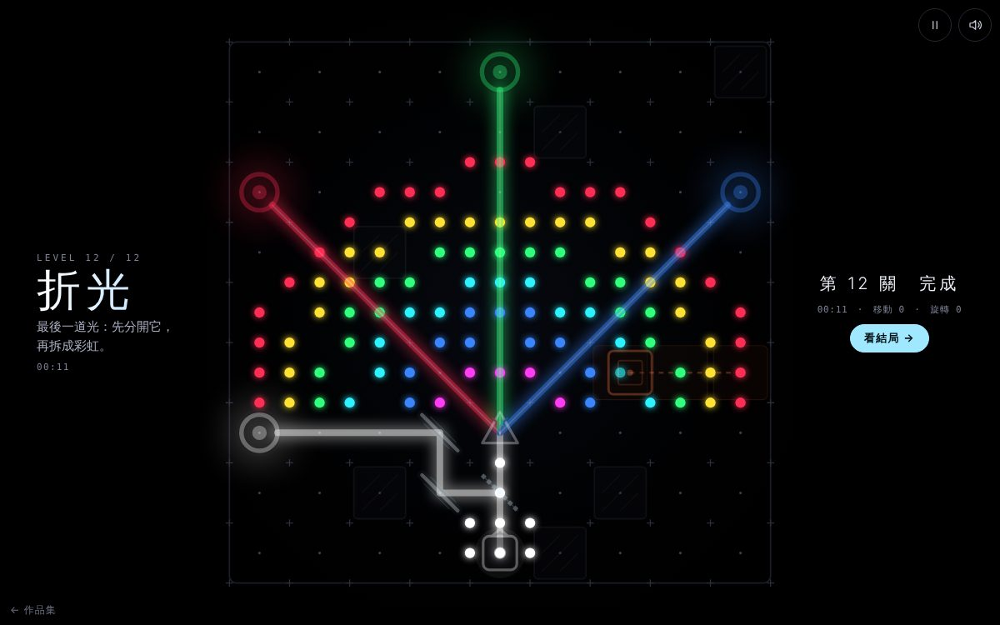

# 遊戲櫃 06 折光

> [!NOTE]
> **這一頁是什麼**  
> [遊戲櫃](../README.md)第 06 個遊戲的完整開發紀錄：玩法、視覺、聲音、技術、取捨、測試與已知問題。內容由製作這個遊戲的 AI 代理在 2026-10-15 寫成，數字都對應目前的程式。
> - 線上玩：[https://echofrommoney-oss.github.io/game-cabinet/g06/](https://echofrommoney-oss.github.io/game-cabinet/g06/)（網址加 `?demo=1` 看精華）
> - 原始檔：`index.html`（要和根目錄的 `lib/` 一起用本機伺服器開，例如 `npm run dev`，直接雙擊可能載不到函式庫）



## 1. 一句話與作品集亮點

**一句話**：把雷射從光源導到目標的霓虹光學解謎；每一關點亮後，整個盤面會亮成一張圖案。

**亮點**
- 光路是真的幾何計算：2D 射線與線段／多邊形／圓相交，拖曳時每次移動都即時重算，並處理迴圈與反射次數上限。
- 顏色採**加法混色**：稜鏡把白光拆成 R/G/B，兩道光同時打中目標會在目標上相加（紅＋綠＝黃、綠＋藍＝青、紅＋藍＝洋紅）。
- 過關演出分兩段：光束依「距光源的路徑長度」沿路依序亮起，接著盤面上 2 倍解析度的點陣亮成一張圖（太陽、三色文氏圖、彎月、愛心、彩虹……），12 關收集完後在結局畫面排成畫廊。
- 每個目標對應和弦中的一個音，亮起時響一聲鐘音並開始持續發聲；全部亮起時剛好疊成完整和弦。
- 12 關全部用自寫的解題器驗證過可解、解的數量與最少元件數，另外用時間模擬確認「移動障礙」真的會擋住偷吃步。
- 附關卡編輯器（`?edit=1`），可試玩、匯出／匯入 JSON。

## 2. 玩法與規則

**目標**：讓每個目標都持續照到「對應顏色」的光。全部目標同時充能完成即過關。

**元件**
| 元件 | 行為 | 旋轉狀態 |
|---|---|---|
| 鏡子 | 雙面反射。出射方向 `d' = (2o − d) mod 8`（方向與角度都以 45° 為單位）。光沿著鏡面平行射入時撞到鏡緣，光被擋住 | 8 段，每段 45°（實際上 4 種不同） |
| 分光片 | 一半反射、一半穿透（兩道光同色） | 同鏡子 |
| 稜鏡 | 任何方向射入都從中心散出：綠光往尖端方向 `o`，紅光 `o−1`，藍光 `o+1`（各差 45°）。只有入射光含有的顏色會出現 | 8 種 |
| 濾色片 | 光色 `c & filter`，結果為 0 就被擋住 | 不能旋轉（點了會搖頭） |
| 牆 | 吸收光 | — |
| 移動障礙 | 在兩格之間做正弦往返（週期 1.6–2 秒），擋光；軌道上不能放元件 | — |

**顏色**用 3 bit 表示：紅 1、綠 2、藍 4；黃 3、青 6、洋紅 5、白 7。目標判定：**打到它的所有光做 OR 之後，剛好等於目標色**才算亮。所以白光打紅色目標不會亮，但紅＋綠兩道光同時打黃色目標會亮；白色目標也可以用 R＋G＋B 三道光湊出來。

**充能**：目標亮著時充能，需要 `hold` 秒連續照射（沒有移動障礙的關卡 0.55 秒，有移動障礙的關卡 1.6 秒）；沒亮時在 0.2 秒內歸零。移動障礙的週期與軌道長度經過計算，穿過軌道的光束最長連續照射時間只有約 1.15 秒，小於 1.6 秒，所以光路必須繞開軌道。

**計分**：不扣分、無失敗。結算顯示總時間（暫停與過關動畫不計）、移動次數、旋轉次數、提示次數；最佳總時間存在 localStorage。

**難度曲線與關卡清單**（全部經解題器驗證）
| # | 名稱 | 尺寸 | 新概念 | 可用元件 | 解數 | 圖案 |
|---|---|---|---|---|---|---|
| 1 | 初光 | 7×7 | 拖曳與旋轉 | 鏡×1 | 1 | 太陽 |
| 2 | 折返 | 7×7 | 牆、兩次轉折 | 鏡×2 | 3 | 菱形 |
| 3 | 三色 | 7×7 | 稜鏡、顏色要對 | 稜鏡×1 | 1 | RGB 文氏圖 |
| 4 | 半透 | 8×8 | 分光片、多目標 | 分光×1、鏡×1 | 4 | 彎月 |
| 5 | 濾色 | 8×8 | 濾色片 | 分光、濾紅、濾藍 | 6 | 眼睛 |
| 6 | 行者 | 8×8 | 移動障礙 | 鏡×2 | 2（沒障礙時 7 解、1 片即可） | 波浪 |
| 7 | 混色 | 8×8 | 加法混色（黃） | 稜鏡、鏡×2 | 2 | 花 |
| 8 | 交錯 | 9×9 | 兩次分光＋上色、3 目標 | 分光×2、濾紅、濾藍 | 9 | 星 |
| 9 | 迴廊 | 9×9 | 斜射光迷宮 | 鏡×3 | 1 | 螺旋 |
| 10 | 雙源 | 9×9 | 兩個光源（紅、藍）相加 | 分光×2 | 1 | 愛心 |
| 11 | 閃 | 9×9 | 稜鏡朝向＋青色混色＋2 個移動障礙 | 稜鏡、鏡×2 | 1 | 閃電 |
| 12 | 折光 | 9×9 | 綜合：先分光再散成三色、4 目標＋移動障礙 | 分光、稜鏡、鏡×2 | 1 | 彩虹＋稜鏡 |

一個有趣的性質：鏡子永遠不會改變「直／斜」的奇偶（`2o − d` 與 `d` 同奇偶），只有稜鏡能把直射光變成斜射光。第 9、11 關的設計就是建立在這點上。

## 3. 操作

**桌機**
- 從右側工具列拖曳元件到格子上；拖曳中會吸附到格子並**即時重算光路**。
- 點一下元件：順時針轉 45°；右鍵：逆時針；滑鼠滾輪也能轉。
- 把盤面上的元件拖出盤面即收回工具列。
- `Esc` 暫停／繼續，`H` 提示，`R` 全部收回，`Enter` 過關後下一關。

**手機**
- 點工具列的元件（外框亮起、可放的格子會出現呼吸光點）→ 點格子放下。
- 點已放的元件旋轉；也可以直接拖曳。
- 右上角：暫停、聲音開關；左下角：「← 遊戲櫃」。

**網址參數**：`?demo=1` 展示模式；`?edit=1` 關卡編輯器。

## 4. 視覺設計

**色票**
| HEX | 用途 |
|---|---|
| `#000000` | 底色（純黑） |
| `#ff2d55` | 紅光 |
| `#32ff7e` | 綠光 |
| `#3a86ff` | 藍光 |
| `#ffe234` | 黃（紅＋綠） |
| `#2ff3ff` | 青（綠＋藍） |
| `#ff3df5` | 洋紅（紅＋藍） |
| `#ffffff` | 白光、光束中心熱線 |
| `#9fe8ff` | UI 強調色（主按鈕、選取外框、可放格提示） |
| `#eef9ff` | 鏡面 |
| `#ff7a45` | 移動障礙與軌道 |
| `#3b3f52` / `#2a2d3a` | 格點／格線交叉十字（極淡） |
| `#0b0c11` + `#2b2e3a` | 牆的填色與外框 |
| `#e9ecf5` / `#7d8296` | 文字主色／次要文字 |

**字型**：Google Fonts `Noto Sans TC`（300/400/700）＋ `JetBrains Mono`（數字、關卡編號），fallback 為 system-ui、PingFang TC、Microsoft JhengHei、Menlo。標題「折光」clamp(64px, 13vw, 120px)、字重 300、字距 .32em，帶 6 秒來回的漸層流光；關卡名稱 30px（手機）／clamp(40px, 4.4vw, 64px)（桌機）。

**版面**
- 橫向（寬高比 ≥ 5:4 且寬 ≥ 720）：三欄 grid——左欄關卡編號＋名稱＋提示＋計時，中間正方形盤面（最多 66vw 或 100vh−40），右欄工具列。
- 直向：上 HUD、中盤面、下工具列（橫排卡片）。
- 盤面是 SVG，viewBox 以「格」為單位（格心在整數座標），`preserveAspectRatio: meet` 自動置中。

**質感做法**
- 盤面拆兩層 SVG：下層放格點、牆、軌道、目標光暈與**光束光暈（feGaussianBlur stdDeviation 0.1 格，userSpaceOnUse 濾鏡區域）**；上層放光束核心（0.075 格寬的彩色線）、白色熱線（0.024 格）、流動光點（dasharray `.02 .34`，0.55 秒一循環往前流）、元件與特效。這樣流動光點的動畫只重繪上層，模糊層只有在光路改變時才重繪。
- 目標外圈依「組成色」分段畫（黃色目標＝紅＋綠兩段、白色目標＝紅綠藍三段），一眼看出可以怎麼混；中心小點顯示「目前收到的顏色」，收錯顏色時看得出來。
- 充能環：stroke-dasharray 從 0 長到圓周。

**動畫參數**
| 動畫 | 時間 | 緩動 |
|---|---|---|
| 元件旋轉／吸附 | 200 ms | cubic-bezier(.3,1.5,.5,1)（輕微回彈） |
| 拖曳中吸附 | 70 ms | ease-out |
| 放下時彈出 | 280 ms，scale .4→1 | cubic-bezier(.3,1.6,.5,1) |
| 放下漣漪 | 450 ms，半徑 .2→.95 格 | easeOutCubic |
| 目標亮起粒子 | 10 顆、0.5–0.85 s、速度 1.2–3.4 格/s、每幀 ×0.92 阻尼 | — |
| 進場 | 物件 600 ms、光束 800 ms（延遲 250 ms）淡入 | ease-out |
| 過關光束重描 | 650–1300 ms（依路徑總長 ×70 ms），每段依 s0/s1 路徑長度亮起 | easeInOutCubic |
| 圖案綻放 | 每點 560 ms，延遲 = 與中心距離 × 560 ms，scale .2→1.8→1 | cubic-bezier(.2,.8,.3,1) |
| 過關後其他物件變暗 | opacity → .32（光束 .42），1–1.2 s | — |
| 標題畫面光束 | 白光 700 ms，五色光依序 900 ms（間隔 60 ms） | cubic-bezier(.3,.7,.2,1) |

`prefers-reduced-motion`：關掉流動光點與標題流光、旋轉不做補間、粒子最多 3 顆、光束重描與圖案綻放改為直接出現。

## 5. 聲音設計（Web Audio 即時合成）

總線：各音效 → dry ＋ 送到殘響（ConvolverNode，IR 為 2.6 秒雙聲道白噪音 × `(1−t)^3.2` 衰減，wet 0.42）→ master（0.9）→ DynamicsCompressor（threshold −14 dB、ratio 4）→ 輸出。第一次互動才建立 AudioContext。

| 音效 | 合成方式 |
|---|---|
| 放下元件「玻璃聲」 | 基頻 1250–1670 Hz 隨機；5 個非整數倍的正弦分音 ×1、×2.32、×4.25、×6.63、×9.1，振幅 0.055×(1/.55/.32/.2/.1)，衰減 1.1/0.7/0.45/0.28/0.18 s；外加 30 ms 高通 3800 Hz 噪音敲擊；殘響送出 0.7 |
| 旋轉「喀」 | 三角波 2300→1300 Hz（35 ms 指數下滑），gain 0.06，50 ms；加一個 3400 Hz 正弦 0.12 s 的小亮音 |
| 拿起 | 正弦 520→880 Hz，70 ms，gain 0.045 |
| 收回 | 正弦 700→330 Hz，120 ms |
| 不能放／不能轉 | 正弦 170→95 Hz，140 ms，gain 0.09 |
| 目標接通 | 該目標的音（每關一組和弦，例如第 3 關 Cmaj9 = MIDI 60/64/67/71/74）：鐘音＝正弦 f（1.8 s）＋2f（0.9 s）＋3.01f（0.5 s）；同時打開一個持續聲部：三角波 f/2 ＋ 正弦 1.004f（被 0.2–0.5 Hz LFO 微幅顫音 ±3 Hz）→ 低通 1600 Hz → gain 以時間常數 90 ms 升到 0.05。熄滅時以 220 ms 時間常數降到 0 |
| 過關 | 和弦音由低到高再升八度的琶音，間隔 75 ms，每音正弦 2.2 s ＋ 2.005f 泛音；帶通 7 kHz 噪音 1.8 s 做閃光感；持續聲部升到 0.08，2.8 s 後淡出 |
| 環境底噪 | 三個鋸齒波 55/82.5/110.3 Hz → 低通 380 Hz（0.07 Hz LFO ±180 Hz 掃動）→ gain 0.012 |

## 6. 技術架構

單一 `index.html`（HTML＋CSS＋JS inline），**不使用任何 lib**。開發時引擎與關卡放在 scratchpad 的 g06dev/，用 build 腳本把 `engine.js` 與 `levels_final.json` 內嵌進 HTML，同一份引擎也被 Node 解題器使用。

**主要模組**
- `trace(lv, pieces, {time, trackAsWall})`：光路引擎（`/*ENGINE_START*/…/*ENGINE_END*/` 區塊）。
- `Snd`：音效。
- `PATTERNS`：12 個圖案函式 `(u,v)∈[-1,1]² → 顏色 bitmask`，在盤面「半格」解析度點陣取樣（9×9 盤面 = 19×19 點），所以任意盤面尺寸都能用。
- `buildBoard / drawBeams / updateTargets`：繪製與充能。
- 輸入：Pointer Events；`toCell` 用 `svg.getScreenCTM().inverse()` 把螢幕座標換成格子座標。
- `winLevel`：光束重描 → 圖案綻放 → 結算卡。
- `runDemoLevel`：展示模式用假游標實際呼叫拖曳／旋轉函式。
- 編輯器：`openEditor / editorClick / renderEditorPanel`，存 localStorage `g06-editLevel`。

**光路演算法**
1. 把場景轉成幾何物件：牆＝0.86 格正方形（4 條線段）、移動障礙＝0.72 格正方形（依時間算位置）、光源 0.56 格正方形、目標＝半徑 0.3 的圓、鏡子／分光片＝長 0.84 格的線段、稜鏡＝外接半徑 0.34 的三角形、濾色片＝半徑 0.3 的菱形。
2. 用 BFS 佇列處理光線 `{x,y,d,c,ign}`：對每個物件算射線交點（線段用叉積公式、圓用二次式），取最近的 t，也和盤面邊界比；`ign` 是剛剛反射／穿過的物件，避免自己撞自己。
3. 依撞到的物件產生新光線（反射、穿透、散射、濾色）。
4. **迴圈處理**：光線起點座標 ×8 取整＋方向＋顏色當 key，出現過就跳過；**上限**：最多 320 條光線、480 段。
5. 每段記錄 `s0/s1`（從光源起算的路徑長度），過關重描動畫直接用它排時間。
6. 效能：用每段座標 ×50 取整組成簽名，光路沒變就不碰 DOM——移動障礙沒擋到光的時候，模糊層完全不重繪。

**解題器（開發用，Node）**：DFS，每一步只在「目前光有經過、且可放」的格子嘗試剩下的元件與所有角度（光沒經過的格子放東西不會改變結果），用狀態 key 去重。移動障礙在解題時視為整條軌道都是牆，再用 1/60 秒步進模擬 12 秒，確認預定解能連續照亮、而「穿越軌道」的解最長連續照亮時間 < 1.6 秒。第 9、11、12 關的牆是用隨機生成＋解題器評分（最少元件數等於可用數、解數越少越好）挑出來的。

**關卡 JSON 格式**
```json
{"name":"折光","w":9,"h":9,
 "sources":[{"x":4,"y":8,"d":6,"c":7}],
 "targets":[{"x":0,"y":2,"c":1}],
 "walls":[[8,0]], "movers":[{"path":[[6,5],[8,5]],"period":1.8}],
 "fixed":[{"t":"mirror","x":2,"y":2,"o":1,"lock":"fixed|rotate"}],
 "inv":["splitter","prism","mirror","filter:4"],
 "hint":"…","pattern":"prism","chord":[60,64,67,71,74,79],
 "sol":[{"t":"prism","x":4,"y":6,"o":6}]}
```
`d` 方向 0–7（0＝東，順時針每 45°，y 向下）；`o` 元件角度同單位；`c` 顏色 bitmask。

**用到的 lib**：無（只有 Google Fonts，離線時走系統字型）。

## 7. 取捨與原因（對照原企劃）

- **元件只在格心、方向只有 8 個**：讓所有光束都落在通過格心的直線／對角線上，碰撞仍用一般的射線×線段計算（企劃要求），但盤面可讀性高、解題器可窮舉。
- **稜鏡規則簡化**：不模擬真實折射率，改成「從中心往尖端散出 R/G/B 三道、各差 45°」，入射方向不影響出射——玩家只需要管「放在哪、尖端朝哪」。
- **移動障礙＝「光要穩定照住」**：如果只要瞬間全亮就過關，移動障礙只會變成等待時間。改成需要連續充能 1.6 秒，且讓障礙週期短到穿越軌道的光一定會被切斷，障礙才真的有謎題意義。
- **「拖曳旋轉」改成點擊／右鍵／滾輪旋轉**：拖曳已經用來移動元件，兩者同時存在在手機上容易誤觸。
- **展示模式**：照企劃從第 4 關開始，假游標先示範放一面鏡子，再放分光片完成關卡，之後自動玩下去（第 12 關後回到第 4 關循環）。點任何地方就把控制權交還玩家；展示模式不寫入進度。
- **加法混色**：企劃只說「目標要對應顏色」，我把它做成光的加法，讓第 7、10、11 關有「把兩道光湊在同一點」的新玩法。
- **效能**：SVG 模糊在手機上很貴，所以拆成上下兩層 SVG、`will-change: transform` 讓瀏覽器分層合成，並在光路沒變時跳過重繪。無頭（軟體繪圖）Chromium 1440×900 下第 1 關從 11 fps 提升到 48–60 fps。

## 8. 測試結果

`node test.mjs`（Playwright，內建 Node 靜態伺服器 port 8106，根目錄 games/；Google Fonts 以空樣式表回應，模擬離線）——**20/20 通過**。
1. 1440×900：用滑鼠拖曳實際解完第 1–6 關（含拖錯位置、拖回工具列收回），進第 7 關後測 Esc 暫停／繼續、提示鬼影；互動 > 15 秒、關卡 1→7；無版面溢出；console error / pageerror = 0。
2. 375×812（isMobile、hasTouch）：用「點元件 → 點格子 → 點元件旋轉」解完第 1–4 關；無溢出、無錯誤；另截第 11 關（移動障礙）手機畫面。
3. `?demo=1`：10 秒內從第 4 關自動完成並進到第 5 關；手機版展示模式無錯誤。
4. `?edit=1`：放一面牆、按「試玩」能進入遊玩；無錯誤。
5. 12 關逐一套用儲存的解答，在**即時移動障礙**下全部能過關；結局畫面與 12 張圖案畫廊正常顯示。
6. 縮圖 `thumb.jpg`：第 12 關過關瞬間（彩虹圖案＋三色扇形光束），1200×750、JPEG 82。

**截圖觀察與修正紀錄**
- 第一版無頭環境只有 11–15 fps → 拆兩層 SVG＋跳過未變更的光路重繪。
- 過關時目標沒有變暗：進場動畫用 inline opacity 蓋掉了 class，改用 WAAPI 不留樣式。
- 進場時下層光暈比核心光束先出現，看起來像一條模糊的粗棒 → 兩層一起淡入，並把光暈從 0.34 格縮到 0.2 格、模糊 0.13→0.1。
- 手機上連放兩個同種元件時，第二次點工具列會「取消選取」→ 放下後自動清除選取，流程一致。
- 第 12 關原本的稜鏡圖案在 19×19 點陣下看不出形狀 → 改成彩虹拱橋＋小稜鏡；彎月、波浪也重調參數；結局畫廊點放大到 0.13 格。
- 結算列在 1200 寬時「旋轉」被拆行 → `white-space: nowrap`。
- 編輯器面板被右上角按鈕蓋住 → 編輯模式右欄加上 64px 上邊距。

截圖在 `g06/shots/`。

## 9. 已知問題與下一步

- 無頭 Chromium（軟體繪圖）在有移動障礙的關卡約 16–40 fps；實機有 GPU 時應能維持流暢，但低階手機上的 SVG 模糊仍是主要成本。可以考慮偵測低 fps 時關掉光暈層。
- 第 8 關的移動障礙沒有改變解的集合（有沒有障礙都是 9 解），目前主要是視覺上的壓力；可以再調整軌道位置。
- 第 4、5、8 關有多個解（主要是濾色片能放在路徑上的任何一格），難度偏教學向。
- 編輯器沒有內建「驗證可解」按鈕（解題器目前只在 Node 端）；提示功能只對內建關卡有效。
- 沒有「拖曳旋轉」手勢（見第 7 節）。
- 下一步：加入能旋轉但不能移動的固定元件關卡（引擎與編輯器已支援 `lock:"rotate"`）、會移動的鏡子、關卡分享連結（把 JSON 編進網址）。

## 10. 可以重複利用的做法

- **兩層 SVG＋簽名比對**：昂貴的濾鏡放在只有資料變了才重繪的下層，常駐動畫放上層，並用 `will-change` 讓它們成為各自的合成層。
- **以格為單位的 viewBox＋`getScreenCTM().inverse()`**：任何格子遊戲都能免手算縮放，直接把指標座標換成格子。
- **CSS 變形作用在 SVG `<g>`**：`transform: translate(Xpx,Ypx) rotate(Ndeg)` 的 px 就是 user unit，可以直接用 CSS transition 做旋轉補間；角度累加（不取餘數）才不會從 315° 倒轉回 0°。
- **濾鏡要用 `filterUnits="userSpaceOnUse"`**：水平／垂直的線 bounding box 高度為 0，預設的 objectBoundingBox 濾鏡會讓它直接消失。
- **路徑長度 s0/s1 驅動的「沿路亮起」**：在追蹤時順便記錄每段的累積長度，動畫只要用 dashoffset＝len×(1−f) 即可。
- **關卡驗證流水線**：同一份引擎同時給遊戲與 Node 解題器用；隨機生成牆＋以「最少元件數＝可用數、解越少越好」評分，自動挑出有唯一解的關卡。
- **圖案函式 f(u,v)→顏色**：與盤面尺寸無關的過關圖案或像素畫，適合各種點陣式獎勵畫面。
- **每個目標一個和弦音、持續聲部疊成和弦**：把「進度」轉成和聲，完成度用耳朵就聽得出來。
