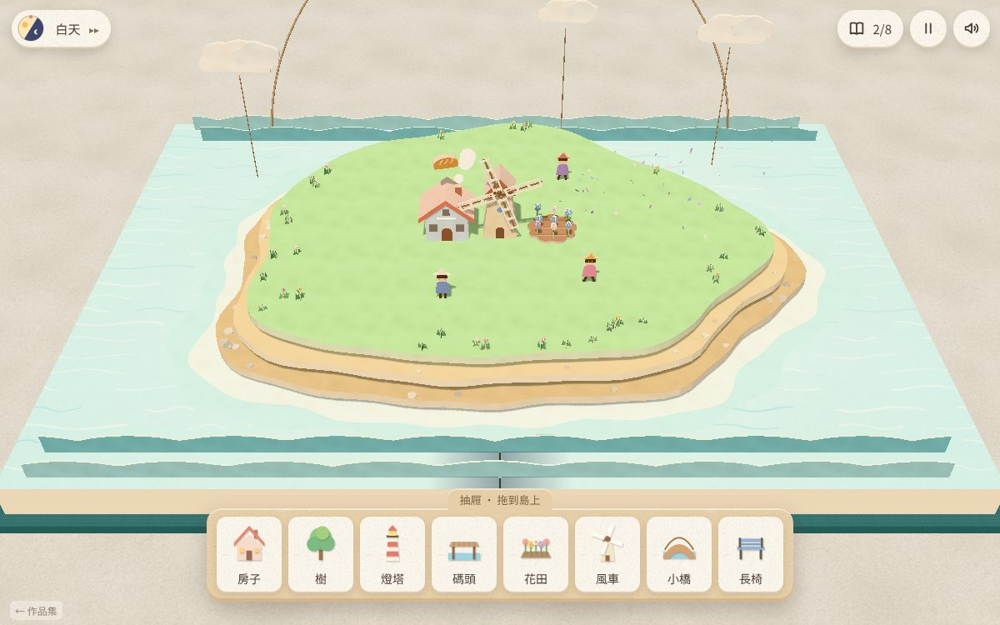

# 遊戲櫃 07 紙上小島

> [!NOTE]
> **這一頁是什麼**  
> [遊戲櫃](../README.md)第 07 個遊戲的完整開發紀錄：玩法、視覺、聲音、技術、取捨、測試與已知問題。內容由製作這個遊戲的 AI 代理在 2026-10-15 寫成，數字都對應目前的程式。
> - 線上玩：[https://echofrommoney-oss.github.io/game-cabinet/g07/](https://echofrommoney-oss.github.io/game-cabinet/g07/)（網址加 `?demo=1` 看精華）
> - 原始檔：`index.html`（要和根目錄的 `lib/` 一起用本機伺服器開，例如 `npm run dev`，直接雙擊可能載不到函式庫）

## 1. 一句話與作品集亮點

**一句話**：翻開一本立體書，把紙做的房子、樹、燈塔拖上小島，看島上的紙片小人自己過日子；擺對組合就會發生小事件，收集八張發現卡，書會合上、封面印上你的島。

**亮點**
- 開場是一整段「立體書」動畫：布面精裝書封面沿書脊翻開 → 三張書頁彎曲著翻過去（頂點即時彎曲，不是硬板旋轉）→ 浪花、三層島、波浪紙條、雲、太陽軌道依序「啪」地立起來。
- 全部物件都是「平面紙片＋厚度」：`ExtrudeGeometry` 擠出，切面自動用較淺的米白色，看起來像真的卡紙切口；十字交叉插片（樹、燈塔、花）讓任何角度都有體積。
- 放下物件時從平躺「啪」地立起來（`elastic.out(1.05,0.42)`）＋壓扁回彈＋紙屑；碼頭則是先直立再「倒」向海面（`bounce.out`）。
- 結尾會從正上方拍下你的島，印進封面插畫的圓框裡，書合上後封面就是你做的那座島。
- 所有圖像（紙紋、海面、封面、卡片插畫、抽屜圖示）都是 Canvas 2D 程式畫；所有聲音都是 Web Audio 即時合成。
- 無頭瀏覽器 / 軟體算圖會自動偵測並降畫質，仍能完整跑完。

## 2. 玩法與規則

- **目標**：收集 8 張「發現卡」。沒有失敗、沒有計時壓力，只有發現。
- **擺放**：島上有 36 格陸地（9×7 格的橢圓島，格子必須完整落在草地內）。每格放一個物件。碼頭只能放在「靠海的一圈」（陸地格且上下左右至少一格不是陸地），會自動朝外海方向。
- **組合規則**：兩個物件所在格的切比雪夫距離 ≤ 1（八方位相鄰）就算「擺在隔壁」。系統每 0.5 秒檢查一次（放下物件後 0.3 秒立刻檢查）。
- **時段條件**：一天 60 秒（展示模式 40 秒）。phase 0–1：清晨 [0.965,0.06)、白天 [0.06,0.6)、黃昏 [0.6,0.7)、夜晚 [0.7,0.965)。條件不符時第一次會提示「要等到夜晚才會發生」，條件一到自動觸發。左上角時鐘按鈕（或 T 鍵）可快轉到下一個時段（以 0.1 phase/秒 推進）。
- **事件清單**

| id | 組合 | 時段 | 卡名 | 發生什麼 |
|---|---|---|---|---|
| boat | 燈塔＋碼頭 | 夜晚 | 夜航歸港 | 紙船沿貝茲曲線從外海駛向碼頭 7 秒，停 9 秒後駛離 |
| petal | 風車＋花田 | 隨時 | 風裡的花瓣 | 風車轉速升到 9 rad/s，花田沿風向吹出花瓣 5 秒 |
| read | 長椅＋樹 | 白天 | 樹蔭下的讀書人 | 一位小人走去長椅坐下、拿出書，樹葉飄落 |
| fly | 樹＋花田 | 白天 | 蝴蝶來訪 | 3 隻紙蝴蝶在樹與花田間繞 8 字飛 15 秒 |
| hello | 房子＋房子 | 白天或黃昏 | 鄰居的招呼 | 兩戶各走出一人，在中間相遇、跳兩下、冒出愛心 |
| bread | 風車＋房子 | 白天 | 剛出爐的麵包 | 煙囪冒煙 8 秒，屋頂上方跳出一條麵包 |
| fish | 碼頭＋長椅 | 白天或黃昏 | 釣到一條魚 | 小人走到碼頭尾端拋線，2.6 秒後魚跳出水面 |
| firefly | 小橋＋樹 | 夜晚 | 螢火蟲之夜 | 16–26 顆發光點在橋邊隨機漫遊、閃爍 15 秒 |

- 第一次觸發 → 發現卡飛入；已發現的組合仍會「再次上演」（冷卻 30–50 秒、不給卡），讓島一直有生命。
- **結局**：8/8 → 1.6 秒後進入結尾：提示 → 從上方拍照印上封面 → 物件依序倒下、島層摺回、波浪與雲收起 → 封面合上 → 結束畫面（發現數、這次用時、最快紀錄）。
- **計分**：沒有分數，紀錄「完成一座島所用時間（遊戲秒數）」與「最快紀錄」，以及跨局的收藏冊累計。
- **難度曲線**：前幾個（花瓣、麵包、蝴蝶）白天隨手就會碰到；燈塔＋碼頭、小橋＋樹需要夜晚＋碼頭的位置限制；收藏冊的提示句逐步引導。一般 3–5 分鐘可完成。

## 3. 操作

| 動作 | 桌機 | 手機 |
|---|---|---|
| 放物件 | 從底部抽屜拖曳到島上（格子吸附，綠框＝可放、紅框＝不行） | 手指拖曳 |
| 移動物件 | 按住島上物件拖到別格（按下後移動 > 7px 才算拖） | 同左 |
| 移除物件 | 拖回抽屜（抽屜變珊瑚色「放開就收回抽屜」）或拖到島外 | 同左 |
| 輕點物件 | 物件晃一下＋小互動（風車加速、樹掉葉子、燈塔閃、叫房子裡的人出來） | 點一下 |
| 旋轉視角 | 拖曳空白處（水平＝繞島、垂直＝俯仰 0.42–1.2 rad）；方向鍵 | 單指拖曳空白處 |
| 縮放 | 滾輪；+ / − 鍵（0.5–1.5 倍） | 雙指捏合 |
| 快轉時間 | 左上時鐘按鈕或 T | 點時鐘 |
| 暫停 | Esc 或右上 ‖ | 右上 ‖ |
| 鍵盤放置 | Tab 到抽屜項目按 Enter → 放在最靠近島中心的空格 | — |

## 4. 視覺設計

**色票**

| HEX | 用途 |
|---|---|
| #fbf6ec | 紙（UI 底色、按鈕） |
| #e6cfa8 / #d6b88c | 抽屜牛皮紙 / 抽屜底邊 |
| #4b3f37 / #85705f | 主要文字 / 次要文字 |
| #e4846f / #c96a56 | 珊瑚強調色（主要按鈕、提示標籤）/ 按鈕厚度 |
| #3f6d72 | 布面封皮 |
| #b6dba5 | 島頂草地 |
| #f0dcb0 / #d3bb92 | 中層沙 / 底層深沙 |
| #f2fbfb / #cdeef2 | 兩圈浪花 |
| #bfe5ea → #8ccbd6 | 海面紙（放射漸層） |
| #82c4d2 / #a6d8e2 | 波浪紙條 |
| #fffaf0 | 紙張切面（各色與此色 60% 混合） |
| #ffc96b | 夜間窗光（emissive） |
| 天空關鍵影格 | 清晨 #eab7b0、早晨 #f5dcc6、白天 #cfe7ee、黃昏 #f2c0a4、入夜 #9a8fc0、夜 #3a4878 |

**字型**：Google Fonts「Huninn（粉圓）」，fallback：jf open 粉圓 → PingFang TC → Noto Sans CJK TC → 微軟正黑體 → sans-serif。標題 46px（手機 38px）、h2 26px、內文 16px、說明 14px、抽屜標籤 14px（手機 11px）。

**質感做法**
- 紙紋：256² Canvas，逐像素亮度 239–255 雜訊＋26 個低頻污漬（四方向循環繪製以無縫）＋160 條短纖維；當 `map` 乘在所有 Lambert 材質上。DOM 用另一張半透明紙紋（alpha 0–14）疊在任何底色上。
- 卡紙切面：`ExtrudeGeometry` 的 group 0（正反面）用原色，group 1（側面）用原色與 #fffaf0 混 60%。合併網格時（`Kit` 類別）直接把切面頂點寫成淺色的頂點色，一個物件一個 draw call。
- 島：三層外形由 `wob(a)=1+.06sin(3a+.7)+.045sin(5a+2.1)+.025sin(8a+.3)` 的極座標橢圓（RX 4.75、RZ 3.7）放大 1.13/1.06/1.0，層厚 0.16、層間空隙 0.14，用 7 條米白紙條撐著（立體書的支架）。
- 書：布紋封皮 128² Canvas 交叉細線；書頁側邊用條紋貼圖；書溝用漸層透明貼圖做陰影。
- 光：HemisphereLight＋DirectionalLight（陰影）＋燈塔 PointLight（夜間）。Three r174 用物理光單位，Lambert 需乘 `LIGHT_K = 2.0`。色調映射 `NeutralToneMapping`（粉彩不偏色）。
- 夜晚：天空、霧、桌面一起換色；窗戶 emissive 0→1.4、燈塔光束（兩個加法混色圓錐）不透明度 0→0.26 並旋轉 0.9 rad/s；13 顆紙星星從上方垂吊下降。

**版面**：左上時鐘、右上收藏冊／暫停／聲音、底部置中抽屜（桌機 8×78px、手機 8 等分）、左下「← 遊戲櫃」。遊戲時相機 `setViewOffset` 往下偏移抽屜高度的 42%，讓島不被抽屜蓋住。

**動畫參數**
| 動畫 | 時長 / 緩動 |
|---|---|
| 封面翻開 | 1.3 s `power2.inOut` |
| 三張書頁 | 每張 0.62 s、間隔 0.23 s，彎曲量 `sin(pπ)·1.1` |
| 島層立起 | 0.9 s `elastic.out(1.05,0.42)`，層間 0.16 s |
| 物件立起 | 從 -86° 到 0：0.8 s elastic；縮放 1.18/0.78 → 1，0.7 s `elastic.out(1,0.5)` |
| 碼頭倒下 | -1.45 rad → 0，0.75 s `bounce.out` |
| 拖曳中 | 後仰 -0.75 rad、抬高 0.45、跟隨 `1-exp(-16dt)` |
| 發現卡 | 從事件位置翻面飛到中央 0.9 s `back.out(1.4)`、停 2.8 s（點擊可略過）、飛進收藏冊 0.7 s `power2.in` |
| 相機 | 所有參數以 `1-exp(-6dt)` 平滑 |
| 減少動態 | elastic 全換成 `power2.out`、粒子數減半、卡片動畫縮短 |

## 5. 聲音設計（全部 Web Audio 即時合成）

- **總線**：Master Gain 0.9 → DynamicsCompressor（-16 dB、4:1）→ 輸出。回音：Delay 0.23 s、回授 0.33、低通 2600 Hz。
- **翻紙**：白噪音 → 帶通（Q 0.9）頻率 500→3200→900 Hz（0.4 s），包絡 0.08 s 起到 0.32；尾端再一個 1500 Hz 高通的短「啪」。
- **紙片立起（啪）**：高通 1800 Hz 噪音 45 ms＋三角波 260→80 Hz 嘟（0.13 s）＋1300 Hz 正弦 50 ms 小亮點。
- **拿起**：帶通 2400 Hz 噪音 0.12 s。**揉掉**：7 個隨機 0–0.28 s 的帶通噪音碎響（900–3500 Hz）。**輕點**：正弦 900→500 Hz 70 ms。
- **發現音（風鈴）**：從 C6 五聲音階（1046.5/1174.7/1318.5/1568/1760/2093 Hz）隨機取 5 個，間隔 0.11 s；每個音 = 基頻 0.14＋2.76 倍泛音 0.045＋5.4 倍 0.015，基頻衰減 2.4 s，送回音。
- **海浪**：預算好的布朗噪音循環 → 低通 480 Hz，增益 0.16 由 0.11 Hz LFO（深度 0.1）調變；第二層帶通 900 Hz、0.075 Hz LFO 做浪花嘶聲。
- **音樂盒**：每 1.1–2.6 s 從 C5 五聲音階彈一個音（正弦＋3 倍泛音），30% 機率接一個大三度/五度；夜晚降八度、間隔 ×1.5。
- **環境**：白天每 6–13 s 一串鳥叫（2600–3400 Hz 正弦快速上滑 2–4 聲）；夜晚每 1.5–4 s 蟋蟀（4300 Hz 正弦 × 28 Hz 方波 AM）。
- **水花**：帶通 3000→700 Hz 噪音 0.3 s。
- 第一次互動後才建立 AudioContext；暫停時 suspend；聲音開關存 localStorage。

## 6. 技術架構

- 單檔 `index.html`，ES module；lib：`../lib/three.module.min.js`（r174）＋`../lib/gsap.min.js`。importmap 把 `../lib/three.core.min.js` 重新指到 `../lib/three-addons/three.core.min.js`（three.module.min.js 會 import 它，但 lib 根目錄沒有這個檔；跟其他遊戲用同一做法）。沒有用任何 addon。
- 主要區塊：
  - `makePaperCanvas`、`drawCover`、`drawTitlePage`、`cardArt`、`drawIcon`：所有 Canvas 圖。
  - `SH`（形狀工具：poly/rect/arch/blob/star/heart）、`exGeo`、`Kit`（多片紙合併成一個頂點色網格，切面自動淺色，Euler 用 `YXZ` 讓「平躺再水平旋轉」直覺）。
  - 書：`leftHalf` 群組以書脊為軸 `rotation.z` 從 -π（闔上）到 0；`makeSheet/setSheet` 把 19×2 頂點的條帶沿角度 `θ0 - bend·s` 積分出彎曲的書頁，正面標題頁、背面是左頁海面的貼圖（repeat -0.5）→ 翻完後與左頁無縫。
  - 格子：`grid[i][j]`（land/coast/dir/obj），`bfs()` 八方向尋路（禁止切角），`walkable` 排除房子/燈塔/風車/樹。
  - `buildObject(type)`：8 種物件；`group`（位置/朝向）→ `stand`（立起動畫的樞紐在底部）→ 合併網格＋特殊部件（窗戶、燈塔燈與光束、風車葉片）。
  - `Villager`：任務佇列（walk / wait / sit / enter / fn）＋ `think()` 自主行為（22% 坐長椅、16% 進房子、12% 到樹下、其餘隨機走 3 格內；夜晚有家的回家睡到天亮）。永遠以相機方位角做圓柱 billboard，左右移動時用 `scale.x` 翻面（像紙片轉身）。
  - 人口：`2 + 房子數`（上限 7），每間房子分配一位住戶。
  - `RECIPES` + `EVENTS`：每個事件是 async 函式，用 `wait()`（遊戲時間計時器）與 `onTick()`（每幀回呼）編排；`grabVillager` 借用最近的小人，`moveVillagerTo` 14 秒走不到就「噗」地瞬移。
  - `Pool`：InstancedMesh 粒子池（紙片 240／手機 150、發光 100／60），支援重力、阻力、漂浮、隨機遊走、閃爍、面向相機。
  - 日夜：`KEYS` 關鍵影格線性插值（smoothstep），太陽/月亮在後仰 0.42 rad 的鐵絲弧線上移動。
  - 畫質：`TIERS` 五級（DPR 2→0.5、陰影 PCFSoft 2048 → Basic 512）。偵測 SwiftShader/llvmpipe 直接從最低級開始；執行中每 45 幀平均 > 38 ms 就降一級。`?q=high|mid|low` 可強制。GSAP 關掉 lagSmoothing，慢裝置上動畫照真實時間播完。
  - 存檔 `g07-paper-island`：album（跨局收藏）、best（最快秒數）、islands（完成座數）、sound。全部 try/catch。
- 測試掛鉤 `window.__g07`：狀態查詢、`cellScreen(i,j)`、`setTier`、`freeze`、`_grant(ids)`（只給結尾測試用）。

## 7. 取捨與原因（對照企劃）

- **事件做了 8 個（企劃至少 6 個）**，每種物件都至少出現在一個組合裡；不做「燈塔＋長椅看夕陽」，避免長椅出現在太多組合。
- **組合判定用「八方位相鄰」**，而不是距離 2 格：規則清楚、玩家容易理解「擺在隔壁」。
- **碼頭限定海邊**：讓船有地方靠岸，也讓玩家多一個空間思考；不合法時給溫和提示，不算失敗。
- **夜間事件不強迫等待**：加了時鐘快轉，避免最長要等 40 秒的空窗。
- **小人用 billboard 紙片**而不是固定朝向：任何視角都看得到臉；用 scale.x 翻面來保留「紙片轉身」的感覺。
- **沒有用 addons**（RoundedBox、EffectComposer 都不需要）：全部用 core 的 ExtrudeGeometry；後製會讓手機與軟體算圖更慢。
- **桌面改用 MeshBasicMaterial**（顏色跟著時段手動換）：它佔了畫面一大塊，不需要光照與陰影，省下大量片段運算。
- **結尾拍照**用主 canvas 在同一個 task 內 render＋drawImage（不需 preserveDrawingBuffer），保留色調映射與 sRGB。

## 8. 測試結果

測試腳本 `test.mjs`（Playwright，自帶 node http 伺服器 port 8107，根目錄 games/）。環境：2 核心、負載 14–16，SwiftShader 軟體算圖（遊戲自動降到 DPR 0.5，截圖前用 `setTier(1)` 暫時拉高）。

- **桌機 1440×900**：開書 → 用滑鼠從抽屜拖入 6 個物件（風車、花田、房子、樹、長椅、燈塔）→ 拖曳空白處旋轉、滾輪縮放 → 把燈塔拖回抽屜移除、把房子挪一格 → 等事件：觸發 petal、bread、fly、read 4 個發現 → 快轉到夜晚 → 收藏冊 → Esc 暫停/繼續。console error / pageerror = 0。
- **手機 375×812（isMobile、hasTouch）**：用 CDP `Input.dispatchTouchEvent` 真的觸控拖曳 4 個物件、單指旋轉、雙指縮放；觸發 3 個事件；檢查抽屜、HUD、返回連結沒有超出畫面。
- **?demo=1**：跳過開始畫面，自動翻開書、依序放入風車／花田／房子，10 秒內已在 play 模式並放好物件，之後觸發「風裡的花瓣」「剛出爐的麵包」。手機 demo 也確認。
- **結尾**：給 7 張卡後實際擺出最後一個組合 → 進入 end 模式（8/8）→「再做一座島」→ 回到 play、物件與發現都清空。
- **截圖觀察與修正**：
  - 起初畫面 1 fps：GSAP 預設 lagSmoothing 讓開場動畫卡在半途 → 關掉 lagSmoothing。
  - 封面字上下顛倒 → 貼圖 `rotation = π`。
  - DOM 紙紋是不透明圖，把珊瑚色按鈕蓋成白色 → 改成半透明紙紋。
  - 浪花、書溝與海面相距 0.002 造成 z-fighting 細線 → 拉開到 0.016–0.03、near 改 0.6。
  - 雲和牆面偏灰、整體偏暗 → 發現是 r155+ 物理光單位，乘 `LIGHT_K = 2.0`。
  - 夜晚太黑 → 提高夜間半球光與底色。
  - 太陽弧線與雲被畫面頂端切掉 → 弧線半徑 6.8→5.4、往後仰 0.42 rad，雲降低。
  - 手機開始畫面書被切 → 直式畫面另算鏡頭角度。
  - 雙指縮放在連續手勢後失效（殘留 pointer）→ 新手勢的 primary pointer 會清掉舊紀錄。
  - 測試裡的雙指縮放一開始失敗，是因為手指剛好按在畫面中央的發現卡上（卡片可點擊略過）→ 測試改在下半部捏合。
  - 直式畫面島太靠上、下方留白 → 直式時相機目標往後移 2.2、抽屜偏移量改 20%。
  - 手機收藏冊標題「收藏冊」被擠成兩行 → 標題不換行、副標可折到下一行。
  - 直式畫面白天看得到吊在高處的星星 → 星星升到最高時隱藏。
- 最後一次完整執行：desktop / mobile / demo / mobile-demo / ending 全部 ok，console error 與 pageerror 都是 0（console 只有 SwiftShader 的效能 warning）。

## 9. 已知問題與下一步

- 軟體算圖（無 GPU）時會降到 DPR 0.5，畫面明顯顆粒；真實裝置不受影響。
- 小人尋路只避開「實心」物件，事件中的臨時小人（鄰居招呼）是直線走，可能穿過旁邊的物件。
- 物件沒有旋轉功能（房子永遠朝 +z）；可以加「雙擊轉 90°」。
- 下一步：每座島存檔（目前只存收藏與紀錄）、更多事件（季節、下雨）、可分享的封面圖片下載。

## 10. 可重複利用的做法

- **`Kit` 紙片合併器**：把很多 `ExtrudeGeometry` 合成一個非索引網格，頂點色區分正面/切面 → 一個物件一個 draw call，任何「紙雕／卡紙」風格都能直接用。
- **彎曲書頁**：沿長度方向積分角度 `θ(s)=θ0 - bend·s` 生成條帶頂點，正反面兩個 mesh 共用幾何、背面貼圖 repeat 負值 → 翻完與下一頁無縫。
- **軟體算圖偵測＋自動降級**：`WEBGL_debug_renderer_info` 判斷 SwiftShader/llvmpipe，再用滑動平均幀時間逐級降 DPR/陰影；GSAP 記得 `lagSmoothing(0)`。
- **事件腳本 = async 函式＋遊戲時間 `wait()`＋`onTick()`**：暫停時自然停住，重置時清空計時器即可放棄所有進行中的事件。
- **CDP 觸控測試**：`Input.dispatchTouchEvent` 可以模擬拖曳與雙指捏合，比 `page.tap` 完整。
- **主 canvas 拍照**：同一個 task 內 `renderer.render(scene, otherCam)` 後立刻 `drawImage(renderer.domElement)`，不用 preserveDrawingBuffer。
