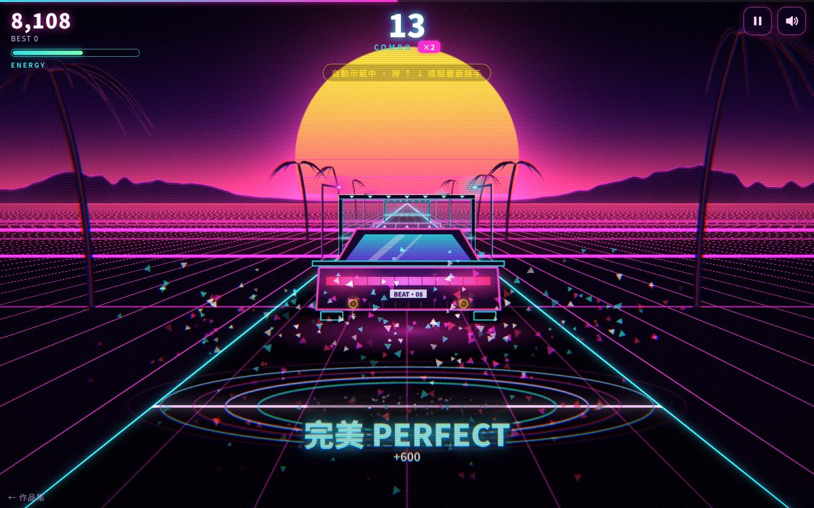

# 遊戲櫃 08 節拍公路

> [!NOTE]
> **這一頁是什麼**  
> [遊戲櫃](../README.md)第 08 個遊戲的完整開發紀錄：玩法、視覺、聲音、技術、取捨、測試與已知問題。內容由製作這個遊戲的 AI 代理在 2026-10-15 寫成，數字都對應目前的程式。
> - 線上玩：[https://echofrommoney-oss.github.io/game-cabinet/g08/](https://echofrommoney-oss.github.io/game-cabinet/g08/)（網址加 `?demo=1` 看精華）
> - 原始檔：`index.html`（要和根目錄的 `lib/` 一起用本機伺服器開，例如 `npm run dev`，直接雙擊可能載不到函式庫）

## 1. 一句話與作品集亮點

**一句話**：開著霓虹跑車衝向合成器夕陽，大鼓響就跳過粉紅欄杆、小鼓響就滑過青色雷射門的節奏跑酷。

**亮點**
- **兩首曲子全部即時合成**：自寫 16 分音符 step sequencer（大鼓、小鼓/拍手、hi-hat、crash、riser、貝斯、和弦 pad、琶音、主旋律），沒有任何音檔。
- **譜面就是鼓譜**：每個「跳」都落在大鼓、每個「滑」都落在小鼓（測試會逐一驗證），玩家其實是在「打鼓」。
- **音訊時鐘驅動一切**：排程用 `AudioContext.currentTime` 的 look-ahead（預讀 120ms），判定與畫面也讀同一個時鐘，再扣掉裝置輸出延遲與玩家自訂延遲。
- **WebGL 全螢幕 shader**：天空、條紋太陽、山脈、透視格線地面全在一個 fragment shader 裡算；前景 Canvas 當貼圖丟進同一個 shader 做色差、故障位移、掃描線、暗角。
- **格線與拍子對齊**：地面橫線間距 = 半拍行駛距離，所以亮的那條線剛好在每一拍通過判定線；路燈每拍一盞、棕櫚樹在半拍。
- **實驗功能**：選本機音檔 → OfflineAudioContext 分頻 → 能量差 onset → 自相關估 BPM → 梳狀濾波細修 BPM 與相位 → 自動產生關卡（測試用 124 BPM 檔案，偵測誤差 < 0.01 BPM、相位誤差 2ms）。
- **延遲校正工具**：跟著 8 聲嗶聲點擊，取中位數自動算出延遲。

## 2. 玩法與規則

**目標**：撐完整首歌（約 90 秒），分數越高越好。

**障礙**
| 障礙 | 外觀 | 動作 | 對應聲音 |
|---|---|---|---|
| 霓虹欄杆 | 粉紅 `#ff2fd0` 半透明斜紋矮牆、▲ 記號，高 0.26 | 跳 | 大鼓 |
| 雷射門 | 青色 `#2de2e6` 門框＋車頂高度（0.34）的雷射、▼ 記號 | 滑 | 小鼓/拍手 |

**判定**（以「聽到的歌曲時間」計算，見第 6 節）
| 結果 | 時間差 | 分數 | 生命 |
|---|---|---|---|
| 完美 PERFECT | ≤ 50 ms | 300 × 倍率 | +2 |
| 不錯 GOOD | ≤ 115 ms | 100 × 倍率（顯示「早/晚 N ms」） | +1 |
| 失誤 MISS | 漏按超過 115 ms，或提早 115–160 ms 按 | 0，連擊歸零 | −20 |

- 按鍵時找「同種類、未判定、時間差最小且 ≤ 160ms」的障礙來判；沒有就只做動作不扣分（不懲罰亂按，但提早按到 115–160ms 會被判 MISS，避免狂按）。
- **連擊倍率**：0–9 ×1、10–24 ×2、25–49 ×3、50+ ×4。10/25/50/每 50 連擊有中央橫幅＋上行琶音。
- **生命**：100 起，0 即「引擎熄火」（音樂磁帶停轉般降頻）→ 結果畫面。≤40 時血條變紅、畫面紅色暗角脈動。
- **評級**（通關才有）：準確率 =（完美 + 0.5×不錯）/ 總數；S ≥ 95%、A ≥ 85%、B ≥ 70%、其餘 C；失敗為 F。
- 最高分以曲目為單位存 localStorage；第一首通關後結果畫面出現「下一首 ▶」。

**難度曲線**
- 01 霓虹起跑線（100 BPM、A 小調 Am–F–C–G、38 小節 = 91.2 秒、102 個障礙、最短間隔 0.30 秒）
  | 小節 | 段落 | 編曲 | 譜面 |
  |---|---|---|---|
  | 1–2 | 前奏 | pad、hi-hat，第 1 小節倒數 3-2-1-GO | 無 |
  | 3–10 | 主歌 | 大鼓 1、3 拍＋小鼓 2、4 拍、8 分貝斯 | 每小節 1→2 個 |
  | 11–18 | 導歌 | ＋八度貝斯、琶音 | 每小節 2–3 個 |
  | 19–26 | 副歌 | 大鼓加切分（第 6、8 格）、16 分 hat、主旋律 | 每小節 3–4 個，含 8 分音符連跳 |
  | 27–30 | 間奏 | 只剩 pad 與柔和旋律 | 每小節 2 個 |
  | 31–36 | 副歌 2 | 同副歌 | 最密 |
  | 37–38 | 尾奏 | 最後一聲大鼓 | 1 個 |
- 02 午夜超頻（128 BPM、D 小調 Dm–B♭–F–C、48 小節 = 90 秒、176 個障礙、最短間隔 0.234 秒）
  前奏（riser）→ 主歌（四拍大鼓、反拍貝斯）→ 導歌（16 分滾動貝斯）→ Drop（拍手＋主旋律）→ 間奏 → Build（每拍跳 2 小節 → 每拍滑 → 8 分音符連滑 8 下＋小鼓滾奏）→ Drop 2（10 小節，含 0.234 秒雙跳）→ 尾奏。
- 實驗模式：依偵測到的拍子，挑能量高於 40 百分位的拍點放障礙；BPM > 143 時最多每 2 拍一個；開頭 16 拍間距加倍；同種連續 3 個就強制換種類。

**展示模式 `?demo=1`**：不經選單直接從第一首第 9 小節開始（跳過前奏與教學），AI 以完美判定自動玩 10 秒，跳出「換你了！」交棒；若玩家完全沒操作且連續漏 3 個，AI 重新接手（避免評審只看到 Game Over），任何按鍵/點擊即永久交給玩家。

## 3. 操作

| | 桌機 | 手機 |
|---|---|---|
| 跳 | ↑、W、空白鍵 | 點畫面上半 |
| 滑 | ↓、S | 點畫面下半 |
| 暫停/繼續 | Esc、P、右上角 ❚❚ | 右上角 ❚❚ |
| 聲音 | 右上角喇叭 | 同左 |
- 跳在空中時按滑 → 急降並滑行；滑行中按跳 → 立刻起跳；連續兩個跳可以二段跳（每次按都重設上升速度），所以任何譜面組合都做得出來。
- 手機開局 3.5 秒顯示上下半區提示；第一首（非展示）前兩個欄杆、前兩道門上方會浮出「▲ ↑ 跳」「▼ ↓ 滑」，第 1–3 小節天空有「粉紅欄杆 ▲ 跳過去（大鼓）／青色雷射門 ▼ 滑過去（小鼓）」。
- 繼續遊戲時有 3-2-1（每 380ms）倒數再恢復時鐘。切換分頁自動暫停。

## 4. 視覺設計

**色票**
| HEX | 用途 |
|---|---|
| `#0b0221` | 頁面底色、天空頂 |
| `#ff2fd0` | 主粉紅：欄杆、車身描邊、按鈕、第一首格線 |
| `#2de2e6` | 青色：雷射門、路緣、HUD 標籤、第二首格線 |
| `#7b2ff7` | 紫：按鈕漸層、車窗下緣 |
| `#ffd319` | 太陽上緣、GOOD、星等、實驗標籤 |
| `#ff3d8b` / `#ff2975` | 地平線霞光、太陽下緣 |
| `#ff3355` | MISS、低血量 |
| `#f6e9ff` / `#b49cd6` | 主文字 / 次要文字 |
- 每首曲子有自己的 shader 主題（格線/天空/路緣三色），選單切換曲目時 3/s 緩動過去：01 粉紅格線＋粉紅霞光＋青色路緣；02 青色格線＋橘色夕陽＋粉紅路緣；實驗模式紫色格線。

**字型**：英數 Orbitron 500/700/900（Google Fonts），副標 Monoton；中文 Noto Sans TC → PingFang TC → 微軟正黑體 → system-ui。標題「節拍公路」clamp(54px, 11vw, 108px) 900 字重，80 年代鍍鉻漸層（白 → 天藍 → 49.5% 處硬切深紫 → 粉紅 → 白）＋粉紅 drop-shadow。判定字 clamp(min(W,H)×0.06, 24, 54)px，倒數 clamp(×0.2, 60, 170)px。

**透視與版面**
- 相機高 1，地面點深度 z 投影到 `y = hy + k / z`、`x = cx + X·k / z`。`k = min(0.4H, 0.54W)`，`hy = clamp(0.8H − k, 0.3H, 0.52H)`，車子（判定線 z=1）在 `hy + k`，橫式約 80% 高、直式約 75%。
- 道路半寬 1.25，可視深度 16，障礙從地平線到判定線剛好 4 拍（`v = 15 / (4 × 拍長)`）。
- shader 與 Canvas 用同一組 hy/k/cx，所以格線、路緣與 Canvas 畫的障礙完全對齊。

**質感做法**
- 太陽：直徑 min(0.27W, 0.22H)，下半部 6.5 條水平切口、切口寬度往下漸增並以 0.3/s 向下捲動；小鼓時光暈 +30%。
- 地面：橫線間距 = 半拍距離，偶數線（拍子線）更粗更亮；大鼓時所有線加亮 90%、拍子線加寬。線寬用「世界距離 × 每單位像素」換算成螢幕像素做反鋸齒，不需要 derivatives 擴充。遠處依線距 < 7px 淡出避免摩爾紋。
- 後製：色差偏移 = (uv − 0.5) × (0.0025 + 衝擊 × 0.012)；MISS 時 38 列水平故障位移 0.35 秒、紅色閃光 0.35、畫面晃動 0.7；掃描線週期 3 CSS px、暗度 13%；暗角 0.5 × (距離×1.3)^2.6；細微噪點 ±1.5%。
- 霓虹發光不用 shadowBlur（太慢），改用預先畫好的 64px 徑向漸層貼圖以 `lighter` 疊加；只有判定字用 shadowBlur。
- 車子（從車後看）：梯形下車身 + 12 格尾燈條 + 尾翼 + 雙排氣管火焰 + 漸層後擋玻璃反光 + 車牌「BEAT·08」+ 粉紅底盤光（大鼓時變亮）。

**動畫參數**
| 項目 | 參數 |
|---|---|
| 跳躍 | 拋物線，最高 0.62，滯空 min(0.46s, 0.8 拍)；落地擠壓 x+8% y−14%，6/s 恢復 |
| 滑行 | 持續 min(0.45s, 0.85 拍)，壓低 40%（28/s 趨近，12/s 回彈）；滑行中車底噴火花 |
| 判定字 | 0–0.075s 從 1.45 倍縮回 1，0.45s 後 0.3s 淡出，期間上移 18px |
| 連擊數字 | CSS `bump` 0.18s，cubic-bezier(.2,1.6,.4,1)（回彈） |
| 面板進場 | 0.45s cubic-bezier(.2,.9,.25,1.15)，位移 14px＋縮放 0.97 |
| 通過的障礙 | 判定後 0.45s 淡出；越過車子（z<1）再依深度加速淡出 |
| 速度線 | 倍率 ×3 以上出現，每幀 14 條隨機放射線 |
| 失敗 | 畫面時間以 0.35×(1−e^(−3t)) 減速停下，1.7 秒後結果 |

**減少動態**：`prefers-reduced-motion` 預設關閉「畫面特效」→ 無晃動、無故障、色差降到 30%、大鼓閃動降到 40%、太陽條紋不捲動、MISS 閃光 0.12；設定裡可手動切換。

## 5. 聲音設計

全部 Web Audio 即時合成。匯流排：音樂（→ 可掃頻的低通 → 主音量）、鼓組、側鏈（pad/貝斯/琶音，大鼓時壓到 0.32、0.26s 線性回到 1）、音效、殘響（2.4 秒雜訊衝擊響應、指數 2.8 衰減）、延遲（附點 8 分音符、回授 0.36、回授路徑 2.4kHz 低通）。總線 DynamicsCompressor（−12dB、4:1、3ms/180ms）。

| 聲音 | 合成 |
|---|---|
| 大鼓 | sine 160→44Hz（0.12s 指數），音量 3ms 起音、0.42s 衰減；加 18ms 高通雜訊 click |
| 小鼓（01） | 1300Hz 高通雜訊 0.2s ＋ triangle 210→150Hz 0.12s，送殘響 |
| 拍手（02） | 3 個相隔 11ms 的 1500Hz 帶通雜訊脈衝＋0.17s 尾巴 |
| Hi-hat | 7800Hz 高通雜訊，閉合 40ms、開放 240ms；16 分音符依拍位做重音 |
| Crash | 5000Hz 高通雜訊 1.7s |
| Riser | 帶通雜訊 400→7000Hz 跨整段，音量指數上升 |
| 貝斯 | sawtooth ＋ 低八度 sine，24dB 感的 Q7 低通 220→1500→260Hz 包絡 |
| Pad | 每音 2 支 saw（±8 cents），1500Hz 低通，0.22s 起音、0.35s 釋放 |
| 琶音 | square 4ms 起音、16 分音符長，送延遲 |
| 主旋律 | saw＋square（+7 cents），3000Hz Q2.5 低通，0.14s 後漸入 5.6Hz ±14 cents 顫音，送延遲與殘響 |
| 跳 | triangle 300→780Hz 0.1s ＋ 1800Hz 帶通雜訊 |
| 滑 | 帶通雜訊 3200→500Hz 0.22s |
| 完美 | 當下和弦根音與五度高兩個八度（triangle＋sine，錯開 30ms），送延遲 → 打擊聲永遠在調上 |
| 不錯 | 和弦三音高兩個八度 triangle |
| 失誤 | saw 160→40Hz 0.3s ＋ 低通雜訊；同時音樂低通瞬間掉到 450Hz 再 0.5s 掃回 20kHz（「悶一下」） |
| 連擊里程碑 | 和弦四音 square 琶音，間隔 50ms |
| 倒數 | square 880Hz，GO 1320Hz（由 sequencer 對拍排程） |
| 失敗 | saw 420→45Hz 1.1s ＋ 音樂低通 3000→120Hz 1.2s、音量淡出（磁帶停轉） |
| 校正嗶聲 | square 660Hz（前 4 聲）/ 1100Hz |

## 6. 技術架構

單一 `index.html`（約 100KB），不依賴任何 lib（自寫 WebGL，不用 Three.js）。

**模組（依程式順序）**
1. `store`：localStorage（最高分、延遲、靜音、特效、通關），讀寫都包 try/catch。
2. 曲目資料 `DRUMS / BASS / SONG_DEFS` → `buildSong()`：展開小節，產生 `chart`（障礙）、`kickT`、`snareT`（畫面脈衝用），以及 `v / spacing / air / slideDur`。
3. 音訊引擎：`ensureAudio()` 建立圖、各樂器函式（都接受「AudioContext 時間 t」參數）。
4. `Clock`：有聲音時 `AC.currentTime − base`，沒聲音（展示模式尚未互動）時退回 `performance.now()`，`AC` 開始執行的瞬間 `toAudio()` 無縫換軌。暫停 = 凍結 `pausedAt`，繼續 = 重算 base。
5. `songTime() = Clock.raw() − (AC.outputLatency || AC.baseLatency) − 使用者延遲`：判定與畫面都用它。
6. `Seq` + `schedule()`：每 25ms（setInterval 只負責「叫醒」）以及每幀呼叫，把 `[now, now + 0.12s)` 內的 16 分音符排進 AudioContext。暫停時把指標倒回 `ceil(pausedAt / step)`，避免恢復後掉音。
7. 遊戲邏輯：`startSong / input / judge / fail / finish / pause / resume / update`。
8. 粒子（上限 420，swap-remove）。
9. WebGL：一個全螢幕三角形；`scene(p)` 算背景；`main()` 對前景貼圖取三次樣（R/G/B 偏移）做色差並與背景以預乘 alpha 合成。
10. Canvas 前景：路燈、棕櫚樹、障礙依 z 由遠到近排序，車子插在 z=1 的位置，再疊粒子、文字。
11. 動態解析度 `QL = [1, .8, .62, .48, .36, .26]`：幀時間 EMA > 28ms 持續 45 幀就降一級（只降不升）；`?q=N` 可固定等級。
12. 實驗功能 `detectBeats()` / `makeFileSong()`、延遲校正 `CAL`。

**關鍵演算法**
- 障礙深度：`z = 1 + (t_hit − t) × v`；尚未判定但已過判定線時改為 `1 − (1−z) × 0.12`（停在車頭等判定，不會「穿過去才爆」）；判定後從當時位置 `zj` 以正常速度繼續往鏡頭飛。
- 節拍偵測：OfflineAudioContext（11025Hz、雙聲道：150Hz 低通／2500Hz Q0.7 帶通）→ 每 128 樣本（11.6ms）算對數能量 → 正向差分 → 以 98 百分位正規化 → `onset = 低頻 + 0.7×高頻` → 減去 0.5 秒滑動平均 → 70–180 BPM（0.5 步）自相關＋二倍週期，乘上以 120 BPM 為中心的對數高斯偏好（σ=0.8 個八度）→ 粗估 ±2 BPM 內以 0.02 BPM、相位 0.25 幀做梳狀濾波聯合搜尋 → 相位 +半個 hop 修正。最長分析 150 秒。
- 延遲校正：120 BPM 拍 12 聲，前 4 聲只聽；每次點擊時間減去最近拍點，取 8 次中位數，四捨五入到 5ms，範圍 ±200ms。

## 7. 取捨與原因（對照企劃）

- **背景用自寫 shader 而不是 Three.js**：場景全部是「地平線 + 地面」的 2.5D，單一 fragment shader 比 3D 場景輕、可控，也讓格線和拍子精準對齊。
- **前景 Canvas 當貼圖丟回 WebGL**：這樣色差、故障、掃描線能同時作用在前景物件上（企劃要求的電視掃描線與色差），代價是每幀一次 texImage2D。
- **角色選車子而不是奔跑剪影**：從車後的視角最能呈現 synthwave 的消失點構圖；「滑行」設計成跑車壓低車身＋車底噴火花，閱讀性比剪影好。
- **判定以按鍵為準、不做碰撞**：節奏遊戲公平性優先；物理動畫只是表現，允許二段跳/急降讓任何譜面都打得出來。
- **按鍵判定點用 handler 當下的 AudioContext 時間**，沒有用 `event.timeStamp` 換算（音訊時鐘以 render quantum 前進，誤差數 ms，遠小於 50ms 完美窗）。
- **實驗模式只用 Offline 分析產生譜面**，即時 AnalyserNode 只拿來讓太陽隨中高頻閃動（譜面需要預知未來，即時分析做不到）。
- **展示模式從第 9 小節開始**：從頭開始的話前 10 秒有 5 秒是前奏，評審看不到東西。

## 8. 測試結果

`node test.mjs`（Playwright + 自寫 node http 伺服器，port 8108），最新一輪 35 項全部通過（見 `shots/`）：
- 譜面資料：兩首歌每個跳都在大鼓、每個滑都在小鼓；長度 91.2s / 90.0s。
- 桌機 1440×900：真實鍵盤 ↑ 起跳、S 滑行；Esc 暫停時時鐘凍結、繼續有倒數；機器人遊玩 >15 秒（含故意每 7 個漏 1 個的那段：完美 10、不錯 0、失誤 2）；失敗流程（引擎熄火 → 結果）；第二首遊玩；快轉到結尾通關 → 結果畫面＋最高分寫入 localStorage；版面不溢出；0 個 console error / pageerror。
- 手機 375×812（isMobile、hasTouch）：真實觸控點上半跳；機器人觸控遊玩 16 秒連擊 10；暫停按鈕、設定面板；版面不溢出。
- `?demo=1`：直接開始、自動完美判定、10 秒後交棒（無人操作時漏 3 個 AI 重新接手）。
- 實驗功能：產生 124 BPM 的 40 秒 WAV（含大鼓、反拍小鼓、hi-hat）丟給 file input，偵測 124.00 BPM、相位 0.372s（實際 0.370s）、產生 42 個障礙並可遊玩。
- 延遲校正：模擬每次慢 40ms 點擊，量到 +40～+50ms（容許 ±30ms，沙箱計時抖動）。
- 截圖觀察：選單鍍鉻標題、三張曲目卡在桌機橫排、手機直排都完整；遊戲中車子、欄杆、雷射門、路燈、棕櫚樹、太陽條紋、格線都對齊；PERFECT 字與色差、MISS 故障效果正常；結果畫面評級與統計清楚。

**沙箱限制說明**：測試環境只有軟體 WebGL（SwiftShader）且與其他工作共用 2 核 CPU，全解析度一幀要數百毫秒到數秒、截圖一次可能 10 秒以上。因此：(1) 操作測試用 `?q=5` 固定低內部解析度；全解析度另外拍一組 `v-*.png`；(2) 節奏機器人在頁面內用 `setTimeout` 輪詢音訊時鐘、到點送出 `KeyboardEvent`/`PointerEvent`（走與玩家相同的 handler），真實 Playwright 鍵盤/觸控另外測；(3) 遊玩段落用測試掛勾把血量維持在 60 以上，避免截圖卡頓時被判死；失敗流程測試前會關掉。

## 9. 已知問題與下一步

- 每幀把 2D Canvas 上傳成貼圖：真實 GPU 上很快，但極低階手機可能觸發動態解析度降級（畫面變糊但流暢）。下一步可把障礙/車子改成 WebGL sprite 直接畫。
- 動態解析度只降不升；若一開始卡一下（例如字型載入）可能降太多。可改成穩定 5 秒後嘗試升一級。
- 實驗模式假設固定速度；變速、搖擺節奏或前奏很長的歌，相位可能飄。可再做分段（每 16 拍）重新對齊。
- iOS Safari 的 `outputLatency` 回報不穩定，第一次玩建議用延遲校正。
- 目前只有兩首；曲目資料是純 JSON 結構，可以再加一個譜面編輯器。

## 10. 可重複利用的做法

- **AudioContext look-ahead 排程 + 單一音訊時鐘 + 延遲補償**（`Clock`、`schedule()`、`songTime()`）：任何需要對拍的遊戲/視覺化都能直接搬。
- **perf → audio 時鐘無縫切換**：在瀏覽器還不准播放聲音時先用 performance.now 跑，使用者一點擊就換成音訊時鐘而不跳拍——展示模式、自動播放頁面都適用。
- **字串化鼓譜**（`'x...x...'`）＋從鼓譜衍生譜面與視覺脈衝：資料一份、三處共用。
- **Canvas 當貼圖丟進全螢幕 shader 做後製**：不用 EffectComposer 就能有色差/故障/掃描線。
- **用像素距離做 shader 線條反鋸齒**（世界距離 × 每單位像素，不需 OES_standard_derivatives）。
- **離線節拍偵測管線**（分頻 → 對數能量差 → 自相關 → 梳狀濾波細修）與 **點擊式延遲校正**（中位數）。
- **動態解析度**（幀時間 EMA 觸發降級）與 **預先渲染的發光貼圖取代 shadowBlur**。
