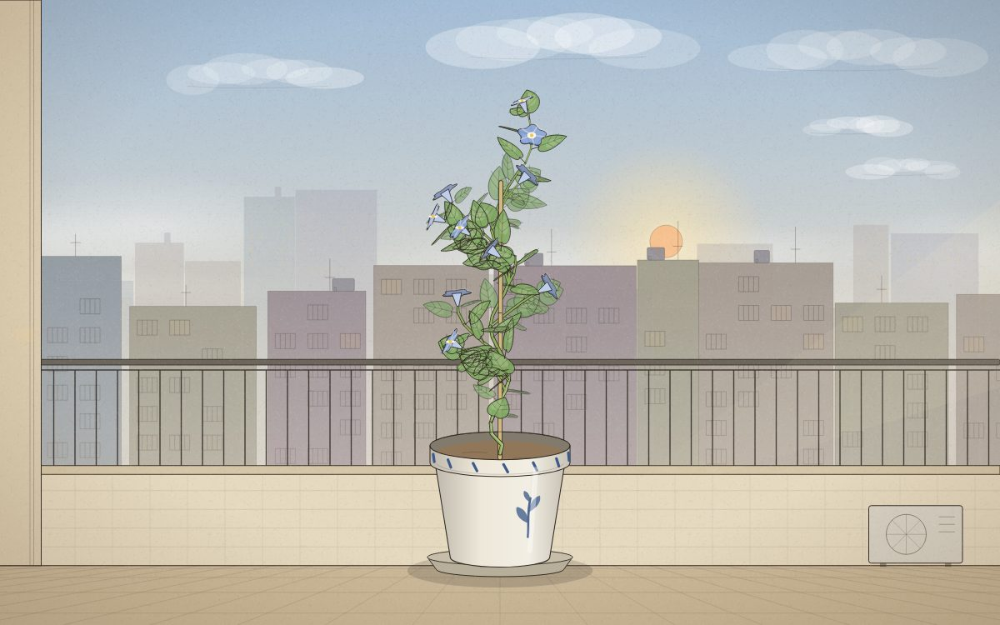

# 遊戲櫃 09 陽台小盆栽

> [!NOTE]
> **這一頁是什麼**  
> [遊戲櫃](../README.md)第 09 個遊戲的完整開發紀錄：玩法、視覺、聲音、技術、取捨、測試與已知問題。內容由製作這個遊戲的 AI 代理在 2026-10-15 寫成，數字都對應目前的程式。
> - 線上玩：[https://echofrommoney-oss.github.io/game-cabinet/g09/](https://echofrommoney-oss.github.io/game-cabinet/g09/)（網址加 `?demo=1` 看精華）
> - 原始檔：`index.html`（要和根目錄的 `lib/` 一起用本機伺服器開，例如 `npm run dev`，直接雙擊可能載不到函式庫）

## 1. 一句話與作品集亮點
選一顆種子，每天回來澆一次水，植物用真實時間長七天，最後壓成一張可以下載的博物館標本頁（PNG）。

亮點：
- **整株植物都是程式生成的**：用參數式、隨機式 L-system（seeded PRNG）推導出結構，再用 3D 海龜繪圖（turtle）解讀，投影成 SVG 墨線加淡水彩。同一個種子編號長出來的樣子一定一樣，換個編號就是另一株。
- **照顧方式真的會改變外形**：
  - 向光性用的是「這段枝條長出來那一刻盆子轉的角度」（每段生長時間都有記錄），所以不轉盆就會整株歪向窗邊，轉了一半再轉回來會長成 S 形。
  - 澆太多水，老葉會先變黃，嚴重的話會變成永久黃化。
  - 修剪會解除頂芽優勢，喚醒休眠芽（L-system 裡預先藏好的 `?` 分枝），長出新的側枝。
- **拖曳轉盆時植物會即時 3D 旋轉**（繞 Y 軸正交投影），盆子上的彩繪花紋與編號會跟著轉。
- 標本頁：米白紙紋、墨線、膠帶、根系、真實比例尺（依植物的公分比例換算）、色票、紅色館藏章、手寫拉丁學名（自創屬名＋種子決定的變種名＋照顧結果決定的品型 f. flavescens／heliotropa／ramosa）。用 SVG 轉成 canvas 再匯出 PNG。
- 陽台背景會跟著真實時段變化（清晨／白天／黃昏／夜晚）；快轉時天色十秒走完一天。晨曦牽藤的花清晨開、黃昏收。

## 2. 玩法與規則
- **目標**：把植物照顧到成熟度 100%（g ≥ 1），按「壓成標本」得到標本頁和品相等級。
- **時間**：真實時間（1 天 = 24 小時）；快轉時 1 天 = 10 秒（右上角，`?demo=1` 預設開啟）。關掉網頁期間以真實速度補算（最多 30 天）。
- **三個物種**（數值在 `SP`）：

| 物種 | 屬名 | 水分衰減 k（/天） | 每次澆水 | 太濕門檻 | 太乾門檻 | 黃化敏感 | 理想頻率 |
|---|---|---|---|---|---|---|---|
| 晨曦牽藤（開花藤蔓） | *Lianella aurorae* | 0.9 | +0.5 | 1.0 | 0.15 | 1.0 | 每天一次 |
| 霧玉（多肉） | *Crassulina nebulosa* | 0.45 | +0.45 | 0.8 | 0.04 | 1.8 | 兩三天一次 |
| 窗台小楓（小樹） | *Acerella fenestralis* | 0.7 | +0.45 | 0.95 | 0.10 | 1.2 | 一兩天一次 |

- **模擬**（`simulate`，每 0.01 天一步）：
  - 土壤濕度 `M *= exp(-k·dt)`；初始 0.32。
  - 黃化 `Y`：M > 太濕門檻時 `Y += (M−wet)·6·sens·dt`，否則 `Y −= 0.16·dt`（上限 1.3）。Y > 0.5 時累積永久黃化 `P += (Y−0.5)·0.45·dt`。
  - 缺水 `D`：M < 太乾門檻時 `D += 2·dt`，否則 `D −= dt`（0..1）。缺水時葉子下垂、葉尖焦黃。
  - 生長速度 `rate = max(0.25, 1 − 0.5·D − 0.25·min(1,Y))`，`g += rate·dt/7`。照顧得好剛好 7 天成熟。
- **品相分數**：`100 × (0.45·濕度合宜時間比例 + 0.30·(1 − 黃化) + 0.25·(1 − clamp((偏斜角−6°)/30°)))`；≥86 A 館藏級、≥72 B 優良、≥56 C 尚可、其餘 D 研究用。
- **事件**：發芽、第一朵花／小紅果、黃化、缺水、偏斜超過 16°（每天提醒一次）、成熟；每天早上記一筆觀察筆記並有鳥叫。
- **修剪**：點枝條會剪掉那段以上整個子樹（主幹最下面 2–3 段不能剪），點葉子只摘那片。剪枝會從切口往下找休眠芽喚醒（最多 2 個，找不到就往下找最近的一個）。

## 3. 操作
- 桌機：點「澆水」或點盆土＝澆水；左右拖曳畫面／盆栽＝轉盆（有慣性）；「修剪」開剪刀，滑鼠移上去會用紅色虛線標出要剪的範圍，點一下剪；W 澆水、←／→ 轉盆、S 剪刀、F 快轉、Esc 暫停。
- 手機：一樣的點擊／拖曳（Pointer Events，`touch-action:none`），剪刀模式點擊判定半徑放大到 26（桌機 16，單位是 viewBox）。
- 點葉子（不在剪刀模式）會讓整株晃一下並發出沙沙聲。

## 4. 視覺設計
| 色票 | HEX | 用途 |
|---|---|---|
| 紙 | `#F4EDDF` / `#EAE0CB` / `#E1D4B8` | 卡片、標本紙底 |
| 墨 | `#2E2721`（次 `#5C5145`、`#8C8072`） | 所有線條、字 |
| 赭 | `#8A6B4A` | 小標、欄名 |
| 朱 | `#B04A36` | 館藏章、「壓成標本」、等級 |
| 水 | `#5E8CB0` / `#7FA7C9` | 濕度條、水滴 |
| 藤葉 / 新芽 | `#83AC66` / `#BCD67F` | 晨曦牽藤 |
| 多肉葉 / 葉緣紅暈 | `#8FB39B` / `#C7675A` | 霧玉 |
| 楓葉 / 新葉紅 / 木 | `#7BA157` / `#CE9064` / `#7F6347` | 窗台小楓 |
| 黃化 / 枯褐 | `#D9C35A` / `#B98A4E` | 澆太多水的葉 |
| 花色（種子決定） | `#6F8FD0` `#9A70C2` `#D27896` `#E0896A` `#5FA3B8` | 喇叭花 |

- 天空時段關鍵影格（`SKY`）：0 時、4.6、5.8（晨曦桃）、7.5、12、16、17.8（黃昏橘）、19、20.5，RGB 線性插值＋smoothstep。
- 字型：中文 LXGW WenKai TC（手寫楷體感）→ Noto Serif TC → 系統襯線；拉丁學名 Caveat（手寫）；標題小型大寫 IM Fell English SC；全都有系統 fallback。
- 水彩做法：每片葉子＝底色（不透明度 0.9）＋偏向光源的淺色內暈（0.42）＋與底色錯位 0.5px 的墨線＋葉脈；後方葉子去飽和並淡化。莖＝較粗墨線底＋較細彩色線（描邊技巧），木質化依年齡從綠變褐。
- 紙紋：256px 雜點＋纖維 canvas，當作 SVG pattern 放在靜態背景層；暗角是 radial gradient。
- 動畫：澆水壺 0.3s easeOut 傾斜 34°、倒 1.0s、0.3s 收回；水滴重力 900·(S/12) 單位/s²，落到土面濺 2 顆水花；剪下的枝條自由落體並旋轉，1.1s 後 0.6s 淡出；轉盆慣性 `v *= 0.04^dt`；風吹搖擺振幅 0.18cm×(高度/40)^1.5，碰觸時加大到 1.08 再指數衰減；標本壓製兩片紙板 520ms 合上（cubic-bezier(.6,0,.9,.5)），咚一聲後翻出標本頁。
- `prefers-reduced-motion`：不搖擺、快轉時天色不循環、飛鳥關閉、CSS 動畫縮到 0.01ms。

## 5. 聲音設計（Web Audio 即時合成，master 0.3）
- 澆水：白噪音 → bandpass（900→1700→1100Hz, Q 0.8）→ lowpass 3200，0.15s 起音、維持 0.9s、0.45s 收；加 9 顆氣泡（sine 420–1020Hz，60ms 內上滑 1.7 倍，0.05）。
- 葉子沙沙：3–6 顆 grain，highpass 2600 → bandpass 4200–6700Hz，每顆 70–100ms，左右隨機 pan。
- 剪刀：兩下（間隔 120ms），每下＝highpass 3200 噪音 35ms ＋ triangle 3300→2500Hz 80ms ＋ sine 220→140Hz 30ms 的咔。
- 鳥叫：2–5 聲，sine f0 2500–3800Hz，45ms 內上滑 1.38 倍再回落，加 38Hz/110Hz 深度的 FM 顫音，0.045，隨機 pan。白天隨機出現，快轉時每個新的一天早上兩聲。
- 夜晚蟋蟀：sine 4300Hz，3 個 30ms 脈衝，0.012。
- 背景城市低鳴：棕噪音 → lowpass 260Hz，0.05。
- 成熟／開花：784/988/1175/1568Hz 的鐘聲（sine＋八度泛音），1.4s 衰減；壓標本：sine 120→55Hz 加低通噪音的咚；UI：sine 950→620Hz 40ms。

## 6. 技術架構
單檔 `index.html`，不用外部函式庫。
- `rulesFor(sp, R)` / `derive()`：各物種的參數式 L-system。模組：`F` 節間、`H` 螺旋攀爬步（藤蔓繞竹竿，半徑 1.05cm、每步 34–42°）、`L` 葉（大小、方位角、仰角、種類、壽命）、`K` 花、`Y` 果、`?` 休眠芽、`+ - & ^ / \` 轉向、`[ ]` 分枝。樹與多肉的休眠分枝帶 `z` 旗標，避免休眠芽裡再長休眠芽而爆量。
- `buildModel()`：括號配對（`bEnd[i]`＝所在分枝的結尾，可以 O(1) 跳過整個分枝）、第 0 遍算路徑長度 → **出生時間** `birth = 路徑長/Dmax × 0.86`，分枝級數越高長得越快（`l / (1 + 0.55·depth)`），花梗的出生時間對齊花苞。
- `interpret(md, care, g)`：每幀用海龜重新解讀；每段的生長比例 `clamp((g−birth)/dur)` 做平滑插值；還沒出生的分枝直接跳過。向光性：`T = localLight(θ(birth))`，把海龜朝 T 轉 `e·|H×T|`。修剪＝遇到被剪的段就跳到分枝尾；休眠芽被喚醒後重新對時 `act + (b − base)·0.9`。
- `renderPlant()`：投影 → 依寬度/顏色分桶合併成少量 `<path>`（約 30 個元素，而不是上千個），所以每幀重建字串也很快。同時產出點擊判定資料。`flat:true` 用在標本：葉片攤平朝向觀看者。
- 狀態 `cs`（localStorage `g09.balcony.v1`）：種子、年齡、g、M/Y/P/D、轉盆角度歷史 `rh`（320 格，每格 g=0.005）、剪枝／摘葉／喚醒芽、每日澆水次數、觀察筆記。標本歷史在 `g09.archive.v1`，聲音開關在 `g09.prefs.v1`；所有讀寫包 try/catch。展示模式用獨立的 key，不會覆蓋玩家的盆栽。
- 背景分層：天空 SVG（只有漸層／太陽／月亮，時段改變時重繪很便宜）→ 靜態城市＋陽台＋紙紋 SVG（只在 resize 時重畫）→ 窗燈、夜色、光束、檯燈都是獨立圖層，只改 CSS opacity（只在合成器處理）→ 植物 SVG。
- 迴圈：模擬用真實經過時間（每幀最多 1 秒），所以低幀率也不會讓時間變慢；植物每 40–50ms 重繪一次；分頁隱藏時停 rAF，回來後補算。
- 標本：`buildSpecimen()` 在 canvas 畫紙紋、邊框、表頭 → 把植物 SVG 字串轉成 data URI 的 Image → drawImage（加一層模糊陰影）→ 膠帶、根、比例尺（s px/cm，取整公分）、色票、標籤、印章（`destination-out` 做斑駁）。下載用 `toBlob` → `<a download>`。

## 7. 取捨與原因（對照企劃）
- 企劃說「長法由種子決定」：用「物種＋編號」當 seed，還加了由種子決定的變種名和花色。
- 轉盆做成真正的 3D 旋轉加生長歷史向光性，而不是只做 2D 偏移，因為這樣「不轉就長歪」是真的長出來的結果。
- 標本頁的文字直接畫在 canvas 上，不放進 SVG 圖片裡：當成圖片載入的 SVG 抓不到網頁字型，所以只有植物走「SVG → canvas」，文字用已載入的字型畫。
- 一開始用 SVG 濾鏡（feTurbulence 水彩邊、模糊）和 multiply 紙紋，在無 GPU 的環境只剩 2–5 fps；後來改成靜態分層＋只改 opacity，同樣的環境大約 20–30 fps。
- 為了讓第一天就有看頭，生長時間按分枝級數加權，花梗和花苞同時出現（不然會看到光禿禿的刺）。
- 展示模式：直接開始、自動快轉、缺水時自動澆、第 2.3／4.6 天自動轉盆、第 3.6 天自動剪一次，成熟 2.5 秒後自動壓成標本。

## 8. 測試結果（`node test.mjs`，22/22 通過）
- 桌機 1440×900：開始畫面有 3 張種子卡 → 選藤蔓、編號 4821 → 點盆土澆水（M 0.32→0.82）→ Esc 暫停／繼續 → 快轉 → 每天用按鈕澆水、拖曳轉盆 3 次、第 3.6 天開剪刀，滑鼠懸停截圖，剪一根枝（喚醒 1 個芽）→ **70 秒跑完 7 天**（g=1.009，78 片葉、82 段枝、9 朵花）→ 壓成標本 → **下載 PNG**：`herbarium-g09-vine-4821.png`，1200×1650，約 1.9MB，PNG 檔頭正確 → 再種一盆回到開始畫面。console／page error 0。
- 手機 375×812（isMobile、hasTouch）：點選多肉 → 點擊澆水 → 用 CDP 觸控滑動轉盆 → 點擊修剪 → 標本頁截圖；沒有破版、沒有錯誤。
- `?demo=1` 跑 10 秒：自動快轉到約第 1.07 天，桌機和手機（`sp=tree`）都沒有錯誤。
- 過度澆水測試（小樹）：Y=1.3、P=1.0，葉子明顯黃化；另外截了夜晚（21:30，窗燈、月亮、檯燈光暈）和清晨的圖。
- 截圖觀察與修正：去掉濾鏡（效能）、窗燈不再畫在欄杆上、雲改成水彩團塊、花梗不再是黑刺、樹冠改成圓潤的葉形並減少分枝密度、多肉的葉子變得更肥、分枝更多、盆子大小和植物比例分開計算（手機上盆子不會太大）、標本的根不再壓到標籤。

## 9. 已知問題與下一步
- 小樹快速生長時，梢端新長的小枝葉會擠成一團比較深的墨線；可以把幼葉的描邊畫得更淡，或延後幼葉出現的時間。
- 真實時間模式下「第 n 天」是從種下那一刻起算，不是對齊午夜。
- 標本 PNG 約 2MB（紙紋雜點很多）；可以改成 JPEG 選項。
- 測試環境擋掉 Google Fonts，所以截圖用的是 fallback 字型；連上網時學名會是 Caveat 手寫體。
- 可以再加：標本櫃畫廊（目前只記數量和等級）、自訂採集者名字。

## 10. 可以重複利用的做法
- **出生時間 L-system**：先用路徑長度算出每個模組的 birth 和 dur，每幀用 `clamp((g−b)/dur)` 解讀，就能得到任意進度的平滑生長，不用存中間狀態；修剪和喚醒芽只要存「id → 時間」。
- **把歷史參數綁在出生時間上**（這裡是盆子角度 `rh[bin]`）：可以做出「過去的照顧方式留在形狀裡」的效果。
- **SVG 分桶合併**：顏色和寬度量化後，每一桶合併成一條 path，上千個圖元也只要幾十個 DOM 節點。
- **墨線描邊莖**：先畫粗的墨色線，再畫細的彩色線，接點自然。
- **背景分層**：變化的部分改成獨立圖層，只動 CSS opacity；靜態部分只畫一次。
- **SVG → canvas 匯出**：植物轉成 data URI 的 Image 再 drawImage，文字直接用 canvas 和已載入的字型畫，避開 SVG 圖片抓不到字型的問題。
- 開頭的種子卡預覽用同一套生成器、固定隨機的轉盆歷史畫成縮圖。
