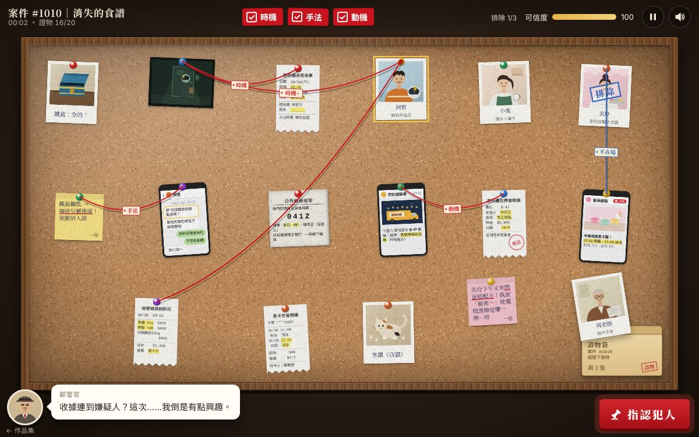

# 遊戲櫃 10 證物牆

> [!NOTE]
> **這一頁是什麼**  
> [遊戲櫃](../README.md)第 10 個遊戲的完整開發紀錄：玩法、視覺、聲音、技術、取捨、測試與已知問題。內容由製作這個遊戲的 AI 代理在 2026-10-15 寫成，數字都對應目前的程式。
> - 線上玩：[https://echofrommoney-oss.github.io/game-cabinet/g10/](https://echofrommoney-oss.github.io/game-cabinet/g10/)（網址加 `?demo=1` 看精華）
> - 原始檔：`index.html`（要和根目錄的 `lib/` 一起用本機伺服器開，例如 `npm run dev`，直接雙擊可能載不到函式庫）

（第 0 節是寫程式前先完成的推理設計表；第 1–10 節為完整紀錄。）

## 0. 案件設計：線索 × 嫌疑人 × 支持關係

**案件**：社區咖啡店「榕樹下咖啡」的招牌「黑糖檸檬磅蛋糕」手寫食譜卡，週六（10/10）打烊後從廚房的餅乾鐵盒裡消失。
**真兇**：林哲宇（阿哲），鮮奶外送員。他想開「哲的甜點車」賣同款蛋糕。

### 嫌疑人

| 代號 | 嫌疑人 | 身分 | 表面疑點（紅鯡魚） | 排除方式 |
|---|---|---|---|---|
| zhe | 林哲宇（阿哲） | 鮮奶外送員 | — | 真兇 |
| wen | 蘇曉雯（小雯） | 週末工讀生，負責打烊 | 有前門鑰匙、知道鐵盒鑰匙藏處、還說溜嘴 | 票卡紀錄：21:08 進站、21:51 淡水出站 |
| meiling | 何美玲 | 對街「蜜朵甜點」老闆 | 下午來問配方 | 21:30–22:40 店內直播 |
| zhou | 周老師 | 退休常客 | 留紙條想要食譜 | 書法課 19:00–21:58 |

### 20 張線索卡

| # | id | 類型 | 卡片 | 關鍵內容 |
|---|---|---|---|---|
| 1 | box | 拍立得 | 廚房的鐵盒 | 鎖完好、沒撬痕 → 用鑰匙開的 |
| 2 | cctv | 監視器 | CAM-02 後門 21:47 | 安全帽人影，側面黃色閃電貼紙 |
| 3 | zhe | 拍立得（嫌疑人） | 阿哲 | 安全帽有黃色閃電貼紙、外送員 |
| 4 | wen | 拍立得（嫌疑人） | 小雯 | 工讀生 |
| 5 | meiling | 拍立得（嫌疑人） | 美玲 | 甜點店老闆 |
| 6 | zhou | 拍立得（嫌疑人） | 周老師 | 常客 |
| 7 | slip | 收據 | 鮮奶補貨簽收單 | 21:45「臨時加送」、送貨員林哲宇、簽收欄空白 |
| 8 | handover | 影印文件 | 打烊交接表 | 小雯 21:05 鎖前後門，當時食譜還在 |
| 9 | askNote | 便利貼 | 桂姐：美玲來問配方 | 紅鯡魚（美玲） |
| 10 | keynote | 便利貼 | 鐵盒鑰匙藏在咖啡豆罐後面 | 鑰匙藏處 |
| 11 | cat | 拍立得 | 店貓拿鐵腳上有麵粉 | 純搞笑紅鯡魚 |
| 12 | line | 對話紀錄 | 小雯 × 阿哲 聊天 | 阿哲主動問鑰匙放哪 |
| 13 | zhouNote | 便利貼 | 周老師：可以教我做嗎 | 紅鯡魚（周老師） |
| 14 | live | 截圖 | 蜜朵甜點直播 21:30–22:40 | 美玲不在場證明 |
| 15 | post | 社群貼文 | 哲的甜點車：招牌黑糖檸檬磅蛋糕 | 動機 |
| 16 | mrt | 收據 | 捷運票卡紀錄 | 小雯不在場證明 |
| 17 | bake | 收據 | 烘焙材料行：黑糖 5kg、檸檬 30 顆，會員林＊宇 | 動機 |
| 18 | calli | 影印文件 | 社大書法班簽到表 | 周老師不在場證明 |
| 19 | stall | 收據 | 夜市攤位 B-17 押金，林先生，品項手工蛋糕 | 動機 |
| 20 | code | 標籤 | 後門密碼鎖「廠商送貨專用碼」 | 打烊後還能進後門的人 |

### 三條關鍵線（連對三條才算證據充足）

每條關鍵線是一個「推論」，由一組線索卡支撐；組內任兩張卡連線（表列的配對）即成立該推論。第一條成立後，同推論的其他配對算「補強線」（+2 可信度）。

| 推論 | 意義 | 支持卡（≥2） | 接受的配對 |
|---|---|---|---|
| K1 時機 | 打烊後 21:45–21:52 有外送員從後門進廚房 | cctv、slip、code、zhe | cctv–slip、cctv–zhe、cctv–code、slip–code、slip–zhe、code–zhe |
| K2 手法 | 鐵盒用鑰匙打開，藏處是阿哲套出來的 | box、keynote、line | box–keynote、keynote–line、box–line、line–zhe |
| K3 動機 | 阿哲早就準備好要賣同款蛋糕 | post、stall、bake、zhe | post–stall、post–bake、stall–bake、post–zhe、stall–zhe、bake–zhe |

三條推論都指向阿哲，而且三位紅鯡魚各有一張不在場證明卡可以排除：

| 排除線（藍線，+5 可信度） | 配對 |
|---|---|
| 美玲排除 | meiling–live |
| 小雯排除 | wen–mrt |
| 周老師排除 | zhou–calli |

| 中性線（「相關但不關鍵」，不扣分） | 配對 |
|---|---|
| 小雯說溜嘴 | wen–line |
| 小雯打烊 | wen–handover |
| 美玲好奇 | meiling–askNote |
| 周老師想學 | zhou–zhouNote |
| 時間軸 | handover–cctv、handover–box、handover–code |

其他所有配對 → 錯線：線會斷掉、鄭警官冷嘲熱諷、可信度 −12。連到貓 → 專屬嘲諷。

**推理是否成立（自我檢查）**
- 時機：交接表證明 21:05 前後門都鎖了；監視器 21:47 有人從後門進入 → 一定是知道密碼的人；密碼只給送貨廠商；簽收單顯示阿哲 21:45 「臨時加送」但沒人簽收；監視器的閃電貼紙和阿哲的安全帽一致。✔
- 手法：鐵盒沒撬痕 → 用鑰匙；鑰匙藏處只有桂姐與小雯知道；小雯的聊天紀錄顯示阿哲主動問過。✔
- 動機：攤位押金（10/8，案發前）＋材料行收據（20:12 案發前）＋凌晨發文的甜點車招牌品項。✔
- 其他三人在 21:47 都有可驗證的不在場證明。✔

### 結局判定

| 條件 | 結局 |
|---|---|
| 指認阿哲，且三條關鍵線都成立 | A 真相大白 |
| 指認的不是阿哲 | B 指錯人 |
| 指認阿哲但關鍵線不足 3 條，或可信度歸零 | C 證據不足 |

---

## 1. 一句話與作品集亮點

**一句話**：把證物釘上軟木板、從圖釘拉出會下垂晃動的紅線，連出「時機、手法、動機」三條推理線，指認偷走社區咖啡店招牌食譜的人。

**亮點**
- 紅線是「有物理的線」：二次貝茲曲線＋彈簧阻尼模擬下垂量，卡片移動時線會彈跳、閒置時微微擺動；錯線會「斷掉」分成兩段掉落。
- 推理不是寫死在程式裡，而是一張資料表（`REL`）：配對 → 關鍵線／排除線／中性線／錯線；容易擴充成其他案件。
- 20 張卡片、6 種紙材（拍立得、監視器截圖、熱感應收據、手機截圖、便利貼、影印文件），全部 CSS＋SVG 程式繪製，加上程式產生的軟木紋理與紙張顆粒。
- 鄭警官的冷嘲熱諷（打字機效果＋打字音），錯線、連到貓、重複錯線都有不同台詞；閒置 50 秒會給提示。
- 三種結局＋結局收集、評價 S/A/B。

## 2. 玩法與規則

- **目標**：在可信度歸零前，成立三條關鍵推論（時機、手法、動機），再指認犯人。
- **卡片流程**：資料夾（證物袋）在板子右下角。手上（資料夾上方）最多 3 張未釘卡片；手上沒卡時 1.6 秒後自動抽一張，距離上次抽卡超過 12 秒也會自動補；點資料夾可立即抽。拖到板上任一處放開＝釘上；拖回資料夾＝放回手上。
- **連線判定**（見第 0 節表格）：
  | 類型 | 外觀 | 可信度 |
  |---|---|---|
  | 關鍵線（推論首次成立） | 紅線＋標籤「時機/手法/動機」 | +8 |
  | 補強線（同推論第二條以後） | 紅線＋「時機+」 | +2 |
  | 排除線（不在場證明） | 藍線＋「不在場」，嫌疑人照片蓋「排除」章 | +5 |
  | 中性線 | 麻繩色線＋「相關」 | 0 |
  | 錯線 | 線斷掉、板子震動、嘲諷 | −12 |
  已連過的同一對不能再連。可信度上限 100，歸零 → 結局 C（警官收走圖釘）。最多容忍 8 次錯線。
- **結局**：A 真相大白（阿哲＋三線）、B 指錯人、C 證據不足（阿哲但不足三線／可信度歸零）。
- **計分**
  - A：`1000 + 可信度×10 + 排除數×150 + 補強線×50 + max(0, 480 − 秒數)×2`；評價 S ≥ 2700、A ≥ 2300、其餘 B。
  - B：`100 + 關鍵線×100 + 排除數×30`
  - C：`關鍵線×150 + 排除數×50`
  - 最佳分數與已收集結局存在 localStorage（`g10_evidence_v1`）。
- **難度曲線**：前 6 張是現場＋四位嫌疑人（建立人物），接著是紅鯡魚與關鍵證據交錯出現，最後才出現動機與不在場證明，所以要抽到後段才能湊齊三條線。抽卡順序：box, cctv, zhe, wen, meiling, zhou, slip, handover, askNote, keynote, cat, line, code, zhouNote, live, post, mrt, bake, calli, stall。
- **教學**（非展示模式）：開場一句、釘第 1 張後教放大/移動、釘滿 3 張後教拉線、三線齊後提示指認。點警探頭像可主動要提示。
- **遊玩時間**：讀卡＋釘卡約 2–3 分鐘、推理連線 2–3 分鐘，約 5–8 分鐘。

## 3. 操作

| 動作 | 桌機 | 手機 |
|---|---|---|
| 釘卡片 | 拖曳手上的卡片到板子 | 直接拖曳（手上卡片不用長按） |
| 移動已釘卡片 | 拖曳卡片本體 | **長按 330ms** 後拖曳（有震動回饋） |
| 拉紅線 | 從圖釘按住拖到另一張卡（命中區 16px） | 按住圖釘（命中區 30px）或在卡片上「直接滑動」就是拉線 |
| 放大看細節 | 點卡片 | 點卡片 |
| 抽卡 | 點資料夾 | 點資料夾 |
| 指認 | 右下「指認犯人」 | 同左 |
| 暫停 | Esc 或右上暫停鈕 | 暫停鈕 |

拉線時，經過的目標卡會亮黃框、線端吸附到它的圖釘。

## 4. 視覺設計

| 色票 | HEX | 用途 |
|---|---|---|
| 桌面 | #241a13 / #3b2b1f | 背景放射漸層 |
| 軟木 | #b8875a（+ #a87448 #c99a68 #9a6a3e #d4a876 #8c5c34 斑點） | 程式產生 256px 紋理 |
| 木框 | #6b4426 #734a2a #5e3b20 #7a4f2d | repeating-linear-gradient 木紋 |
| 紅線 | #c8141e | 關鍵線、按鈕、印章 |
| 藍線 | #2c62b8 | 排除線、「排除」章 |
| 麻繩 | #8f6a46 | 中性線 |
| 紙 | #fbf8f0 / 影印 #f2efe6 / 收據 #fbfaf6 | 卡片 |
| 便利貼 | #fbe58a #f7c6d0 #c9e4f2 | 三種便利貼 |
| 牛皮紙 | #e3c68f #cfae72 | 資料夾、標題卡 |
| 螢光筆 | #fff27a | 卡片上的重點 |

- **字型**：標題 Noto Serif TC 900；手寫 LXGW WenKai TC（便利貼、拍立得說明、線標籤）；收據 Courier New；介面 system-ui。全部有系統字型 fallback（離線可玩）。
- **質感**：紙張顆粒＝128px canvas 雜訊 dataURL，以 `mix-blend-mode:multiply` 疊在每張卡；影印文件＝內容旋轉 0.7°、`contrast(1.2)`、內陰影模擬影印暗邊＋碳粉點；收據＝clip-path 鋸齒底邊＋drop-shadow；監視器＝SVG feTurbulence 雜訊＋掃描線＋REC 字樣；手機＝黑框＋頂部聽筒。
- **卡片**：邏輯座標存「圖釘位置」，`transform-origin` 設在圖釘，所以卡片會繞圖釘擺動。手機直式卡片放大 1.12 倍。
- **版面**：板子邏輯尺寸依螢幕比例：橫式高 1000、寬 1300–1900；直式寬 900、高 1150–1750；整塊用 CSS scale 縮放到畫面（`L.scale`）。
- **動畫參數**
  - 卡片擺動：角度彈簧 k=120、阻尼 8；拖曳時目標角 = −vx×2.2（±18°）。
  - 紅線下垂：目標 sag = min(18 + 距離×0.11, 110)；彈簧 k=70、阻尼 7.5；端點移動量 ×0.9 灌入速度；閒置擺動 sin(t×1.2+相位)×(2+距離×0.004)。
  - 斷線：兩段自由端以 900·t² 掉落，0.7 秒淡出。
  - 抽卡：GSAP `back.out(1.4)` 0.6s，從 0.5 倍放大；圖釘落下 CSS 0.32s `cubic-bezier(.2,1.6,.45,1)`；軟木碎屑 6 顆（上限 50）。
  - 線標籤：`back.out(2.5)` 0.45s 彈出。印章：scale 3→1、0.45s。
- **prefers-reduced-motion**：關閉擺動、震動、彈簧灌速，粒子減到 2，CSS 動畫縮到 0.01s，打字機直接顯示全文。

## 5. 聲音設計（Web Audio 即時合成，第一次互動後才建立 AudioContext）

| 音效 | 合成方式 |
|---|---|
| 釘圖釘 | 高通 4.2kHz 雜訊 12ms ＋ sine 2600→1300Hz 30ms ＋ sine 150→55Hz 80ms（悶響）＋ 低通 500Hz 雜訊 |
| 紙張翻動 | 三段帶通雜訊（2.6/3.3/4.0kHz, Q .9），間隔 45ms，各 60–100ms ＋ 低通 900Hz 雜訊「咻」 |
| 拉線起手 | Karplus-Strong 撥弦 300–340Hz 0.35s ＋ 帶通 1.8kHz 雜訊 |
| 連線成功 | KS 撥弦（關鍵 196Hz／補強 220／排除 262／中性 165）＋ 五度泛音 |
| 關鍵線 | 鐘聲 sine 880/1320/1760Hz 衰減 1.3s ＋ sine 120→60Hz 蓋章悶響 |
| 排除 | sine 523→659Hz 兩音＋1046Hz triangle |
| 斷線 | 高通 2.5kHz 雜訊 20ms ＋ KS 110Hz（damp .97）＋ triangle 700→90Hz |
| 打字（警探說話） | 每 2 字一個 12ms 帶通雜訊（2.5–3.8kHz, Q 3） |
| 指認 | sine 95→40Hz 0.5s ＋ 低通雜訊（法槌） |
| 結局 A | triangle C5-E5-G5-C6 琶音＋高音 G6 |
| 結局 B | sawtooth 392→370→349→294Hz 下行「哇哇」 |
| 結局 C | triangle 220、207Hz 兩聲 |
| 環境 | 每秒一下時鐘滴答（square 2100/1700Hz 交替，12ms，音量 0.012） |

總線：master gain 0.8 → DynamicsCompressor(−14dB, 4:1)。靜音狀態存 localStorage。

## 6. 技術架構

單一 `index.html`，只用 `../lib/gsap.min.js`（tween）。
- **資料**：`CARDS`（20 張：id/type/title/detail）、`cardFace()`（每張卡的 HTML/SVG）、`ART`（SVG 線稿）、`REL`（配對表，key 為排序後的 `a|b`）、`DED`、台詞表 `SNARK / CAT_SNARK / KEY_SAY / HINTS`。
- **狀態** `S`：phase（title/play/zoom/lineup/paused/accusing/end）、keys、cred、lines、snaps、folder、tray、excluded、time。
- **卡片物件**：{x,y（圖釘位置）, r, s, sw/swv（擺動彈簧）, lift, state: folder|tray|pinned}；每幀 `renderCard()` 寫 transform。
- **輸入**：Pointer Events 掛在 #board，`setPointerCapture`；狀態機 pending → card / string。判定：滑鼠 5px 位移開始拖卡；觸控 10px 位移＝拉線（已釘卡）或拖卡（手上卡），330ms 長按＝拖卡；沒位移放開＝點擊放大。
- **命中測試** `hitCard()`：把指標座標轉到卡片局部座標（反旋轉、除以縮放），取 z 最高者。
- **紅線**：SVG `<path>` 三層（陰影 translate(3,7)、主線、白色虛線模擬線的紋理）＋標籤 `<g>`；`curve()` 的控制點 = 中點 +（擺動, 2×sag），曲線最低點 = 中點 + sag。
- **主迴圈**：requestAnimationFrame，dt 上限 0.05s；更新計時、自動抽卡、提示、卡片彈簧、線彈簧。
- **展示模式**：`setupDemo()` 預先釘 8 張、連一條 K1；`runDemo()` 以 async/await 腳本驅動一隻 SVG 手：拉 K2 線 → 點資料夾抽 2 張 → 拖去釘 → 拉 K3 線 → 示範一條錯線 → 點指認 → 選阿哲 → 結局 A（約 16 秒）。任何真實點擊（`isTrusted`）都會中止腳本並交還控制。
- **測試掛鉤**：`window.__g10`（S、cards、L、tryLink、drawCard、pinCard…）。

## 7. 取捨與原因（對照企劃）

- 企劃：「連對三條關鍵線就能指認」。實作：指認鈕一直可按，但不足三條會得到結局 C——這樣「證據不足」才是玩家自己選擇的後果，不是被擋住。
- 「每條關鍵線至少兩張線索支持」：做成「推論」由 3–4 張卡支撐，組內多種配對都算，第一條成立推論、其餘算補強。避免玩家因為想到的是另一個合理配對而被判錯。
- 加了「排除線」與「中性線」：讓紅鯡魚有正當的去處（合理但不關鍵不扣分），只有真的牛頭不對馬嘴才扣分，減少挫折感。
- 卡片放大用「複製 DOM ＋ scale」而非另做大圖，保證放大版與板上完全一致。
- 沒做板子平移/縮放：改用依螢幕比例調整板子邏輯尺寸＋點擊放大，手機上卡片偏小但都能點開閱讀。
- 用 GSAP 做 tween，物理（彈簧）自己寫，因為要每幀讀卡片位置。

## 8. 測試結果（`node g10/test.mjs`，26/26 通過）

- 1440×900：標題 → 開始 → 用真實滑鼠拖曳釘滿 20 張 → 點卡放大 → 拉錯線（貓→鐵盒，可信度 100→88）→ 從圖釘拉 5 條線（K1、K2、排除美玲、K3、K3 補強）→ 移動已釘卡片（線跟著）→ Esc 暫停 → 指認阿哲 → 結局 A。實測 50 秒以上；console/pageerror 0。
- 375×812（isMobile/hasTouch，CDP 真實觸控事件）：觸控拖曳釘 8 張、長按移動、觸控拉線成立 K1、拉錯線、點擊放大、指錯周老師 → 結局 B、重玩直接指認阿哲 → 結局 C；無水平捲動；錯誤 0。
- 可信度歸零測試 → 結局 C；錯誤 0。
- `?demo=1`：10 秒時三條關鍵線已連好，約 16 秒進入結局 A；手機版 demo 錯誤 0。
- 截圖觀察與修正：①木框原本沒有尺寸（只剩角落一小塊）→ 由 layout 設寬高；②圖釘蓋住收據/文件/手機標題 → 內容下移、手機加頂部聽筒邊；③聊天卡最後一則被截 → 加高卡片；④手機 HUD 標題與按鈕重疊 → 改 grid 兩列；⑤手機對話泡泡蓋住資料夾 → 移到 HUD 下方；⑥結局印章蓋住插圖/數據 → 改到右下；手機結局插圖改置中；⑦結局 A/B 插圖重畫。

## 9. 已知問題與下一步

- 手機直式時板子上的卡片字很小（約 60px 寬），必須點開才讀得清楚；下一步可加雙指縮放/平移。
- 卡片可以互相疊放，目標圖釘若被別張卡蓋住，線會連到上面那張卡。
- 只有一個案件；資料表結構已可直接換成新案件（換 CARDS/REL/台詞）。
- Google Fonts 載入失敗時改用系統楷體/明體，手寫感會打折。

## 10. 可重複利用的做法

- **懸垂線**：`Q` 曲線控制點 = 中點 + (sway, 2×sag)，sag 用彈簧追目標值，端點移動量灌入速度 → 便宜又有說服力的繩子/電線/晾衣繩。
- **繞固定點擺動的卡片**：位置存在樞紐點，`transform-origin` 設成樞紐，角度彈簧以拖曳速度為目標。
- **程式產生材質**：canvas 雜訊 → dataURL → CSS 變數 `--grain`，配 `mix-blend-mode:multiply` 讓任何 DOM 元素變紙；軟木＝底色＋數千個隨機橢圓斑點。
- **資料驅動推理**：排序後的配對 key `a|b` → 規則物件，可用在任何「連連看」型推理/配對遊戲。
- **觸控手勢分流**：同一元素上「立刻滑＝動作 A、長按後滑＝動作 B、不動放開＝點擊」。
- **展示模式腳本**：async/await ＋ 每步檢查 `demo.active`，任何 `isTrusted` 輸入即中止，假手游標用 GSAP 移動。
- **Playwright 觸控測試**：用 CDP `Input.dispatchTouchEvent` 送 touchStart/Move/End，才能測長按與拖曳。
