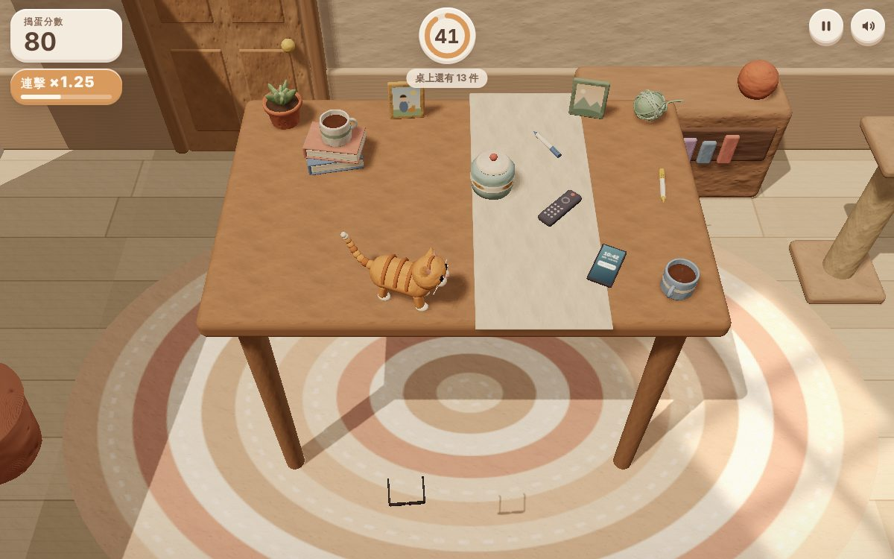

# 遊戲櫃 11 桌上的貓

> [!NOTE]
> **這一頁是什麼**  
> [遊戲櫃](../README.md)第 11 個遊戲的完整開發紀錄：玩法、視覺、聲音、技術、取捨、測試與已知問題。內容由製作這個遊戲的 AI 代理在 2026-10-15 寫成，數字都對應目前的程式。
> - 線上玩：[https://echofrommoney-oss.github.io/game-cabinet/g11/](https://echofrommoney-oss.github.io/game-cabinet/g11/)（網址加 `?demo=1` 看精華）
> - 原始檔：`index.html`（要和根目錄的 `lib/` 一起用本機伺服器開，例如 `npm run dev`，直接雙擊可能載不到函式庫）

## 1. 一句話與作品集亮點

**一句話**：主人出門了，你是一隻貓，要在 90 秒內把桌上的東西一件一件推下去；主人回家時，鏡頭切成俯視圖，讓你看自己搞出的一團亂。

**亮點**
- 黏土玩具感的 3D：所有表面共用一張**程式產生的指紋＋壓痕法線貼圖**，形狀再用放射方向的噪聲位移捏得不規則；整體低飽和奶茶色，大面積柔光。
- cannon-es 真實物理：連鎖撞倒、易碎物落地碎成碎片（碎片留在地上，變成結算畫面的「案發現場」）。
- 貓的尾巴會隨連擊（心情）改變高度和擺動頻率；最後 10 秒門外腳步聲響起時，貓的耳朵豎起、頭轉向門口；門縫的光會被腳步「遮住」一下。
- 結局演出：鑰匙聲 → 門吱呀打開 → 走廊暖光與主人的影子投進房間 → 貓轉頭「喵？」→ 鏡頭升到主人視角俯視圖＋結算卡。
- 全部音效即時合成：玻璃、陶瓷、塑膠、紙、軟物五種落地聲各自不同，喵叫用鋸齒波＋移動共振峰合成。

## 2. 玩法與規則

- **目標**：限時內把桌上 16 件物品（10 種）推下桌，分數最高。
- **時間**：一般 90 秒；展示模式 45 秒。
- **結束條件**：時間到（主人回來）或桌上全部清空（提早結束，剩餘秒數 ×10 分「全清」獎勵）。
- **物品**（基礎分 / 材質 / 易碎方式 / 質量 / 推力係數）：

| 物品 | 數量 | 基礎分 | 材質（聲音） | 易碎 | 質量 | 推力 |
|---|---|---|---|---|---|---|
| 杯子 | 2 | 120 | 陶瓷 | 碎裂（消失、留碎片與咖啡渣） | 0.5 | 1 |
| 筆 | 3 | 40 | 塑膠 | — | 0.15 | 1 |
| 盆栽 | 1 | 160 | 陶瓷 | 碎裂（陶片＋土＋多肉葉） | 1.0 | 0.85 |
| 遙控器 | 1 | 70 | 塑膠 | — | 0.35 | 1 |
| 書 | 2 | 60 | 紙 | — | 1.2 | 0.8 |
| 眼鏡 | 1 | 140 | 玻璃 | 裂開（鏡片掉、玻璃屑） | 0.15 | 1 |
| 毛線球 | 2 | 30 | 軟 | — | 0.25 | 1 |
| 手機 | 1 | 150 | 玻璃 | 裂開（螢幕出現裂痕） | 0.35 | 1 |
| 相框 | 2 | 110 | 玻璃 | 裂開（照片上裂痕） | 0.4 | 1 |
| 餅乾罐 | 1 | 200 | 陶瓷 | 碎裂（陶片＋餅乾＋碎屑） | 1.4 | 0.75 |

- **計分公式**（物品第一次碰到地板時結算）：
  `分數 = round5( 基礎分 × (易碎 ? 1.5 : 1)「破壞」 × (連鎖 ? 1.5 : 1) × 連擊倍率 )`
  - 連擊倍率 = `min(3, 1 + 0.25 × (連擊數 − 1))`；連擊窗口 3.0 秒（每次落地重置）。
  - 連鎖判定：落地時距離貓最後一次碰到它 > 1.5 秒，且它最後一次被別的物品撞（撞擊速度 > 0.6）的時間晚於被貓碰的時間（或從沒被貓碰過）。
  - 全清：剩餘秒數 × 10。
- **難度曲線**：靠佈局。前排的筆、毛線球、手機一推就掉；中間的餅乾罐重（推力 0.75）要推 2–3 次；書堆上疊杯子，推書會帶著杯子一起倒（連鎖）；後排相框立著，容易倒但掉到桌後看不到。最後 10 秒音樂加速、腳步聲越來越近。
- **事件清單**：
  - T−10 秒：門外腳步聲開始（間隔 0.75 → 0.42 秒，音量 0.25 → 1.1），提示條出現 4.5 秒，畫面邊緣紅暈，門縫光每步暗一下，貓耳豎起、頭轉向門。
  - T−5 秒起：每秒滴答（最後 3 秒較高音）。
  - T=0：鑰匙聲 → 0.55 秒門吱呀 → 門 1.1 秒內打開 1.35 rad → 1.0 秒「喵？」→ 2.3 秒鏡頭升到俯視 → 4.1 秒結算卡。
- **稱號**：0 乖巧的室友／300 好奇的小毛球／900 桌面清潔員／1800 重力實驗家／2800 混沌之王。
- **主人台詞**依打破物品優先序：餅乾罐 > 眼鏡 > 手機 > 盆栽 > 相框 > 杯子；什麼都沒掉是「今天好乖喔……（有點失望）」。

## 3. 操作

| 動作 | 桌機 | 手機 |
|---|---|---|
| 走 | WASD／方向鍵 | 左半螢幕任一處按下＝浮動虛擬搖桿（半徑 52px） |
| 伸爪 | 空白鍵（或滑鼠左鍵點畫面） | 右下「爪子」大按鈕（104px） |
| 跳 | Shift | 「跳」按鈕（70px） |
| 暫停 | Esc／P／右上按鈕 | 右上按鈕 |
| 開始／重玩 | Enter／空白鍵（標題）、Enter（結算） | 按鈕 |

- 伸爪往**面向**推：72% 面向方向 + 28% 指向物體中心；範圍 = 0.45 + 物體半徑 + 0.8，需在前方 ±66° 內；冷卻 0.3 秒。
- 跳：起跳速度 10.5，落地時 2 單位內的物品會被往外、往上震（「撲擊」）。
- 展示模式（`?demo=1`）：跳過標題直接開始、45 秒、自動駕駛會自己走過去推東西；玩家一碰任何操作就接手。

## 4. 視覺設計

**色票**

| HEX | 用途 |
|---|---|
| `#d9c6b1` | 背景、霧、Loading |
| `#dccab6` | 牆 |
| `#c8b097` | 護牆板 |
| `#a47c5b` / `#91694b` | 桌面／桌裙 |
| `#d8c8b2` | 桌巾 |
| `#d99a5e` / `#bc7845` / `#f2e2cb` | 貓：橘毛／條紋／奶油色胸口與腳掌 |
| `#e3a3a0` | 貓鼻子、耳內 |
| `#e9dfd2` `#9fb2c4` `#9fb09a` | 杯子 |
| `#c27c5c` `#8ea47a` `#a3b48b` | 盆栽陶盆、葉子 |
| `#7d8fa8` `#c48c7a` `#efe5d3` | 書封面、書頁 |
| `#a9bfb8` `#e7d9c5` `#c99a62` | 餅乾罐、蓋子、餅乾 |
| `#d49a9a` `#9fb39a` | 毛線球 |
| `#f4ebdf` / `#eadccb` | UI 黏土卡片底／次層 |
| `#5a4335` / `#3f3029` | UI 主文字 |
| `#c9786a` 玫瑰、`#93a68a` 鼠尾草、`#c2553f` 警告紅 | 標籤、按鈕 |

**字型**：Noto Sans TC 500/700/900（標題 54px／手機 40px，字距 .08em）、Fredoka 500/700（數字：分數 34px、結算 60px）；fallback PingFang TC、Microsoft JhengHei、system-ui。

**黏土質感做法**
- `makeClayMaps(N)`（桌機 512、手機 256）：可平鋪的 4 層 value noise（頻率 4/8/16/32，振幅 .55/.3/.14/.07）＋ 11 個指紋（橢圓同心環，環距 N/105 px，用低頻噪聲扭曲相位，邊緣 smoothstep 淡出，振幅 .09–.16）＋ 80 個高斯壓痕（σ 1.2–5.7px）→ 用中央差分算法線（強度 2.4×N/512×6）。同一份高度也輸出成顏色貼圖（0.93 ± 噪聲、壓痕變暗），讓顏色有斑駁感。
- `lump(geo, amp, freq, seed)`：沿「頂點 − 幾何中心」方向以三角函數噪聲位移，因為只看位置，所以 RoundedBox 等有重複頂點的接縫不會裂開；保留原法線（振幅小，視覺差不多）。
- 大面積材質用 `rep` 參數放大 UV 重複次數（牆 22、地板法線 36、桌 8），讓指紋尺度在不同物體上一致。
- 燈光：HemisphereLight `#fff3e4`/`#b59c82` 1.15 + 主光 DirectionalLight `#fff0dc` 2.3（左前上方，PCFSoft 陰影 2048/手機 1024，radius 5）+ 冷色補光 0.55；ACES 色調映射，曝光 1.05。地板上有一塊模糊窗格狀的加色光斑。
- CSS 疊加：顆粒（SVG feTurbulence，multiply 7%）與暗角（radial-gradient）。

**動畫參數**
- 相機追蹤：`1 − exp(−dt × 4)`（結算 2.2），桌機橫向跟隨貓 28%、直式 72%。FOV 依畫面比例算：橫式要看到半寬 6.3、直式半寬 4.6。
- 貓：移動速度 4.6，地面加速 `1 − exp(−dt × 14)`、空中 4；轉向 `1 − exp(−dt × 13)`；走路相位速度 4 + 速度 × 3.2，腿擺 ±0.65 rad；伸爪 0.07 秒伸出、保持 0.05、0.23 秒收回，前腳抬 1.5 rad；落地擠壓 sin 曲線 0.25 秒。
- 尾巴 9 節、逐節相位延遲 0.55：心情 m=0 → 頻率 1.6Hz、振幅 0.16、尾根 −1.95 rad（垂低）；m=1 → 7.5Hz、0.3、−0.75 rad（翹高、尾端勾起）。結局時尾巴炸毛（球放大 1.25–1.5 倍）。
- 灰塵：Sprite，壽命 0.7–1.1 秒，大小 easeOutCubic 從 0.35 → 1.2–1.9 倍，透明度 0.6×(1−t)^1.6。
- 碎片：自製簡單物理，重力 −40、反彈 0.3、水平摩擦 0.55，靜止後擺平。
- UI：卡片進場 cubic-bezier(.2,1.3,.4,1) 0.7 秒；分數彈跳 0.28 秒；飄字 1.5 秒（放大 1.12 → 上飄淡出）。

## 5. 聲音設計（全部 Web Audio 即時合成）

- 主線：master gain 0.9 → DynamicsCompressor（−16dB、4:1）；SFX 與音樂分開 bus；落地聲依 x 座標做 StereoPanner（±0.8）。
- **玻璃**：高通 3800Hz 噪聲 0.1 秒 + 300→120Hz 正弦撞擊 + 8–14 個 2300–6800Hz 正弦叮噹（衰減 0.1–0.45 秒，錯開 16ms + 隨機散落 0.3 秒）+ 每三顆一個 5–8kHz 帶通噪聲閃光。
- **陶瓷**：1700Hz 帶通噪聲 0.08 秒 + 160→65Hz 悶響 + 880/1310/2050Hz（±8%）三個不和諧泛音 + 6 個碎片滴答（2.2–5kHz 帶通噪聲 + 三角波）。
- **塑膠**：190→90Hz 低音 + 5 次彈跳喀啦（2600Hz 帶通噪聲 + 600–850Hz 方波過 1500Hz 帶通），間隔越來越短、音量 1/.5/.28/.14/.07。
- **紙／書**：100→40Hz 正弦拍擊 0.22 秒 + 低通 1000Hz 噪聲 + 2400→800Hz 掃頻噪聲（紙頁）。
- **軟（毛線）**：低通 380Hz 噪聲 + 82→55Hz 正弦。
- **桌面碰撞**：同材質的縮小版，音量正比撞擊速度，每物體 120ms 節流。
- **喵**：鋸齒波，基頻 520×p，0.13 秒升到 1.32 倍再落到 0.78 倍；兩個帶通共振峰 750→1350→720Hz（Q5）與 2300→2900→2000Hz（Q7）模擬「i-a-o」；6.2Hz 顫音 ±9Hz；疑問句「喵？」尾音上揚到 1.55 倍。
- **伸爪**：700→2800Hz 帶通掃頻噪聲 0.13 秒；打到東西加一聲低通「啪」。
- **貓腳步**：低通 650Hz 噪聲 0.03 秒，每走 0.55 單位一次。
- **主人腳步**：78→44Hz 正弦 0.15 秒 + 低通 420Hz 噪聲 + 1900Hz 鞋跟喀聲。
- **鑰匙**：10 個 2.7–5.6kHz 正弦＋三角波錯開 45ms；門鎖兩聲方波。**門吱呀**：鋸齒波每 30ms 隨機跳 95–170Hz，過 880Hz Q7 帶通，0.75 秒。
- **連擊音**：C5 起的五聲音階，連擊越高越高音。
- **音樂**：D 小調偷偷摸摸的撥弦（三角波過 1700Hz 低通 + 八度泛音），104 BPM 八分音符，16 步低音 + 4 小節旋律 + 反拍 hi-hat；最後 10 秒改 132 BPM、拿掉旋律、加 55Hz 心跳低鼓。排程器 lookahead 0.2 秒。
- 音訊在第一次使用者互動才建立；暫停時 `ctx.suspend()`；右上角開關存在 localStorage（`g11.sound`）。

## 6. 技術架構

單一 `index.html`，ES module + importmap（`three`、`three/addons/`、以及把 `../lib/three.core.min.js` 對應到 `lib/three-addons/three.core.min.js`，因為 lib 裡的 three.module 會 import 它）。用到：`three.module.min.js`（r174）、`three-addons/geometries/RoundedBoxGeometry.js`、`cannon-es.js`。

程式分 13 段：
0. 設定（桌 9.2×5.8、地板 y=−7、重力 −40、固定步長 1/60）
1. 聲音（`SFX.*`、`musicPump()`）
2. 黏土貼圖 `makeClayMaps()`、材質工廠 `clay()`、`lump()`、**`bake()`**
3. 渲染器／燈光（含軟體渲染偵測 `detectSoftware()`、`std()` 材質工廠）
4. 房間（地板、地毯、牆、門與門縫光、主人影子、書櫃、貓抓柱、盆栽、桌子）
5. 物理世界（4 種接觸材質、桌面＋桌腳靜態 Box、地板 Plane、四面牆 Plane）
6. 物件：`DEFS`、`buildMesh()`、`buildShape()`（只用 Box／Sphere／Cylinder）、`LAYOUT`、`spawnObjects()`、`onCollide()`
7. 貓：cannon 雙球（身體 r .45、頭 r .26，頭球 offset 每步跟著 yaw 轉）＋ `fixedRotation`；Three 階層骨架（身體／頭／耳／四腿／9 節尾巴）
8. 粒子：灰塵 Sprite 池；碎片 InstancedMesh（chip／cookie／soil／leaf／glass 五種，每種一個 draw call，環狀覆寫最舊）
9. 遊戲狀態 `G`、`startGame()`、`endGame()`、`showResult()`、`onLand()` 計分、`processBreaks()`、飄字
10. 輸入：鍵盤、浮動搖桿（Pointer Events + setPointerCapture）、按鈕；`autopilot()` 展示 AI
11. `fixedUpdate(h)`：輸入 → 貓速度 → `world.step(h)` → 限制貓在桌上 → 落地／撲擊 → 把貓背上的東西撥掉 → 物件落地判定 → 計時、腳步聲
12. 每幀：`animateCat()`、`cameraTargets()/updateCamera()`、`updateHud()`（只在值變化時寫 DOM）、`updateEnding()`、`qualityGovernor()`
13. 外殼：按鈕、聲音、暫停、visibilitychange、resize；測試掛鉤 `window.__g11`

**關鍵演算法與參數**
- **固定步長**：累加器、每幀最多 5 步（軟體渲染 30 步、dt 上限 0.5 秒，讓極低 FPS 時遊戲時間仍接近真實時間）。
- **落地判定**：collide 事件只記錄 `pendingLand`（不能在 step 中改世界），step 之後才 `onLand()`；保險：掉到 y < 地板+0.5 或掉落超過 2.5 秒也算。碎裂的物件放進 `queueBreak`，step 之後移除剛體。
- **接觸材質**：物-桌 摩擦 .32 反彈 .12；物-地 .5／.36（落地小彈跳）；物-物 .3／.15；貓-物 .05／0；貓-桌 0／0。允許睡眠（速度 .15、時間 .5 秒），開局全部 `sleep()` 避免疊放抖動。
- **伸爪衝量**：Δv = 6.4 × 推力 × (1 − 0.25 × 距離/範圍)，向上 1.7 × 推力，作用點在重心上方 0.12、後方 0.08 → 產生往前翻倒的力矩。
- **自動駕駛**：選分數最低的物件（距離 + 2.2 × 到桌邊距離 − 易碎加權 1.2；後緣距離 ×1.7 讓它偏好往鏡頭方向推），算出最近桌邊方向，走到物件內側 r+0.75 的位置；如果貓在物件外側就先繞到側邊；對準後伸爪；7 秒推不下就換目標。
- **合併網格 `bake()`**：把群組內直接的黏土 Mesh 轉非索引、套用矩陣、把材質色寫進頂點色、UV 乘上材質的 rep，合成一個 Mesh＋共用的 vertexColors 材質。draw call 從約 190 降到約 60。
- **俯視結算鏡頭**：依卡片佔畫面比例 f 推算鏡頭高度 H 與平移量（讓亂局落在卡片以外的區域）；直式畫面把 camera.up 轉成 −x，讓桌子長邊對齊螢幕長邊；up 向量也做插值避免硬切。霧依鏡頭距離調整（near = 距離+17、far = 距離+46）。
- **效能**：DPR 上限 2（手機 1.5）；手機陰影 1024、關抗鋸齒；粒子上限（灰塵 70/36、碎片 160/90）；離開分頁自動暫停；品質管理器若平均幀時間 > 34ms 就降 DPR（1.25 → 1，只改解析度，不動陰影設定以免重編 shader 卡頓）。

## 7. 取捨與原因（對照原企劃）

- **10 種物品 → 16 件**：只有 10 件的話 30 秒就推完，90 秒沒張力；加到 16 件（杯 2、筆 3、書 2、相框 2、毛線 2）並設計書堆疊杯的連鎖點。
- **易碎分兩種**：杯子、盆栽、餅乾罐「碎裂」（剛體移除換成碎片）；眼鏡、手機、相框「裂開」（留在地上加裂痕貼圖）。兩種都有破壞加成，但結算俯視圖上才看得到各自的樣子，也保留了亂局的辨識度。
- **貓不會掉下桌**：位置被夾在桌面內（邊緣留 0.42）。貓掉下去會讓玩家分心，而且題目是「推東西」。
- **碰撞形狀**：完全照企劃只用 Box／Sphere／Cylinder，渲染網格（指紋、把手、葉子）不參與物理。
- **軟體渲染模式（新增）**：無頭瀏覽器（SwiftShader）裡 MeshStandard 與全螢幕 CSS 疊加層都非常慢，所以偵測到軟體渲染時改用 Lambert 材質、DPR 0.45、隱藏顆粒／暗角、不顯示紅暈，並讓固定步長可以追趕；截圖用 `__g11.hq()` 換回 PBR。
- **HUD 結構**：原本 HUD 是全螢幕容器，會在合成器產生全螢幕圖層；改成 0×0 容器、子元素各自 fixed，`#loading` 淡出後移除、紅暈只在需要時 display。
- **結局動畫**沒有做主人的 3D 模型，用門口投進來的影子＋走廊光暗示，保持黏土小品的節制感，也省掉人物建模。

## 8. 測試結果

`node g11/test.mjs`（Playwright + 自寫 node http 伺服器，port 8111，根目錄 games/）：**15/15 通過**。
- 1440×900：標題出現 → 開始 → 用「讀物件座標、按真實按鍵」的鍵盤機器人玩 17 秒（WASD + 空白鍵 + 偶爾 Shift）→ 推下 2–3 件、分數 70–280 → Esc 暫停／繼續 → 跳到最後 10 秒確認腳步聲提示 → 等到結算畫面 → 重玩。console error / pageerror = 0。
- 375×812（isMobile、hasTouch）：用 CDP `Input.dispatchTouchEvent` 操作虛擬搖桿與「爪子」按鈕 16 秒，推下 2–4 件；結算卡片完全在畫面內（x 10、y 373、355×405）。錯誤 = 0。
- `?demo=1`：10 秒後狀態 playing、剩 40 秒左右、自動推下 3 件。錯誤 = 0。
- 縮圖：demo 模式等兩件掉落後，在下一件物品半空中時凍結（`freezeOnFall`），切 `hq()` 後截 1200×750 JPEG q82。
- **截圖觀察與修正**：
  - 牆／地板／地毯的指紋環太大像灰泥 → 提高 UV 重複次數、牆的法線強度降到 .18。
  - 結局時尾巴放大因為巢狀群組被連乘，變成巨型尾巴 → 改成只放大每節的球體。
  - 手機上計時器壓到分數卡、搖桿不見（定位相對於搖桿區而非視窗）→ 直式把時鐘移到按鈕左邊、搖桿改 fixed。
  - 連擊徽章即使隱藏也撐大分數卡 → 改成絕對定位在卡片下方。
  - 直式結算俯視圖被霧蓋掉、桌子很小 → 霧依距離調整、鏡頭轉 90°。
  - 東西會停在貓背上 → 每步把壓在貓上方的物件往外撥 0.35。
  - 無頭環境一開始 0.2 FPS：二分法找出主因是全螢幕 CSS 圖層（拿掉 WebGL 仍只有 1 FPS）與 MeshStandard 的片段成本，修正後拿掉 WebGL 為 59 FPS、整體約 2–4 FPS（測試機 2 核、同時有其他測試在跑，load 4–16）。

## 9. 已知問題與下一步

- 測試環境只有軟體渲染，實機 GPU 的幀率與手感（加速度、推力）沒有在真機上量過；推力與摩擦是依物理估算調的。
- 小物件偶爾會被貓的頭部碰撞球頂起來一下才掉落（已加撥落處理，但極少數情況仍會停半秒）。
- 掉到桌子後方的物品在遊戲視角看不到（只看到飄字），結算俯視圖才看得到。
- `bake()` 合併後同一物件只能有一種粗糙度；咖啡、遙控器按鈕等特殊材質保留獨立 Mesh。
- 下一步：可以加一隻會在最後幾秒探頭的主人手、玩家自選貓毛色、每日隨機桌面佈局。

## 10. 可重複利用的做法

- **程式產生「指紋＋壓痕」法線貼圖**（`makeClayMaps`）：任何黏土／手作風的 3D 都能直接用，可平鋪、可調尺寸。
- **`lump()` 放射方向噪聲位移**：讓 primitive 看起來是手捏的，又不會讓有重複頂點的幾何裂開。
- **`bake()` 頂點色合併**：同一套貼圖、只有顏色不同的小零件合成一個 Mesh，大幅減少 draw call。
- **InstancedMesh 環狀碎片池**：大量持久碎片只花幾個 draw call。
- **collide 事件只記錄、step 後才處理**：cannon-es 不能在 step 中移除剛體的標準解法。
- **軟體渲染偵測 + 降級**：`WEBGL_debug_renderer_info` 判斷 SwiftShader/llvmpipe → 便宜材質、低 DPR、拿掉全螢幕 CSS 圖層、固定步長允許追趕。
- **HUD 不要用全螢幕容器**：0×0 容器＋子元素 fixed，避免合成器多一層全螢幕圖層；DOM 只在數值改變時寫。
- **俯視結算鏡頭依 UI 卡片佔比自動平移**、直式時轉 camera.up，讓 3D 畫面和 UI 不互相遮擋。
- **截圖凍結掛鉤**（`freezeOnFall` + `hq()`）：自動化產生「物體正在半空中」的代表性縮圖。
