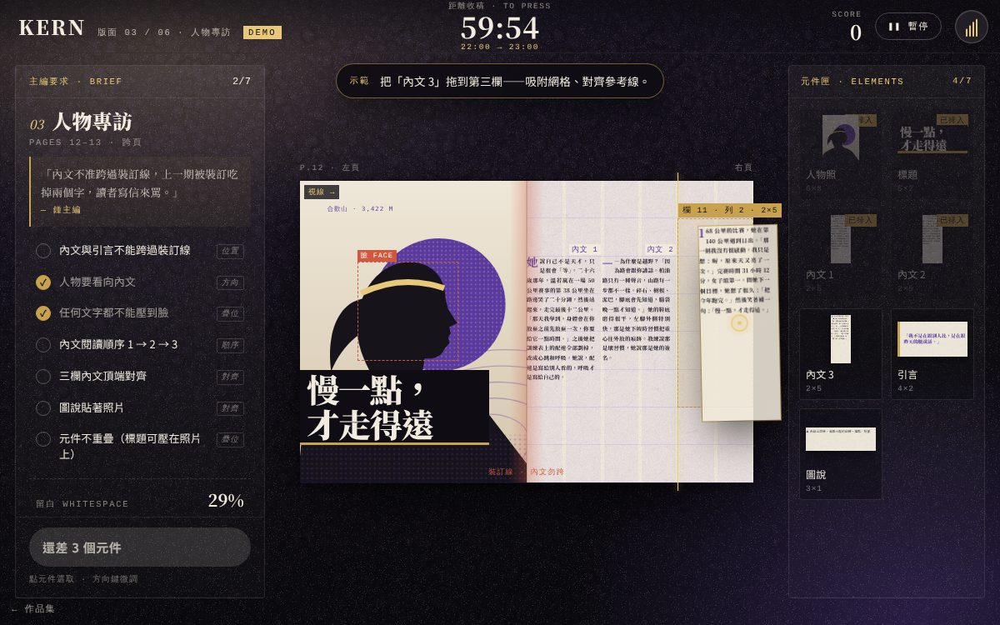

# 遊戲櫃 12 截稿前一小時（長篇）

> [!NOTE]
> **這一頁是什麼**  
> [遊戲櫃](../README.md)第 12 個遊戲的完整開發紀錄：玩法、視覺、聲音、技術、取捨、測試與已知問題。內容由製作這個遊戲的 AI 代理在 2026-10-15 寫成，數字都對應目前的程式。
> - 線上玩：[https://echofrommoney-oss.github.io/game-cabinet/g12/](https://echofrommoney-oss.github.io/game-cabinet/g12/)（網址加 `?demo=1` 看精華）
> - 原始檔：`index.html`（要和根目錄的 `lib/` 一起用本機伺服器開，例如 `npm run dev`，直接雙擊可能載不到函式庫）



## 1. 一句話與作品集亮點

**一句話**：你是《KERN 字距》月刊的美編，印刷廠一小時後收稿。你要把六個版面（封面、目錄、人物專訪跨頁、圖片報導跨頁、廣告跨頁、封底）排進 12 欄網格，做到主編的要求，最後看整本雜誌被印出來、一頁一頁翻過去。

**亮點**
- **規則檢查器是純函式**：`evaluate(layout, placements)` 只吃資料、吐出每條規則的狀態，不碰 DOM。它檢查對齊、疊位、視線方向、留白比例、閱讀順序、裝訂線。測試會用它驗證六個版面的參考解都能全數達成。
- **「臉」會跟著裁切移動**：照片用 `object-fit: cover` 的方式裁切（SVG `xMidYMid slice`）。程式算出照片縮放、裁切之後，臉在網格上的實際位置，所以把照片拉寬，臉會被裁掉，標題能放的位置也會跟著變。
- **左慢右快的斜切轉場**：關卡之間用一塊深色皮革面板加一條金色前導帶轉場。clip-path 的上緣左邊升 1.2 倍、右邊升 1.8 倍。蓋上和揭開用同一個斜率。
- **結局是一本會翻頁的雜誌**：玩家實際排的六個版面會重新渲染成書頁（跨頁切成左右兩半），用 3D `rotateY` 一頁一頁翻。沒排完的版面印成「開天窗」。
- 全部素材都由程式產生：人物側臉剪影、夜間稜線、補給站、跑鞋、日出、飲料廣告是 SVG；紙紋、皮革、雜訊是 canvas 產生的 data URI；聲音全部用 Web Audio 即時合成。

## 2. 玩法與規則

**目標**：在遊戲時間 60 分鐘（現實約 15 分鐘）內排完六個版面，盡量讓每個版面的主編要求全部打勾。

**時間**
- 遊戲時鐘從 60:00 倒數，速度是現實 1 秒等於遊戲 4 秒（`S.speed = 4`），所以 60 分鐘約等於現實 15 分鐘。加上關卡之間的故事，一輪約 15–20 分鐘。
- 故事、結算、暫停、切到別的分頁、直式轉橫式的提示出現時，時鐘都會停。
- 剩 45、30、15、5 分鐘時，印刷廠周師傅會打電話來（吐司訊息加電話鈴聲）。剩 10 分鐘以下，時鐘變紅，背景加一層 55Hz 的低頻脈動。
- 時間到時，當下的版面直接以目前的排法強制交稿（沒有時間獎勵），沒做的版面在結局印成「開天窗」。

**每個版面的流程**：讀主編要求，把元件從元件匣拖進網格，拖右下角縮放。左側清單即時打勾，全部元件放上去後可以交稿，主編評分後進入下一版。

**計分（每版最高 1000）**
- 規則分：`700 × 達成條數 ÷ 總條數`
- 時間獎勵：`200 × clamp((par × 1.8 − 實際用的遊戲分鐘) ÷ (par × 0.8), 0, 1)`。在 par 以內拿滿分，超過 1.8 倍 par 拿 0。強制交稿時這項是 0。
- 全數達成加分：100
- 主編滿意度（星等）：100% → 5 星，≥80% → 4 星，≥60% → 3 星，≥40% → 2 星，其他 → 1 星。每個星等各有一組隨機台詞，再加上第一條沒達成的規則對應的抱怨。
- 結局另加剩餘時間獎勵：`剩餘遊戲分鐘 × 15`（時間到則為 0）。
- 最高分存在 localStorage 的 `g12-best`。

**六個版面**（網格都是 12 欄。單頁 12×16、跨頁 12×8，格子都是正方形；跨頁的裝訂線在第 6 欄之後）

| # | 版面 | 主題 | par（遊戲分鐘） | 元件 | 規則 |
|---|---|---|---|---|---|
| 01 | 封面（單頁、深色紙） | 刊頭、封面人物（右看）、主標、副標、條碼 | 9 | 5 | 刊頭置頂且至少 10 欄；人物照至少 8×11；人物看向標題；任何文字不能壓到臉；臉不能被裁到；副標緊貼主標下方且左緣對齊；條碼放在右下角；文字元件彼此不重疊 |
| 02 | 目錄（單頁） | 標題、三個條目、小圖、圖說、編輯室報告 | 8 | 7 | 標題在最上緣；條目由上而下照頁碼排；條目左緣對齊；圖說貼著小圖；報告和條目之間至少空一格；至少留 1/3 白；不重疊 |
| 03 | 人物專訪（跨頁） | 人物照、標題、內文 ×3、引言、圖說 | 11 | 7 | 內文與引言不能跨過裝訂線；人物看向內文 1；文字不能壓到臉；閱讀順序 1→2→3；三欄頂端對齊；圖說貼著照片；不重疊（標題可以壓在照片上） |
| 04 | 圖片報導（跨頁） | 主圖、兩張小圖、三則圖說、標題、內文 | 12 | 8 | 主圖至少 7×5；主圖裡的跑者不能卡在裝訂線上；三則圖說各自貼著自己的圖；兩張小圖頂端對齊；終點照的人要看向書內；內文不能跨過裝訂線；不重疊（標題可以壓在主圖上）。**事件**：終點照要等攝影師傳完（約 22 秒，demo 模式 6 秒）才能用 |
| 05 | 廣告頁（跨頁） | 全頁廣告（固定 6×8）、「廣告」標示、欄目標籤、標題、內文 ×2、頁碼 | 9 | 7 | 廣告剛好放滿右頁；「廣告」標示放在廣告頁上緣；編輯內容不能跑進廣告頁；欄目標籤緊貼標題上方；標題在內文上方；兩欄內文頂端對齊且先左後右；頁碼在左下角；左頁至少留 1/3 白；不重疊（標示可以壓在廣告上） |
| 06 | 封底（單頁） | 日出圖、下期預告、引言、小刊頭、版權列、條碼 | 8 | 6 | 預告緊貼圖片下方且左緣對齊；引言水平置中；閱讀順序是圖→預告→引言；小刊頭和版權列底部對齊；條碼放在右下角；至少留 40% 白；不重疊 |

**難度曲線**：封面規則多但元件少，是熟悉操作的關卡（有提示脈動與教學吐司）。目錄加入留白與間距。專訪加入裝訂線和閱讀順序。圖片報導最難：元件 8 個、要跨頁，還有照片晚到的事件。廣告頁的規則最多，但因為廣告是固定大小，比較好上手。封底考「安靜」：40% 留白。

**故事**：每個版面開始前有 2 句對白（鍾主編、攝影師阿凱、印刷廠周師傅、廣告部小莫），打字機效果，點一下繼續，也可以略過。結局依「是否全部排完」選不同的兩句對白。

## 3. 操作

**桌機**
- 拖曳：從右側元件匣拖進版面。放開時吸附到最近的格子（`Math.round`），超出版面就收回元件匣。
- 縮放：拖元件右下角的金色圓點（滑過元件或選取時出現），尺寸受每個元件的 `min`／`max` 限制。固定大小的元件（條碼、廣告、頁碼）沒有縮放點。
- 點一下元件匣的卡片：自動放到第一個空位。點版面上的元件：選取。
- 鍵盤：方向鍵移動選取的元件 1 格；Shift+方向鍵縮放；Delete／Backspace 收回；Esc 暫停。故事中按空白鍵或 Enter 繼續。
- 滑過左側規則：版面上相關的元件會出現脈動外框（通過時金色、沒通過時紅色）。

**手機**
- 橫式：版面在中間，左側是主編要求，右側是元件匣，都縮成窄欄（`body.compact`）。
- 直式：先提示「請把手機轉成橫式」（手機圖示旋轉動畫），也可以按「直式也要玩」。直式時元件匣排在版面下方（4 欄），主編要求變成底部的抽屜，標題列放進度和交稿按鈕，點「展開」看完整清單。
- 全部用 Pointer Events，加 `setPointerCapture`；版面和卡片都設 `touch-action: none`。手機上縮放點加大到 26px。

## 4. 視覺設計

**色票**

| Token | HEX | 用途 |
|---|---|---|
| `--ink` | `#0f0d13` | 最深底色、按鈕文字、深色標題框 |
| `--ink-2` | `#1a1522` | 深色面板 |
| `--bone` | `#f2ece0` | 暗底上的主要文字、淺色按鈕 |
| `--paper` | `#efe8da`（版面實際用 `#f1ebde`） | 內頁紙色 |
| 深色封面紙 | `#1a1423` | 封面版面底色 |
| `--gold` | `#c9a24e` | 重點、通過打勾、縮放點、前導轉場帶 |
| `--gold-2` | `#e9c879` | 參考線、刊頭字、mono 標籤 |
| `--violet` | `#5a3aa0` | 內文首字、引言、目錄頁碼 |
| `--violet-deep` | `#2b1850` | 插畫深紫、封底引言 |
| `--violet-fog` | `#8a76b8` | 留白條、插畫中間調 |
| `--rust` | `#d0583e` | 錯誤、臉部框、時間緊迫、裝訂線警示 |

**字型**（Google Fonts，全部有系統字 fallback）
- 展示襯線：Bodoni Moda（刊頭 KERN、大數字、英文斜體）→ Didot／Bodoni 72／Georgia／Noto Serif CJK TC
- 中文標題與內文：Noto Serif TC 700／900 → 宋體／PMingLiU／Noto Serif CJK TC
- 介面：Noto Sans TC → PingFang TC／微軟正黑體
- 等寬小標籤：JetBrains Mono，全大寫，字距 0.16em，10.5px

**字級**
- 標題頁「截稿前一小時」：`clamp(56px, 9.6vw, 160px)`，字距 −0.04em；第二行用 1.5px 金色描邊做空心字。
- HUD 時鐘：Bodoni 34px，數字等寬。
- 版面內的字都跟版面寬度連動：`--cell = --bw / 12`、`--pw = --bw / 頁數`。內文 `pw × 0.024`，圖說 `pw × 0.022`。標題自動塞滿方框：`min(cell × w ÷ 最長行字數, cell × h ÷ (行數 × 1.12))`，所以把標題框拉大，字就變大。

**質感做法**
- 背景是固定的圖層組（`isolation: isolate`），由下到上：放射漸層底 → 皮革 canvas 紋理（`multiply`，300px 鋪排）→ 雜訊（`screen`，opacity 0.16）→ 金／紫光暈（`screen`）→ 暗角。
- 皮革紋理：300×300 canvas 上畫 1,100 顆放射漸層的橢圓卵石，邊緣處另外畫環繞的複本，讓紋理能無縫鋪排；最後再疊 ±15 的灰階雜訊。
- 紙紋：260×260 白底，加 11 階雜訊和 520 條低透明度的纖維曲線。內頁用 `background-blend-mode: multiply`。
- 插畫都是雙色調加半色調網點（SVG pattern，間距 1.4 個 viewBox 單位），再加等高線、攝影 EXIF 小字。

**版面**：桌機的三欄是 300px 主編要求、彈性寬度的版面、236px 元件匣。版面依可用空間等比縮放（`fitBoard`），跨頁中間有裝訂陰影。網格是 InDesign 風格的淡紫欄條，加上每列一條線。

**動畫參數**
- 斜切轉場：金色帶 0.70s、深色面板 0.78s（延遲 0.08s），都是 `power2.inOut`。蓋上是 `polygon(0 100−120p%, 100% 100−180p%, 100% 100%, 0 100%)`；揭開是 `polygon(0 0, 100% 0, 100% 100−180p%, 0 100−120p%)`，0.8s。
- 撿起元件：ghost 從 scale 0.94 到 1.03、rotate −1.2°，0.28s `back.out(2)`。放下：飛到格子 0.16s `power3.out`，元件彈一下（scale 1.035 → 1，0.4s `back.out(3)`），四角裁切記號由 scale 1.8 收到 1（stagger 0.03s），0.55s 後淡出。
- 規則通過：金色斜刷 `clip-path` 從 `polygon(0 0,0 0,-18% 100%,0 100%)` 刷到 `polygon(0 0,118% 0,100% 100%,0 100%)`，0.5s；打勾圖示 scale 0.4 → 1，`back.out(3)`。規則失敗：該列左右彈一下，`elastic.out(1, .3)`。
- 交稿：印章從 scale 2.6、rotate −20° 砸到 rotate −9°，0.32s `power4.in`，接著版面左右震動 4 個關鍵影格。結算卡從右邊滑入 0.55s，數字 count-up 0.9s。
- 結局：一頁翻 1.15s `power2.inOut`，每頁間隔 1.5s。翻到一半時改 z-index，正面陰影漸深、背面陰影漸淡。翻第一頁時整本書從 x −PW/2 移到 0，翻最後一頁時移到 +PW/2，讓封面和封底都置中。
- `prefers-reduced-motion`：CSS 動畫壓到 0.01ms；斜切轉場改成 0.25s 淡入淡出；不震動、不彈跳。

## 5. 聲音設計（Web Audio，第一次點擊才啟動）

| 音效 | 合成方式 |
|---|---|
| 撿起 | triangle 740→1180Hz，0.08s，vol 0.07；加 highpass 3500Hz 雜訊 0.05s |
| 放下（紙拍桌） | lowpass 雜訊 1100→300Hz，0.14s，vol 0.26；加 sine 150→70Hz，0.16s |
| 吸附格子 | square 2600Hz，0.018s，vol 0.018 |
| 規則通過 | sine 660、990、1320Hz，依序延遲 0／0.07／0.13s，衰減 0.5–0.6s |
| 規則失敗 | triangle 220→160Hz，0.2s |
| 蓋章 | sine 95→40Hz，0.3s，vol 0.5；加 lowpass 500Hz 雜訊 0.18s，再加 highpass 雜訊 0.06s |
| 翻頁 | bandpass 雜訊 700→3200Hz，Q 0.7，0.38s，起音 0.06s |
| 轉場 | bandpass 雜訊 260→1700Hz，0.7s，起音 0.25s |
| 電話鈴 | 440＋480Hz 同時響，每 0.05s 一小段、8 段一組，共 2 組 |
| 打字機 | highpass 2500Hz 雜訊 0.02s，每 2 個字一次 |
| 每遊戲分鐘 | square 1800Hz＋900Hz 兩個短音 |
| 背景氛圍 | 4 組和弦（D–A–C–E、C–G–B–E、B♭–F–B♭–D、A–E–A–C♯），每音兩個 triangle（±4 cents 走音），經 lowpass 800Hz。每 6.4s 換和弦，起音 2.2s。總音量由 music bus 控制（遊戲中 0.5，暫停 0.15） |
| 緊迫（剩 10 分鐘） | 55Hz sine，用 1.6Hz LFO 調變音量；lowpass 升到 1300Hz |

切到別的分頁時 `AudioContext.suspend()`。聲音開關存在 localStorage 的 `g12-sound`。

## 6. 技術架構

單一 `index.html`，CSS 和 JS 都寫在檔案裡，只用 `../lib/gsap.min.js`（轉場、回饋、count-up、翻頁時間軸）。

程式分 16 段：
1. 工具函式、URL 參數、localStorage 包裝（每次讀寫都包 try/catch）
2. `makeTextures()`：用 canvas 產生紋理 → CSS 變數 `--tex-grain`、`--tex-leather`、`--tex-paper`
3. `AU`：Web Audio 合成器（`tone`、`noise` 兩個基本函式，其他音效都由它們組成）
4. `ART`：插畫 SVG 字串（共用一組全域 `<defs>`，避免 id 重複）、`barcodeSVG()`
5. 內容與規則：
   - `G`：純幾何函式。`ov` 算重疊面積，`touch` 判斷貼邊（邊相接且另一軸有重疊），`gap` 算距離，`cross` 判斷是否跨過 x=6，`before` 判斷閱讀順序（右邊或同欄下方），`inside` 判斷是否在範圍內，`white` 用格子中心點取樣算留白，`face` 算裁切後的臉部框。
   - `RU`：規則工廠（`noOverlap`、`noFace`、`noGutter`、`gaze`、`white`、`touch`、`corner`）。
   - `LAYOUTS`：六個版面的資料（元件定義、規則、參考解 `sol`）。
   - `evaluate(L, P)` 與 `scoreOf(L, P, usedMin, forced)` 是純函式。
6. `renderEl(def, rect)`：一份渲染程式同時用在版面、元件匣縮圖、拖曳 ghost、結局書頁。所有位置和字級都只靠 CSS 變數 `--bw`、`--x/--y/--w/--h`，所以換容器尺寸就能等比縮放。
7–9. 響應式分類（`compact`／`portrait`）、`fitBoard()`、`buildLayout()`、`refresh()`（更新規則列、留白條、交稿按鈕）
10–11. 放置與選取；拖放狀態機分成 `press` → `beginDrag` → `moveDrag` → `endDrag`，另外有 `resizeMove`。demo 模式也呼叫同一組函式來示範。
12. rAF 主迴圈（時鐘、來電、晚到的照片、時間到）、暫停、可見度變化
13. 斜切轉場與故事（打字機效果）
14. 遊戲流程：`goLayout` → `startLayout` → `submit` → `showResult` → `next` → `finishIssue`
15. 結局翻頁書：`layoutBook`、`playBook`（GSAP timeline）、`renderSummary`
16. 標題頁、demo、`window.__g12` 測試介面

**核心演算法：臉部框跟著裁切移動**

```
s  = max(框寬 / 圖比例, 框高)                  // cover 縮放
dw = 圖比例 × s; dh = s
ox = (框寬 − dw) / 2; oy = (框高 − dh) / 2     // xMidYMid 置中裁切
臉 = { x: 框x + ox + f.x × dw, y: 框y + oy + f.y × dh, w: f.w × dw, h: f.h × dh }
```

- **視線規則**：目標元件的中心 x 要在臉中心 x 的視線那一側，至少差 0.25 格。
- **終點照「看向書內」**：她往左看，所以臉的中心要在 x=6 的右邊（也就是放在右頁）。

## 7. 取捨與為什麼（對照原企劃）

- **網格**：企劃寫「12 欄」。跨頁用 12 欄 × 8 列，單頁用 12 欄 × 16 列，兩種格子都剛好是正方形，算面積和臉部框時不必處理長寬比，判斷也比較穩。代價是跨頁每頁只有 6 欄，精細度較低，但手機上拖起來比較準。
- **參考線**：吸附只吸到網格。參考線是「提示」：和其他元件的邊緣對齊時會亮金線。沒有做元件之間的磁吸，因為元件已經對齊整數格，再加磁吸會和格子吸附互相打架。
- **縮放**：只有右下角一個縮放點（企劃寫拖角）。四個角都能拖的話，在小螢幕上很容易誤觸。
- **時間**：企劃寫一小時壓縮成約 12 分鐘。實際用 4 倍速，約 15 分鐘，因為第一次玩的人要讀規則。故事和結算時時鐘暫停，加上故事後，一輪約 15–20 分鐘，符合「深」遊戲的 10–20 分鐘目標。
- **直式手機**：企劃寫「直式提示轉橫式」。照做之外，另外提供「直式也要玩」的版面，讓 375×812 也能完整操作、不破版。
- **字型**：Google Fonts 在測試環境連不到（沙箱擋外網）。測試把 fonts.googleapis.com 的請求替換成空的 CSS，確認離線時用系統字也能正常顯示。
- **標題頁的雜誌**：直接把封面和專訪的參考解丟進同一個渲染程式產生，不另外做圖。

## 8. 測試結果

`node g12/test.mjs`（伺服器 port 8112，根目錄是 games/）：**25/25 通過**。

- 1440×900：六個版面的參考解全部讓每條規則達成。用真的滑鼠拖完封面的 5 個元件，加上 2 次右下角縮放，8 條規則全部打勾。也測了方向鍵微調、故意放錯會出現紅叉、滑過規則會標出元件、交稿得分。接著依序跑完 6 個版面到翻頁結局（總分 6,000＋時間獎勵）。共玩了約 29 秒，console 錯誤 0。
- 375×812（isMobile、hasTouch）：出現轉橫式提示，按「直式也要玩」後，用 CDP 的 touch 事件拖放照片，位置正確；點一下卡片會自動放置；底部抽屜能展開、收合；能交稿並進入目錄。console 錯誤 0。
- 812×375 橫式手機（demo）：compact 版面不破版，console 錯誤 0。
- `?demo=1`：直接從第 3 版（人物專訪）開始，5 個元件已經預先放好。自動示範用金色游標把「內文 3」拖進第三欄，有吸附和參考線。10 秒時狀態正確，console 錯誤 0。
- `prefers-reduced-motion: reduce`：流程正常，console 錯誤 0。
- 另外手動跑了時間到的流程：強制交稿，蓋「時間到」紅章，結局印出開天窗頁，主編說「……我去跟周師傅道歉。」
- 看截圖修過的問題：三欄內文之間沒有欄距，看起來像同一段（已加內距）；專訪標題放在黑色剪影上看不到（改成深色標題框）；插畫裁得太緊、網點太粗（人物縮到 0.86、網點縮小）；紙色偏灰、網格太搶眼（已調淡）；直式時 HUD 的順序、抽屜和「← 遊戲櫃」重疊；手機結局頁被切掉（改成上下排列，翻完自動捲到成績）。

截圖在 `g12/shots/`，縮圖是 `g12/thumb.jpg`（demo 第 3 秒、正在拖曳中的人物專訪跨頁）。

## 9. 已知問題與下一步

- 沙箱沒有 Bodoni Moda 和 Noto Serif TC，截圖用的是系統的 Noto CJK 和 Georgia 類 fallback。真機連得上 Google Fonts 時，刊頭和數字會是 Bodoni，風格更強。
- 窄螢幕（compact）的規則清單要捲動才看得到最後一兩條。
- 參考線只是提示，沒有吸附到其他元件的「中線」。
- 直式手機上版面很小，內文字只是紋理，看不清楚（標題和規則都看得清楚）。
- 下一步：可以加 undo、每個版面的「主編紅筆」提示動畫（在出錯的地方畫圈），以及更多版面（讀者來信、地圖頁）。

## 10. 可以重複利用到其他專案的做法

- **純函式規則引擎**：用 `{t, tag, need, partial, fn}` 描述一條規則，`evaluate` 回傳 `ok`、`bad`、`pend` 加上要標示的元件 id。可以直接拿去做表單驗證、排版 lint、關卡解答檢查。
- **一份渲染、多處使用**：元件只靠 CSS 變數（`--bw`、`--x/--y/--w/--h`）定位，同一個 `renderEl` 就能用在編輯器、縮圖、拖曳 ghost、輸出成品（翻頁書）。
- **斜切轉場**：兩層（前導色帶＋主面板）的 clip-path polygon，左右用不同倍率升起。可以當換頁或換章節的轉場。
- **canvas → data URI 材質**，搭配 `mix-blend-mode` 疊圖層（multiply／screen），就有不靠圖檔的皮革與紙感。
- **object-fit: cover 的焦點框換算公式**：做圖片裁切、自動避開人臉放字時都能用。
- **拖放狀態機和輸入事件分開**，demo 自動示範和 E2E 測試都能直接呼叫同一組函式。
- **Playwright 測試技巧**：把 Google Fonts 的請求替換成空 CSS，避免離線環境產生 console 錯誤；用 CDP 的 `Input.dispatchTouchEvent` 模擬真正的觸控拖曳。
