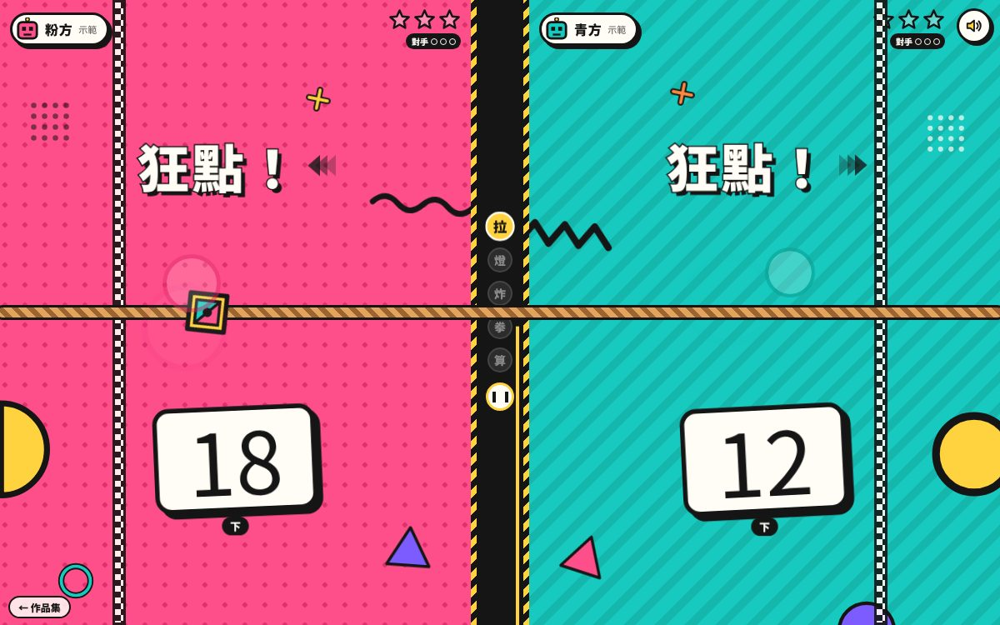

# 遊戲櫃 13 桌角對決

> [!NOTE]
> **這一頁是什麼**  
> [遊戲櫃](../README.md)第 13 個遊戲的完整開發紀錄：玩法、視覺、聲音、技術、取捨、測試與已知問題。內容由製作這個遊戲的 AI 代理在 2026-10-15 寫成，數字都對應目前的程式。
> - 線上玩：[https://echofrommoney-oss.github.io/game-cabinet/g13/](https://echofrommoney-oss.github.io/game-cabinet/g13/)（網址加 `?demo=1` 看精華）
> - 原始檔：`index.html`（要和根目錄的 `lib/` 一起用本機伺服器開，例如 `npm run dev`，直接雙擊可能載不到函式庫）

## 1. 一句話與作品集亮點
**一句話**：一支手機平放桌上，兩個人各占一頭，五個微型小遊戲輪流來，先拿 3 分的人贏。

**亮點**
- **面對面分割畫面**：直式時上半部整塊 `rotate(180deg)`，對面的人看到的是正的字；橫式（桌機）自動改成左右並排、不旋轉。同一份 DOM，只靠 CSS Grid 的 `grid-template-areas` 加上 `@media (min-aspect-ratio:1/1)` 切換。
- **真正的多點觸控**：用 Pointer Events，每個 `pointerId` 依照按下的位置（相對於中線）判斷是哪一邊，所以兩個人可以同時按。測試時用 CDP `Input.dispatchTouchEvent` 送出「一次 touchStart 帶兩個觸控點」驗證過。
- **孟菲斯（Memphis）視覺**：熱粉 vs 青綠兩個主色、黑粗框加硬陰影、圓點、斜紋、波浪線、三角形、半圓、黃黑斜紋的中線；勝利時逐字彈跳的大字、旋轉放射光圈、紙花。
- **一個人也能試玩**：有「和電腦對戰」（簡單／普通／困難，主要差在反應時間），`?demo=1` 直接開一場電腦對電腦的示範，打完交回標題畫面。
- 全部聲音都用 Web Audio 即時合成，沒有外部音檔。

## 2. 玩法與規則
**目標**：五個小遊戲隨機排序輪流上場，每贏一個小遊戲得 1 分（1 顆星），先拿 3 分的人贏得比賽。最多打 5 場。

每個小遊戲開始前，兩邊各自跳出一張介紹卡（第幾場、名稱、規則、怎麼操作），約 2.5 秒（示範模式 1.25 秒）。

| # | 小遊戲 | 規則 | 勝負 | 時間 |
|---|---|---|---|---|
| ① | 搶按 | 燈等 1.7–4.3 秒後隨機亮黃燈，燈亮後先按的人贏這把。45% 機率會先閃一次紅燈「還沒！」（0.48 秒）當陷阱。燈亮前（含紅燈時）按＝犯規，這把直接判對手贏。燈亮 3.5 秒都沒人按就重來 | 三戰兩勝（示範一戰定勝負） | 約 12–20 秒 |
| ② | 拔河 | 3-2-1 倒數後狂點，每點一下繩結往自己那邊移一格。淨差 16 格（示範 8 格）先過線就贏；12 秒（示範 4.5 秒）時間到時繩結偏哪邊就是誰贏；剛好在正中間進入「驟死賽」，下一下點的人贏 | 一局 | 約 15–18 秒 |
| ③ | 先按輸（膽小鬼） | 倒數後炸彈開始計時，按下＝收手，鎖定目前秒數。炸彈在 3.6–8.2 秒間隨機爆炸（示範 3.0–5.2），沒收手的人 0 分。分數＝收手的秒數，高的人贏；一邊爆掉另一邊自動贏。兩邊都爆或秒數一樣就換一顆重來。兩人都收手會立刻結算並公布炸彈原定秒數 | 一局 | 約 10–15 秒 |
| ④ | 猜拳 | 畫面喊「剪刀、石頭、布」（每拍 0.78 秒，示範 0.56），喊完前偷偷選，可以改。喊完同時揭曉。沒出拳的人輸；都沒出或平手就重來 | 三戰兩勝（示範一勝） | 約 12–20 秒 |
| ⑤ | 算數搶答 | 題目是二位數加減（例 37＋18、64−19）或九九乘法，三個選項（干擾項是答案 ±1、±2、±10，乘法用 ±a、±b）。先點對的人得 1 題；答錯這題被鎖住；兩邊都錯或 8 秒到就換下一題 | 先答對 3 題（示範 2 題） | 約 15–25 秒 |

**一場比賽**：實測（和普通電腦對打）約 55–90 秒；加上標題、看規則、再來一場，一輪體驗大約 3–5 分鐘。

**電腦難度參數**（`DIFF` 陣列）

| 參數 | 簡單 | 普通 | 困難 |
|---|---|---|---|
| 搶按反應時間 (ms) | 430–640 | 290–420 | 205–290 |
| 紅燈陷阱上當率 | 24% | 10% | 4% |
| 拔河點擊速度 (下/秒) | 5.2–6.6 | 6.8–8.2 | 8.6–10.2 |
| 炸彈收手時間 (ms) | 2000–4600 | 2800–5600 | 3300–6300 |
| 對手收手後立刻跟著收（必勝招） | 否 | 是 | 是 |
| 算數思考時間 (ms，乘法 ×0.85) | 2300–3300 | 1550–2400 | 1050–1650 |
| 算數答錯率 | 18% | 9% | 4% |
| 猜拳針對玩家最常出的拳 | 0% | 20% | 40% |

示範模式兩邊電腦隨機分到「普通」「困難」，讓比賽有起伏；第一場固定是拔河或搶按（最有畫面），算數思考時間 ×0.75。

## 3. 操作
**手機**：平放桌上，兩人各坐一頭，點自己那一半（上半部是轉過來給對面看的）。搶按／拔河／先按輸點半邊任何地方；猜拳、算數點自己那邊的選項。兩個人可以同時按。中線上的 ❚❚ 是暫停。觸控時會用 `navigator.vibrate` 做觸感回饋（點擊 12ms、犯規 70-40-140、炸到 200-60-200、得分 30-40-30、勝利 60-50-60-50-200），全部包在 try 裡。

**桌機**
- 粉方：主鍵 `A`（或左 Shift、空白鍵），選項 `A` `S` `D`
- 青方：主鍵 `L`（或右 Shift），選項 `J` `K` `L`
- `Esc` 暫停／繼續；也可以用滑鼠點
- 和電腦對戰時玩家是粉方
- 按住不放（key repeat）不算，拔河一定要真的連點

畫面底部的提示、介紹卡、選項角落的鍵帽，都只在 `(pointer: fine)` 的裝置才顯示鍵盤字母，手機上只寫「點這半邊」。

## 4. 視覺設計
**色票**

| 名稱 | HEX | 用途 |
|---|---|---|
| 熱粉 `--p0` | `#FF4F8B` | 粉方主色、半邊底色 |
| 深粉 `--p0d` | `#E02F6E` | 粉方圓點花紋、漣漪框 |
| 淺粉 `--p0l` | `#FFB3CE` | 粉方勝利放射光、標籤 |
| 青綠 `--p1` | `#17C9BE` | 青方主色、半邊底色 |
| 深青 `--p1d` | `#0C9F96` | 青方漣漪框 |
| 淺青 `--p1l` | `#A6F0EA` | 青方勝利放射光 |
| 黃 `--yel` | `#FFD23F` | 燈亮、星星、大字、中線斜紋、鍵帽 |
| 紫 `--pur` | `#7D5CFF` | 裝飾三角、石頭 |
| 橘 `--org` | `#FF8A3D` | 裝飾、剪刀握把、爆炸內圈 |
| 紅 `--red` | `#FF3B3B` | 紅燈陷阱、犯規、答錯 |
| 墨 `--ink` | `#151515` | 所有框線、硬陰影、中線 |
| 奶油 `--cream` | `#FFF4DB` | 標題畫面底色 |
| 紙白 `--paper` | `#FFFDF6` | 卡片、按鈕、標籤 |

**字型**：中文 `Noto Sans TC` 900/500（Google Fonts，fallback：Noto Sans CJK TC、PingFang TC、Microsoft JhengHei）；數字 `Bungee`（fallback Arial Black → 中文黑體）。標題 `clamp(66px,19vw,128px)`，勝利大字 `clamp(64px,21vmin,170px)`，倒數 `clamp(84px,26vmin,170px)`。

**質感做法**
- 粗黑框（3–6px）＋ 不模糊的硬陰影 `box-shadow: 8px 8px 0 #151515`。
- 大字＝黃色填色＋`-webkit-text-stroke: 4px` 黑邊＋`paint-order: stroke fill`（讓描邊在填色下面，字不會變細）＋ 6px 黑色 text-shadow。輸的一方反過來：黑字配紙白描邊、陰影用自己的深色。
- 粉方底紋：`radial-gradient` 圓點 24px 格；青方底紋：-45° 斜紋。兩者都 18 秒緩慢漂移。
- 每半邊放 6 個 SVG 幾何裝飾（半圓、波浪、三角、點陣、圓環、十字），兩邊配置不同。
- 中線：墨色底，上下（橫式為左右）各 7px 黃黑斜紋，中間五顆小遊戲圓章（進行中的是黃色彈跳，打完的塗上贏家顏色）。
- 拔河的繩子是 45° 兩色條紋＋黑框，終點線是黑白棋盤格 `conic-gradient`，繩結是黃色菱形內含粉青兩半。

**版面**：直式 `grid-template-rows: 1fr 58px 1fr`（上：青方、旋轉 180°；中：中線；下：粉方）。橫式 `grid-template-columns: 1fr 70px 1fr`（左粉、右青）。每半邊內部是「標頭（名牌＋自己的星星＋對手小圓點）／舞台／提示」三段 flex。

**動畫參數**
- 介紹卡進場 `.55s cubic-bezier(.2,1.5,.4,1)`，從 -14° 縮到 0.4 倍彈出；退場 `.3s ease-in` 往右飛出。
- 倒數數字 `.55s cubic-bezier(.2,1.7,.4,1)`，從 2.2 倍縮回，每拍 640ms（示範 430ms）。
- 大字逐字彈跳 `letterPop .65s cubic-bezier(.2,1.9,.4,1)`，每字延遲 55ms；勝利大字再接 1.1 秒來回 `bob`。
- 得分星星 `starPop .7s`，從 -90° 0.2 倍轉出。
- 紙花：Web Animations API，三段 keyframe（起點 → 35% 噴到最高 → 落下淡出），1.5–2.5 秒，`cubic-bezier(.2,.75,.35,1)`；上半部因為是倒著的，噴發與重力方向會反過來。勝利 140＋70 片，每場得分 36 片，畫面上限 260 個元素。
- 觸控漣漪：420ms，scale .3→1.6。
- 爆炸：畫面白閃 420ms＋整個 #app 晃動 380ms（16px）。
- `prefers-reduced-motion`：關掉底紋漂移、裝飾漂浮、燈的旋轉光、晃動，紙花降到 24 片，白閃降到 0.3。

## 5. 聲音設計（Web Audio 即時合成）
主音量 0.6 → DynamicsCompressor（threshold -14、ratio 4）→ 輸出。雜訊用 1 秒白雜訊 buffer 循環播放。所有包絡都是 exponential ramp（0.0001 → 峰值 → 0.0001）。

| 音效 | 合成方式 |
|---|---|
| 倒數嗶 | square 660Hz，130ms，音量 .11 |
| 開始 | square 988Hz ＋ triangle 1482Hz，340ms |
| 按下 | triangle 粉方 392→784Hz、青方 523→1046Hz 滑音 90ms ＋ 高通雜訊 30ms |
| 拔河一下 | square 240/300Hz（±10% 隨機）往下滑、lowpass 1800 ＋ bandpass 1600Hz 雜訊 35ms |
| 燈亮 | sine 1319/1760/2637Hz 錯開 18ms，550ms ＋ square 659Hz |
| 紅燈陷阱 | sawtooth 233Hz、lowpass 900，200ms |
| 犯規蜂鳴 | sawtooth 110Hz ＋ 117Hz（拍頻產生刺耳感）＋ square 55Hz，620ms，lowpass 1500/500 |
| 答錯 | sawtooth 196Hz → 165Hz 兩聲 |
| 得分 | square 784/1047/1319Hz 琶音，間隔 75ms |
| 介紹卡 | bandpass 雜訊 500→3500Hz 刷過 320ms ＋ triangle 330→660Hz |
| 猜拳喊拍 | square 523 / 587 / 784Hz |
| 揭曉 | lowpass 雜訊 180ms ＋ triangle 196→98Hz |
| 引信嘶嘶 | highpass 5000Hz 雜訊 50ms，間隔從 260ms 隨時間縮短到 60ms |
| 爆炸 | lowpass 雜訊 2400→50Hz 1.2 秒 ＋ sine 95→28Hz |
| 勝利號角 | C5-E5-G5-C6 square＋低八度 sawtooth 每 120ms 一音，接著 C 大三和弦 sawtooth＋微走音 square 長音 1.1 秒、triangle 131Hz 低音、高通雜訊「鈸」 |
| UI 點擊 | triangle 660→990Hz 60ms |

音訊在第一次 pointerdown/keydown 時才建立 AudioContext。右上角聲音開關存在 localStorage。

## 6. 技術架構
單一 `index.html`，沒有用任何 lib，純 DOM＋CSS 動畫＋Web Animations API。

- **遊戲時鐘** `S.T`：rAF 每幀加 `dt`（上限 50ms），暫停時不加。`after(ms, fn)` 把計時器排在遊戲時鐘上，所以暫停時所有倒數、電腦反應都會凍結。每個計時器綁定比賽 id `S.mid`，換場或回標題時舊的計時器自動作廢；小遊戲內部再用回合 token `tok` 防止上一回合殘留的計時器誤觸發。
- **小遊戲模組**：`mkDraw / mkTug / mkChicken / mkRps / mkMath` 各回傳 `{ start(), press(p, opt), update(dt), cleanup() }`。小遊戲決定勝者後呼叫 `finish(w)`，由比賽流程處理計分、星星、下一場或 `endMatch`。
- **畫面**：`setStages(p => html)` 對兩邊各渲染一次（同樣的內容，`p` 決定「你／對手」與鍵帽字母），旋轉由外層 CSS 處理，所以小遊戲程式完全不用管方向。
- **輸入**：
  - `pointerdown`（`passive:false`、`preventDefault`）→ `sideOf(x, y)` 用中線的 `getBoundingClientRect()` 判斷：直式看 y 在中線上或下，橫式看 x 在中線左或右；落在中線上就忽略。`pointerId → 邊` 存在 Map 裡。若按在 `[data-opt]` 選項上，且選項屬於同一邊，就帶入選項編號。
  - `keydown` 對應表 `KEYS`，忽略 `e.repeat`。
  - `human(p, opt)` 會擋掉電腦那一邊、暫停中、或沒有小遊戲進行時的輸入。
- **電腦**：`cpu(p, opt)` 和人類走同一條 `press` 路徑，並在電腦那邊畫漣漪、讓舞台震一下，看起來像有人在點。
- **拔河繩**：`#rope` 是蓋在整個 `#app` 上的層，`placeRope(v)` 依直式／橫式換算繩子、終點線與繩結位置（繩結位置以 `kv += (target - kv) * min(1, dt/70)` 平滑追蹤）。
- **暫停**：除了停遊戲時鐘，還把 `#app`、`#fx` 底下正在跑的 Web/CSS 動畫 `pause()`，繼續時只 `play()` 被自己暫停的那些（避免把已結束的進場動畫重播）。切到背景分頁（`visibilitychange`）自動暫停。
- **存檔**：`localStorage['g13-desk-duel-v1']` = `{sound, diff, rec:[[勝,敗]×3 難度], pvp:[粉勝, 青勝], played}`，讀寫都包 try/catch。
- **測試窗口**：`window.__g13.state` 提供 screen、score、key、presses（各邊有效輸入次數）、log 等。

## 7. 取捨與原因（對照原企劃）
- **橫式改成左右並排、不旋轉**：企劃寫的是「上半部旋轉 180 度」，這在手機直放桌上最對。但桌機橫螢幕通常是一個人（或兩人並肩）看，倒過來的字反而難讀，所以橫式改成左右各一邊，A 在左、L 在右，跟鍵盤位置一致。
- **猜拳與算數需要三個選項**：一個鍵不夠，所以桌機改成每人三個鍵（A S D / J K L），主鍵 A 與 L 剛好分別是兩組的一員，好記。
- **猜拳的「秘密」**：手機上對面的人離得遠、字是倒的，所以只有自己那邊會亮起選擇；電腦那邊選了也不顯示，避免玩家偷看。
- **先按輸的電腦策略**：這個遊戲的關鍵是「後收手的一定贏（只要沒爆）」，所以普通與困難電腦在對手收手後 160–380ms 也收手；簡單電腦只照自己的膽量收手，讓新手有機會。
- **一場的長度**：每個小遊戲 10–25 秒，比企劃的 15–30 秒略快，因為實測節奏快比較有派對感；一場比賽 1–1.5 分鐘，連打兩三場剛好 3–5 分鐘。
- **沒有用 lib**：全部都是 DOM 元素與 CSS 動畫，載入快，文字在旋轉後依然銳利。

## 8. 測試結果
`node g13/test.mjs`（Playwright、port 8113、Google Fonts 以空樣式表代替）：**19/19 通過**。
- 1440×900 和電腦（普通）對戰：用鍵盤自動玩完整場（搶按等燈亮才按、拔河連按、炸彈 2.6 秒收手、猜拳隨機、算數算出正確答案按對應鍵），比數 3:2 左右，約 60–90 秒；Esc 暫停／繼續正常，暫停後介紹卡會正常收起；戰績寫進 localStorage；console error＝0。
- 375×812（isMobile、hasTouch）雙人對戰：用 CDP `Input.dispatchTouchEvent` 一次送出上下兩個觸控點，確認兩邊的輸入計數在同一次觸控中各 +1；打完整場；沒有橫向溢出；console error＝0。
- `?demo=1`：直接進入電腦對電腦，10 秒內有得分，打完約 40–80 秒後回到標題並顯示「示範結束，換你上場！」。
- 截圖檢查（`g13/shots/`）：標題、介紹卡、五個小遊戲、勝利畫面、結果卡在兩種尺寸下都沒有破版或被切的字。修過的問題：勝利大字的 class 名 `big` 跟標題按鈕撞名（多出一個大框）→ 改名 `huge`；暫停時對所有動畫呼叫 `play()` 讓介紹卡重播而不消失 → 只恢復自己暫停的；猜拳喊拍的「、」描邊後像怪符號 → 拿掉；拔河終點線壓到名牌 → 改用比例；勝利畫面的白字在白燈上看不清 → 換成放射光背景、輸的一方改黑字。

## 9. 已知問題與下一步
- 手機橫放時是左右並排但不旋轉，兩人坐在手機長邊的兩側時文字是側的；可加一個「面對面／並肩」切換。
- 電腦只有一種人格，可加入「愛賭」「保守」等不同先按輸策略。
- 拔河在兩個真人同時狂點時，手機瀏覽器對大量同時觸控的上限（多數 5–10 點）以外沒有額外處理。
- 結果卡在直式畫面只朝向粉方；青方靠自己那半的大字知道結果，但按鈕是倒著的。
- 可以再加小遊戲（例如「找不同顏色」「節拍」），`GAMES` 表加一筆即可。

## 10. 可以重複利用的做法
- **面對面雙人版面**：CSS Grid areas ＋ 一個 `rotate(180deg)`，加 `min-aspect-ratio` 切換左右並排；遊戲邏輯只寫一次，用 `setStages(p => ...)` 渲染兩次。
- **依位置分邊的多點觸控**：pointerdown ＋ 中線 rect 判斷，`pointerId` 存 Map；測試用 CDP 一次送多個 touchPoints。
- **可暫停的遊戲時鐘排程器**：`after(ms, fn)` 綁在自己的時間軸，再加比賽 id 與回合 token 作廢舊計時器，暫停/切分頁/重開都不會有幽靈事件。
- **暫停 CSS 動畫**：`document.getAnimations()` 篩出自己範圍內 running 的動畫暫停，恢復時只播放那一批。
- **孟菲斯大字**：`-webkit-text-stroke` ＋ `paint-order: stroke fill` ＋ 硬 text-shadow，逐字 span 加 `--i` 變數做錯開彈跳。
- **紙花**：Web Animations API 三段 keyframe 模擬拋物線，元素數量設上限、動畫結束自動 remove。
- **電腦對手與人類共用輸入路徑**：`cpu()` 呼叫跟人類一樣的 `press()`，難度只是一組數字表。
