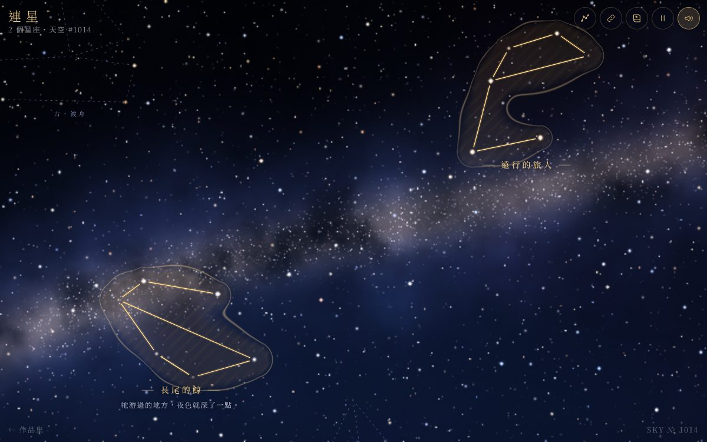

# 遊戲櫃 14 連星

> [!NOTE]
> **這一頁是什麼**  
> [遊戲櫃](../README.md)第 14 個遊戲的完整開發紀錄：玩法、視覺、聲音、技術、取捨、測試與已知問題。內容由製作這個遊戲的 AI 代理在 2026-10-15 寫成，數字都對應目前的程式。
> - 線上玩：[https://echofrommoney-oss.github.io/game-cabinet/g14/](https://echofrommoney-oss.github.io/game-cabinet/g14/)（網址加 `?demo=1` 看精華）
> - 原始檔：`index.html`（要和根目錄的 `lib/` 一起用本機伺服器開，例如 `npm run dev`，直接雙擊可能載不到函式庫）

## 1. 一句話與作品集亮點

**在夜空裡點星星連線，連出只屬於你的星座，幫它取名、寫一句神話，再把整片星空編進網址送給別人。**

亮點：
- WebGL 粒子星空：約 1.1 萬顆點精靈（1,000 顆可連的星＋背景星＋銀河星），閃爍、色溫、繞射十字都在 shader 裡算，加法混合。
- 「星座圖像」：用每條連線的高斯距離場加總、取等值線，畫出像古星圖那樣有金邊、淡淡斜線陰影的輪廓（不是凸包，會隨連線長出「身體」形狀）。
- 確定性星空：同一個種子（SKY № 1014）永遠是同一片天；可「換一片新天空」，種子跟著分享網址走。
- 無後端分享：所有星座（星星編號＋名字＋神話）用 bit packing 壓成 base64url 寫進 `#s=`；兩個中文星座約 170 字元。
- 古人的星座比較：三個自創古星座，用「線段取樣 → 正規化 → 72 個角度 × 鏡像 → 雙向 Chamfer 距離」算形狀相似度。
- 聲音全部即時合成：鐘琴（非諧波泛音 1 : 2.756 : 5.404 : 8.93）依星星高度與亮度對應五聲音階；完成時和弦＋整個星座「自己唱一遍」。

## 2. 玩法與規則

- **目標**：沒有輸贏。想連幾個星座就連幾個，想像力就是全部的「分數」。
- **連線規則**：
  - 點一顆星開始；再點別顆星就連一條線（序列式，可以回到已經點過的星，形成分岔或封閉圖形）。
  - 不重複的星最少 3 顆、最多 12 顆；序列最多 30 步（受網址編碼位元數限制）。
  - 點「最後一顆星」或按「完成」（Enter）→ 命名視窗。少於 3 顆會提示「至少要連 3 顆星」。
  - 復原（Backspace / Ctrl+Z / U）、取消（Delete / 按鈕）。
- **命名**：名字最多 12 字、神話最多 40 字；「幫我想一個」從 16 個形容詞 × 20 個名詞與 8 句神話模板隨機組合（使用者自己打過名字就只換神話）。空白直接按「點亮它」會自動取名。
- **完成效果**：連線 2.8 秒內從淡白（#D7E1FF）漸變為金（#F5CD82）、一顆光點沿連線跑過、星星變亮變金、星座圖像淡入並「呼吸」、名字與神話浮現、和弦。約 1.6 秒後提示「形狀和古人的『○○』有 xx% 像」。
- **相似度公式**：`score = round(100 · exp(-(d / 0.19)²))`，d 為最佳旋轉/鏡像下的雙向平均 Chamfer 距離（正規化座標）。校準結果：完全相同 d=0 → 100%；移動一顆星的近似形 d≈0.06–0.14 → 60–90%；隨機形狀與三個古星座取最佳 d≈0.14–0.27 → 約 15–55%。
- **星座卡**：點星座名字開啟，可讀神話、看最像哪個古星座，或「讓它回到夜裡」（刪除，1.2 秒淡出）。
- **結束畫面「今晚的星空」**：星座數、用了幾顆星、最高相似度、全天星圖（SVG）、每個星座的神話、分享連結框、分享／繼續連星／換一片新天空（需再按一次確認）。
- **節奏（3–5 分鐘一輪）**：看開場示範 → 連 2–4 個星座 → 比古人 → 分享。

## 3. 操作

| 動作 | 桌機 | 手機 |
|---|---|---|
| 連星 | 滑鼠點星（判定半徑 20px，亮星略優先）| 點星（判定半徑 30px）|
| 完成 | 點最後一顆星 / Enter / 「完成」按鈕 | 點最後一顆星 / 按鈕 |
| 復原 / 取消 | Backspace、Ctrl+Z、U / Delete | 按鈕 |
| 平移 | 拖曳（放開有慣性）、方向鍵 | 單指拖曳 |
| 縮放 | 滾輪、+ / - | 雙指捏合 |
| 暫停 | Esc / 右上暫停鈕 | 暫停鈕 |
| 視差 | 滑鼠位置帶動遠景（±13px）| 傾斜裝置（DeviceOrientation；iOS 需按「傾斜視差」授權，拒絕也能玩）|

拖曳判定：移動超過 6px（觸控 10px）才算拖曳，否則視為點擊。

## 4. 視覺設計

### 色票

| HEX | 用途 |
|---|---|
| `#02040C` | 頁面底色 / theme-color |
| `#020308`→`#081129`→`#0D1F45` 系 | 天空漸層（shader：頂 vec3(.006,.010,.030) → 底 vec3(.030,.066,.155)＋地平微光）|
| `#4D61B8` / `#DBB894` | 銀河外圈藍 / 核心暖色（shader 中 vec3(.30,.38,.72)、vec3(.86,.72,.58)）|
| `#F2CF86` | 主金色：標題、按鈕框、完成連線 |
| `#D9A648` | 深金：按鈕漸層、進度條起點 |
| `#F7E2AD` | 大標題「連星」 |
| `#F6D692` | 星座名字（畫在 canvas）|
| `#FFD696` 系 | 星座圖像：內部光暈、金邊、斜線陰影 |
| `#E9ECF8` / 64% / 38% | 主文字 / 次文字 / 淡文字 |
| `#AEBDFF` | 古人的星座（銀藍虛線）|
| `rgba(8,13,32,.78)` | 面板玻璃底（backdrop-filter blur 14px）|
| 星星色溫 6 種 | `#9EB8FF` 10%、`#CCDBFF` 20%、`#FFFFFF` 28%、`#FFF2DB` 20%、`#FFD6A3` 14%、`#FFB380` 8% |

### 字型
- 中文：Noto Serif TC（Google Fonts，300/400/500）→ fallback Noto Serif CJK TC、Source Han Serif TC、Songti TC、PMingLiU、serif。
- 英文點綴：Cormorant Garamond（300/400/500/italic）。
- 大標題 clamp(64px, 15vw, 112px)、字距 .42em、weight 300、金色雙層 text-shadow 光暈；副標 STELLAR THREADS 14px 字距 .62em。
- 星座名字：canvas 500 weight、`17px × zoom`（夾在 14–24px）、字距 0.3em，兩側各一條 20px 金色細線；神話 12.5px × zoom（11.5–16px）。

### 質感做法
- **星星 shader**：核心 `exp(-d²·k)`，k 依點精靈大小在 3–30 之間插值（小星不會暗到看不見）；光暈 `exp(-5d)·0.32`；亮星（b>0.5）加繞射十字；閃爍 `1 + 0.38·(0.6·sin(t·ω+φ) + 0.4·sin(2.37·t·ω+1.7φ))`。
- **銀河**：開場用 6 層 fbm 烘焙到 2048×1366 貼圖（手機 1536×1024），帶狀高斯＋核心暖光＋暗塵帶（第三組 fbm 的 smoothstep 遮罩）＋兩團極淡星雲；之後每格只取樣一次。
- **三層視差**：銀河/銀河星層 0.55、遠星層 0.75、可連星層 1.0（拖曳時移動比例）；傾斜/滑鼠只位移遠景（乘 1−par），所以可點的星不會在手指下跑掉。
- **星座圖像**：在星座包圍盒（外擴 110 世界單位、每像素 1.6 單位）逐像素計算 `f = Σ exp(-(dist/σ)²)`（σ = 30+0.1·線長，且中段 ×1.3 較豐滿）＋每顆星 0.55 的小高斯；`inside = smoothstep(.35,.95,f)`、`rim = exp(-((f-.45)/.028)²)`、斜線陰影 `sin((x+y)·0.19)>.55`；alpha = inside·.12 + rim·.5 + hatch·.035。每個星座只算一次快取成 canvas，以 `lighter` 疊加。
- 連線在星點前後各留 8px 空隙（古星圖風格），底下再疊一條 4.5px、14% 的光暈線。

### 版面
- 左上：品牌「連星」＋「n 個星座・天空 #1014」；右上：古人的星座、分享、今晚的星空、暫停、聲音（最右）。
- 下方中央：情境提示文字＋連線時的「復原／取消／完成 n/12」；左下「← 遊戲櫃」；右下 SKY № 種子（手機改為「傾斜視差」鈕，限 iOS）。
- Toast 在上方（避開下方的星座名字）；分享模式下移到橫幅下方。

### 動畫時間
| 動畫 | 時間 / 緩動 |
|---|---|
| 完成星座 prog 0→1 | 2.8s 線性；顏色用 easeOutCubic(prog×1.4)；圖像 smoothstep(.25,1)；名字 smoothstep(.35,.8) |
| 沿線光點 | prog 0–0.75，easeOutCubic |
| 圖像呼吸 | alpha × (0.86+0.14·sin(0.7t)) |
| 鏡頭飛行 | 1.4–1.8s easeInOutCubic；reduced motion 0.35s |
| 拖曳慣性 | 每秒衰減至 4%（`0.04^dt`）|
| 面板出現 | 0.55s cubic-bezier(.2,.8,.2,1) 上浮 16px |
| 漣漪 | 1.1s easeOut，一般 6→32px，完成時 10→70px |
| 流星 | 每 7–16 秒（demo 3–7 秒），0.7–1.2 秒，速度 700–1200px/s |

## 5. 聲音設計（Web Audio 即時合成）

- **主匯流排**：master gain 0.85 → DynamicsCompressor(threshold −16dB, ratio 3)；另有 ConvolverNode 殘響（3.8 秒雙聲道噪音、(1−t)^2.6 衰減、前 200 樣本淡入），wet 0.5。
- **鐘琴（點星）**：4 個 sine 泛音 `[倍率, 音量, 衰減秒]` = `[1, .20, 2.4] [2.756, .07, .55] [5.404, .035, .18] [8.93, .012, .08]`，3ms 起音、指數衰減；55% 送殘響。音高：螢幕高度切 8 段 → C 大調五聲音階（C D E G A）跨約 1.6 個八度，從 C4（261.63Hz）起；亮度 > 0.45 的星再高一個八度；音量 0.7+0.5×亮度。
- **完成和弦**：半音 [0, 7, 14, 16, 21]（C G D E A，Cadd9/6），每音 2 個 triangle（±7 cents）→ lowpass 600→2200→900Hz；包絡 0.7s 起、維持到 45%、5.2s 指數收尾，音量 0.045；同時每顆星依序（間隔 0.13s）再敲一次高八度鐘琴。
- **環境音墊**：C2 / G2 sawtooth＋C3 / G3 triangle＋D4 sine → lowpass 380Hz（0.045Hz LFO ±150Hz）；加一條 bandpass 650Hz 的噪音「風」（0.07Hz LFO 調音量）；整體 5 秒淡入到 0.05，暫停時降到 0.015。另每 5–12 秒隨機一個高兩個八度的極輕鐘琴（0.12）像遠處的星在響。
- **流星**：白噪音 → bandpass Q4 從 5200 掃到 900Hz（0.9s），音量 0.035。
- **UI**：tick = sine 700–1800Hz、60ms、0.03；復原/錯誤 bloop = sine 330→220Hz、0.25s。
- 第一次 pointerdown / keydown 才建立 AudioContext；分頁隱藏時 suspend。

## 6. 技術架構

單一 `index.html`（約 97KB），ES module，import Three.js r174（`../lib/three.module.min.js`）。

- **importmap 補丁**：共用的 `lib/three.module.min.js`（r174）會 `import './three.core.min.js'`，但 lib 裡沒有這個檔。依 SPEC 只能寫 `lib/three-addons/`，所以把 `node_modules/three/build/three.core.min.js` 複製到 `lib/three-addons/three.core.min.js`，並在 importmap 加一條 URL 重導：`"../lib/three.core.min.js": "../lib/three-addons/three.core.min.js"`。其他用 Three 的遊戲也可以照做。
- **主要模組（同檔分區）**：
  - `mulberry32` 確定性亂數；`genStars(seed)`：格子加速的 dart throwing（最小距離 62、上限 1000 顆、40,000 次嘗試），銀河附近較密；亮度 `b = rand^2.6`。
  - `buildAncients()`：把 3 個古星座的模板點（−1..1）放到固定天區，吸附到最近（且偏亮）的星。
  - `shapeSamples / chamfer / similarity`：相似度（見第 2 節）。
  - `BitW / BitR / encodeSky / decodeSky`：網址編碼。格式：版本 4 bit、種子 16 bit、星座數 5 bit；每個星座：序列長 5 bit、每顆星 10 bit、名字長 4 bit、神話長 6 bit；每個字元 1 bit 旗標＋ASCII 7 bit 或 BMP 16 bit（中文比 UTF-8 省 1/3）。最後轉 base64url。
  - `buildScene()`：背景全螢幕三角形（ShaderMaterial）＋3 個 `THREE.Points`；vertex shader 直接把世界座標轉 clip space（不用相機矩陣），uniform 共用 `uCam / uZoom / uRes / uTilt / uTime / uDpr`。可連星層有動態 `aBoost` 屬性（草稿 0.7、完成 0.35–0.8、懸停 0.55）讓星變大變金。
  - `buildFigure(seq)`：星座圖像距離場（見第 4 節）。
  - 2D overlay canvas：連線、名字、漣漪、粒子（上限 420）、流星、古星座虛線。標籤做碰撞位移（最多 6 次往下推）並夾在螢幕內。
  - 狀態機：`title / play / paused / naming / modal`。
  - 展示腳本：`gwait(ms)` 以遊戲時間計時（暫停時也會停），`demoToken` 遞增即可取消；虛擬游標 `#ghost` 依世界座標移動。
- **效能**：DPR 上限 2；**自動降解析度**：每 1.2 秒量平均幀時，超過 25ms 就把 WebGL 像素比 ×0.7（最低 0.5）；銀河只烘焙一次；手機減量（遠星 4,200、銀河星 3,000，桌機 6,400 / 4,200）；分頁隱藏時停止 rAF 並暫停。
- **存檔**：`localStorage['g14.sky'] = {seed, cons:[{seq,name,myth}]}`、`g14.muted`；全部 try/catch。
- **分享模式**：開啟 `#s=…` 時不寫入 localStorage，上方橫幅提供「收下這片星空」（覆寫成自己的）/「回到我的天空」。壞掉的連結會提示並回到自己的天空。
- 測試用鉤子：`window.__g14`（state / visibleStars / starScreen / shareURL / decodeSky / simTest / simRaw / frameAll）。

## 7. 取捨與原因（對照原企劃）

- **星座圖像**：企劃說「沿連線生成柔和光暈形狀」。一開始想用凸包＋Catmull-Rom，但凸包會把所有形狀都變成圓餅；改用距離場等值線，形狀會跟著線長出「手腳」，比較像在「推想」圖像。加了極淡斜線陰影模仿古星圖版畫。
- **連線是序列不是任意圖**：編碼最短、操作最直覺（一路點下去）；要分岔就點回之前的星。
- **銀河改成烘焙貼圖**：原本每格算 5 組 fbm，軟體算繪只有 2 fps，手機 GPU 也有風險。烘焙後效果一樣、每格只剩一次取樣。
- **傾斜只動遠景**：如果可點的星也跟著晃，手機上很難點準；只讓遠景動，視差感仍在。
- **分享不用 CompressionStream**：短的中文字串 deflate 幾乎沒效果，而且是非同步；自訂位元格式＋16 bit 中文更短也更穩。
- **開場示範**：一般模式在標題畫面背後自動連出「遠行的旅人」並命名（開始後淡出，不佔你的天空）；`?demo=1` 直接進遊戲，虛擬游標連第一個星座、打字命名、點亮，飛到第二個區域連「長尾的鯨」，打開古人的星座比較，拉遠看全景，最後展示「今晚的星空」。
- **結束畫面**：沒有輸贏，所以「今晚的星空」以星座數、星數、最像古人的百分比當作結局統計。

## 8. 測試結果

`node g14/test.mjs`（Playwright、headless Chromium、SwiftShader 軟體 WebGL、本機 node http 伺服器 port 8114、Google Fonts 以空樣式表代替）：**39/39 通過**，約 210 秒。

- 桌機 1440×900：標題 → 開始 → 滑鼠點 5 顆星 → 點最後一顆開命名 → 輸入名字神話 → 點亮；拖曳平移（相機移動 >100 單位）；Backspace 復原與取消；第二個星座用「完成」＋「幫我想一個」；滾輪縮放；超過 15 秒後確認 2 個星座；古人的星座面板顯示 3 個百分比；Esc 暫停；今晚的星空；分享網址 170 字元、decode 後名字與星序完全一致；localStorage 有存；console / pageerror 0。
- 分享網址：新瀏覽器環境開啟 → 標題顯示「有人送你一片星空：『測試的鯨』『…』共 2 個星座」→ 按「看這片星空」→ 9/9 顆星都在畫面內、星座金色發光、橫幅出現、0 錯誤。
- 手機 375×812（isMobile、hasTouch、DPR 2）：觸控點 4 顆星、命名、點亮；CDP 觸控拖曳平移；古人面板與結束畫面版面正常；scrollWidth = 375（無水平捲動）；0 錯誤。
- `?demo=1`：10 秒時已在自動連線（虛擬游標）；之後「遠行的旅人」命名完成；手機 demo 0 錯誤。
- `prefers-reduced-motion: reduce`：可完整連一個星座（動畫縮短為 0.6 秒）、0 錯誤。
- 截圖觀察：天空層次（遠星、色溫、銀河塵帶）清楚；金色連線＋光暈輪廓辨識度高；面板文字無截斷。修正過的問題：示範星座壓到標題字（改放右上空處）、虛擬游標的按壓動畫蓋掉 translate（改用內層元素）、兩個相近星座名字重疊（加標籤避讓）、神話文字超出螢幕（夾在畫面內）、句號單獨一行（避頭點規則）、toast 擋到星座名字（移到上方）、小星星太暗（核心銳利度依大小調整）。

## 9. 已知問題與下一步

- 軟體算繪（無 GPU 的 headless）只有 7–18 fps，靠自動降解析度撐住；真機 GPU 應無問題，但沒有在實體 iPhone / Android 上量過。
- 傾斜視差在 iOS 需按鈕授權，桌機無法實測，只測了「不支援也能玩」的路徑。
- `navigator.share` 只在觸控裝置使用；剪貼簿被拒時改顯示可選取的連結框。
- 序列最多 30 步、名字 12 字、神話 40 字、星座 31 個（編碼位元限制）。
- 下一步：星座圖像可以加入依形狀挑選的「圖騰」（例如用相似度把輪廓配到鯨、鳥、船的筆刷）；分享時產生一張 PNG 卡片；季節/時間讓星空慢慢旋轉。

## 10. 可以重複利用到其他專案的做法

- **不用相機矩陣的 2D WebGL 點精靈**：vertex shader 直接 `(world − cam·par)·zoom + res/2` → clip，多層視差只差一個 uniform。
- **重 fbm 背景先烘焙到 RenderTarget**，每格只取樣（行動裝置與軟體算繪都受惠）。
- **自動降解析度**：量 1.2 秒平均幀時，慢就 `setPixelRatio ×0.7`。
- **距離場等值線畫「有機輪廓」**：任何線條/路徑都能長出柔和外框（地圖區域、技能樹、手寫筆畫光暈）。
- **形狀相似度**：線段等距取樣 → 置中、RMS 正規化 → 旋轉×鏡像暴力搜尋 → 雙向 Chamfer；再用 `exp(-(d/σ)²)` 校準成百分比。
- **網址 hash 位元編碼**：BitWriter＋「ASCII 7 bit / BMP 16 bit」文字編碼，中文短句比 UTF-8 base64 省約 1/3；無後端就能分享狀態。
- **三方 lib 缺依賴時用 importmap 做 URL 重導**，不必改動共用檔案。
- **遊戲時間計時的腳本協程**（`await gwait(ms)`＋token 取消），做展示模式、教學、過場都方便。
- 鐘琴合成泛音比例 1 : 2.756 : 5.404 : 8.93 ＋ 五聲音階映射，任何「點擊即音樂」的互動都好聽。
