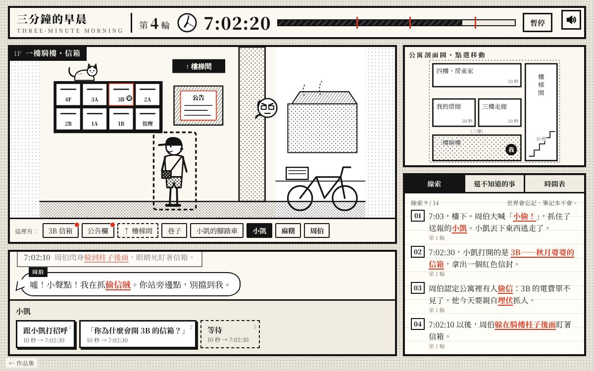

# 遊戲櫃 15 三分鐘的早晨（長篇）

> [!NOTE]
> **這一頁是什麼**  
> [遊戲櫃](../README.md)第 15 個遊戲的完整開發紀錄：玩法、視覺、聲音、技術、取捨、測試與已知問題。內容由製作這個遊戲的 AI 代理在 2026-10-15 寫成，數字都對應目前的程式。
> - 線上玩：[https://echofrommoney-oss.github.io/game-cabinet/g15/](https://echofrommoney-oss.github.io/game-cabinet/g15/)（網址加 `?demo=1` 看精華）
> - 原始檔：`index.html`（要和根目錄的 `lib/` 一起用本機伺服器開，例如 `npm run dev`，直接雙擊可能載不到函式庫）

## 1. 一句話與作品集亮點
**一句話**：鬧鐘響後只有三分鐘，7:03 樓下會發生一場誤會；世界每輪重置，但你的筆記本不會。

亮點：
- **知識即進度**：沒有道具欄、沒有經驗值，唯一跨輪保留的是「你知道了什麼」。核心設計刻意讓關鍵知識（小凱今天最後一天）在同一輪內「拿到也來不及用」，強迫玩家用筆記本把它帶到下一輪。
- **黑白漫畫分格 UI**：DOM 分格版面＋SVG 線稿＋SVG pattern 網點紙＋粗黑框＋手寫字對白框；整個畫面只有**朱紅 #D7361F** 一個顏色，而且只用在「已知線索」與紅包上。
- **兩份狀態**：`S`（存檔／知識，跨輪）與 `W`（世界，每輪 `freshWorld()` 重置），乾淨分離。
- **自動整理的「還不知道的事」**：依知識圖自動列出下一個問題與可展開提示，玩家永遠知道下一步該往哪查。
- **時間表筆記**：玩家親眼看到某人時自動寫入「角色 × 10 秒格」表格，變成玩家自己畫出來的事件時間軸。
- **翻頁重來**：每輪結束是漫畫頁倒翻回「第 N 輪」章節頁，配合翻頁雜訊掃頻音效與鬧鐘聲。

## 2. 玩法與規則
- **目標**：在 7:03 之前改變局面，讓誤會不再發生；最好的結果是婆婆親手把紅包交給小凱。
- **時間**：每輪 180 秒（7:00:00–7:03:00）。時間只在行動時前進（回合制），每個行動有固定秒數。
- **勝負**：沒有失敗，只有「重來」。t=180 時依下表判定；循環結局 → 翻頁進入下一輪；普通／好結局 → 結局畫面（普通結局可選「再過一次這個早晨」繼續追求好結局）。
- **計分**：不計分；結局畫面顯示「使用輪數、線索 n/14、總行動數」，並記錄已解鎖的結局徽章。
- **難度曲線**：第 1 輪自然看到事件 → 第 2–4 輪拼出「誰、為什麼」→ 第 5–8 輪拼出密碼／紙箱／燈泡 → 最後一輪要把所有事在 180 秒內排進同一條路線（約 45 秒餘裕）。實測最短知道答案時 3 輪可破；一般玩家約 6–10 輪、10–20 分鐘。

### 劇本：事件 × 時間 × 觸發條件表
（實作前先寫好並檢查漏洞，實作完全照此表）

t = 鬧鐘響後的秒數（0 = 7:00:00，180 = 7:03:00）。時間只在玩家行動時前進。

### 地點與移動
| 地點 id | 名稱 | 相鄰 |
|---|---|---|
| room | 我的房間（3A） | hall |
| hall | 三樓走廊（3B 秋月婆婆家門口） | room, stair |
| stair | 樓梯間 | hall, top, lobby |
| top | 四樓・房東家門口 | stair |
| lobby | 一樓騎樓・信箱 | stair |

移動每一格 10 秒（可多格自動走，逐格模擬）。調查 5 秒、拿取 5 秒、對話 10 秒、換燈泡 10 秒、轉信箱密碼 5 秒、等待 10 秒。

### 角色時間表（世界預設，不被玩家干擾時）
| 角色 | 0–60 | 60–100 | 100–120 | 120–130 | 130–150 | 150–180 | 180 |
|---|---|---|---|---|---|---|---|
| 秋月婆婆 | 3B 家中（敲門可談） | 家中 | 家中 | 走廊澆花 | 走廊澆花 | 樓梯間窗口看小凱 | 目睹誤會 |
| 周伯（房東） | 4F 家中（敲門可談） | 家中 | 樓梯間（下樓） | 樓梯間 | 騎樓柱子後埋伏 | 埋伏 | 衝出喊「小偷」 |
| 小凱（送報） | 不在 | 街上騎來（從房間窗戶看得到） | 街上 | 抵達騎樓送報 | 騎樓 | t=150 開 3B 信箱拿紅包 | 被抓 |
| 麻糬（貓） | 樓梯底下紙箱窩（不讓人碰） | 走廊 | 走廊 | 騎樓信箱上 | 騎樓 | 騎樓 | — |

### 世界狀態（每輪重置）
| 狀態 | 初始 | 改變條件 |
|---|---|---|
| items.bulb | false | room 抽屜「拿燈泡」 |
| lightFixed | false | 持有燈泡，在 stair 換燈泡 |
| items.bill | false | t ≥ 60（貓離窩）在 stair 搜紙箱窩 |
| landlordSuspicious | true | 持有電費單，對周伯（任何地點）出示 |
| giftInBox | true | 玩家用 0815 開 3B 信箱並拿走；或小凱 t=150 拿走 |
| items.gift | false | 玩家拿走紅包 |
| kaiGotGift | false | 玩家在 lobby 把紅包交給小凱（t ≥ 120） |
| kaiOpened | false | t=150 時小凱在 lobby、kaiGotGift=false、婆婆不在 lobby → true |
| grandmaDepart | null | 對婆婆說「小凱今天最後一天」：需知識 lastday + secret，且本輪 lightFixed；否則她說樓梯太暗（得到 light 線索） |

婆婆出發後的路程：從家/走廊出發 → 15 秒後在樓梯間 → 45 秒後到騎樓；從樓梯間出發 → 30 秒到騎樓。要在 t=180 前到 → 最晚 t=135 從三樓出發。

### t = 180 的判定（依序）
| 條件 | 結果 |
|---|---|
| 婆婆在 lobby 且 周伯仍懷疑 | 循環：「騙錢誤會」— 周伯以為小凱騙老人家的錢（得到 scam 線索）→ 重來 |
| 婆婆在 lobby 且 周伯不懷疑 | **好結局「早安，小凱」** |
| 周伯懷疑 且 小凱開了信箱（不論有沒有拿到紅包） | 循環：「小偷誤會」→ 重來 |
| 其餘（周伯不懷疑，或小凱已直接從玩家手上拿到紅包） | **普通結局「平靜的早晨」**（兩種變體：calm / handed） |

### 知識（跨輪保留）與取得方式
| id | 內容 | 取得方式 | 前置 |
|---|---|---|---|
| event | 7:03 樓下周伯喊小偷抓小凱 | 第一次走到 t=180 | 無 |
| mailbox | 小凱開的是 3B 信箱 | t=150 或 180 時人在 lobby／stair | 無 |
| suspect | 周伯認定有人偷 3B 的信 | 敲 4F 門談話（t<100）、與在 stair/lobby 的周伯談話、讀 lobby 公告欄 | 無 |
| hiding | 7:02:10 後周伯躲在柱子後 | t ≥ 130 從房間窗戶看、或在 lobby 看到 | 無 |
| nest | 信是麻糬叼走的，窩在樓梯下 | t ≥ 60 搜 stair 紙箱窩 | 無（t<60 貓哈氣） |
| codehint | 密碼是老伴生日 | 問婆婆「信箱的事」 | mailbox 或 suspect |
| birthday | 老伴生日 8/15 | 調查走廊花台照片 | 無 |
| （推導）code | 0815 | 自動：codehint + birthday | — |
| gift | 3B 信箱裡有飯糰紅包字條 | lobby 開 3B 信箱（玩家自行轉 0815；不知道密碼也可以亂試） | 正確密碼 |
| secret | 早餐是婆婆準備的 | 問婆婆「信箱裡的飯糰」 | gift |
| lastday | 今天是小凱最後一天送報 | t ≥ 120 在 lobby 和小凱說話，或看他的腳踏車 | 無 |
| light | 樓梯燈壞了婆婆不敢下樓 | 調查樓梯燈，或對婆婆說最後一天但燈沒修 | 無 |
| bulb | 抽屜有備用燈泡 | 調查/拿房間抽屜 | 無 |
| scam | 婆婆在場周伯仍會誤會 | 發生「騙錢誤會」循環 | — |

### 漏洞檢查
1. **好結局可達性**（已知全部知識時的最短路線）：0 拿燈泡(5) → 走廊(15) → 樓梯間(25) → 換燈泡(35) → 走廊(45) → 告訴婆婆(55，出發，100 到騎樓) → 樓梯間(65，貓已離窩) → 搜窩(70) → 四樓(80) → 出示電費單(90，周伯 100 才出門) → 樓梯間(100) → 騎樓(110) → 等到 180 → 好結局。餘裕約 45 秒，不會太緊也不會太鬆。
2. **知識必須跨輪**：lastday 只能在 t ≥ 120 於騎樓取得，取得後回三樓（20 秒）＋說服（10 秒）＝最早 t=150，婆婆出發 +45 → 195 > 180，同一輪不可能完成 → 迫使玩家用「筆記本」帶到下一輪。這是本作的核心設計。
3. **不會卡死**：每條知識至少有一條不依賴機運的取得方式；密碼雖然要自己轉，但筆記本會把推導出的 0815 用朱紅寫出來。
4. **拿走紅包不能解決問題**：小凱開空信箱仍會被周伯看到 → 仍然誤會（避免捷徑）。
5. **婆婆在途中（未到騎樓）**：t=150 小凱照樣開信箱；t=180 判定看婆婆是否已在 lobby，所以「出發太晚」= 失敗，筆記本提示裡有「婆婆下樓要 45 秒」。
6. **普通結局路線**：(a) 只出示電費單 → 周伯不懷疑 → 小凱默默拿走紅包。(b) 自己開信箱拿紅包交給小凱（t ≥ 120）→ 小凱不開信箱。兩者都不需要婆婆下樓，所以比好結局淺。
7. **給小凱紅包時周伯在旁邊懷疑**：玩家是住戶，交東西不算偷 → 普通結局，不矛盾。
8. **玩家拿著紅包而婆婆到騎樓**：自動把紅包還給婆婆再由她親手交出（文字處理）。

### 結局清單
| 結局 | 條件 | 內容 |
|---|---|---|
| 循環「小偷」 | 周伯懷疑＋小凱開了信箱 | 周伯衝出喊小偷，小凱逃走（紅包掉落／空信箱兩種分鏡） |
| 循環「騙錢」 | 婆婆到了騎樓，但周伯仍懷疑 | 周伯以為小凱騙老人家錢 → 得到 scam 線索 |
| 普通結局「平靜的早晨」calm | 出示電費單、婆婆沒下樓 | 小凱默默拿走紅包，婆婆在窗口揮手他沒看見 |
| 普通結局「平靜的早晨」handed | 玩家用密碼拿紅包親手交給小凱 | 謝謝隔了一個人才傳達 |
| 好結局「早安，小凱」 | 燈修好＋婆婆被說服且 7:03 前到騎樓＋周伯不懷疑 | 婆婆親口說畢業快樂，周伯尷尬承認是貓，時鐘走過 7:03:01 |

## 3. 操作
- **桌機**：滑鼠點場景中的物件／人物（虛線框提示可互動），或點場景下方「這裡有」的名稱按鈕；動作按鈕顯示花費秒數與完成後的時間；數字鍵 1–9 直接選動作；右側「公寓剖面圖」點一次選目的地、再點一次（或按按鈕）出發；Esc 暫停；暫停選單可「放棄這一輪」直接迎接 7:03。
- **手機（直式）**：單欄：精簡的黏頂時鐘列 → 場景 → 「這裡有」大按鈕 → 對話與動作 → 剖面圖 → 筆記本（頂列「筆記本」按鈕捲過去）。全部 Pointer/觸控可操作，按鈕高度 ≥ 36px。
- 密碼鎖：四個轉輪 ▲▼，「轉轉看」花 5 秒。

## 4. 視覺設計
| 色票 | HEX | 用途 |
|---|---|---|
| 紙 | #FBF8F1 | 分格底、人物填色 |
| 紙 2 | #F1ECE1 | 動作區底、表頭 |
| 背景 | #E8E3D8 + 6px 網點 | 頁面外圍（排版桌） |
| 墨 | #141414 | 線稿、框、字、深網點 |
| 灰字 | #4A4A4A / #8B867C | 說明、次要文字 |
| 朱紅 | #D7361F | **唯一彩色**：已知線索文字底線、已知線索物件外框、紅包、時間軸上已知事件刻度、秒針 |

- 字型：標題／旁白 Noto Serif TC（500/700/900）；對白、筆記本 LXGW WenKai TC（手寫楷體感）；皆有系統 fallback（Noto Serif CJK TC、Songti TC、PMingLiU／Kaiti TC、BiauKai、DFKai-SB）。標題 54px、時鐘 34px（手機 25px）、對白 17px、旁白 15px。
- 網點紙：SVG `<pattern>` t1（7px、r1.05、旋轉 45°，淡）、t2（5px、r1.4，中）、t3（黑底白點，深）、tH（35° 斜線），CSS 背景用 `radial-gradient` 6px 網點。
- 版面：桌機左欄（場景 46vh＋對話）、右欄 370px（剖面圖＋筆記本）；粗框 4px，過場頁 5px＋8px 實心陰影。
- 動畫：場景切換 clip-path 從右擦入 420ms `cubic-bezier(.2,.9,.25,1)`；對白 pop 320ms `cubic-bezier(.3,1.6,.5,1)`；過場格「蓋章」450ms `cubic-bezier(.2,1.5,.4,1)`，每格間隔 900ms（好結局 1100ms，demo ×0.55）；翻頁：3 張草稿頁＋章節頁依序 rotateY(-180°→0) 500ms `cubic-bezier(.45,.05,.3,1)`，間隔 150ms，停 900ms 後淡出 500ms；選取物件虛線框 march 0.6s；最後 30 秒時鐘數字抖動；7:03 整頁 shake 450ms。`prefers-reduced-motion` 時全部動畫幾乎為 0、翻頁改為直接顯示、不 shake。

## 5. 聲音設計（Web Audio 即時合成，第一次 pointerdown 後啟動）
| 音效 | 合成 |
|---|---|
| 鬧鐘 | 3 組 × 5 下，每下 triangle 1046Hz（0.07s, peak .16）＋ triangle 1568Hz ＋ square 2093Hz 短敲；下間隔 85ms、組間隔 620ms |
| 腳步 | 帶通雜訊 360–500Hz（樓梯 520–660）Q1.8、80ms ＋ sine 95Hz→60Hz 70ms；3 步，間隔 240ms（樓梯 170ms） |
| 翻頁 | 高通雜訊 700→5200Hz 掃頻 0.32s ＋ 80→50Hz sine 輕擊 |
| 時鐘滴答 | 高通雜訊 3600Hz 18ms ＋ sine 1750Hz 30ms；最後 30 秒改 5200Hz/2400Hz。閒置時每 1 秒一下（音量 35%），t≥150 加快為每 0.5 秒；行動時時鐘每跳一格一下 |
| 線索 | 6 下隨機 1800–3400Hz 帶通雜訊（寫字聲）＋ sine 1046Hz、1568Hz 小鈴 |
| 敲門 | 3 下 sine 170→120Hz ＋ 900Hz 帶通雜訊 |
| 喊叫衝擊 | sine 140→40Hz 0.6s ＋ 低通雜訊 900→200Hz ＋ sawtooth 220→110Hz |
| 換燈泡 | 高通雜訊「喀」＋ 60Hz 電流嗡 ＋ 880→1320Hz 亮起 |
| 結局旋律 | triangle 五聲音階琶音（好結局 10 音上行，普通結局 7 音較低），疊 sine 低八度 |
主音量 0.7 → DynamicsCompressor；右上角開關存在 localStorage；離開分頁 `ctx.suspend()`。

## 6. 技術架構
單檔 `index.html`（約 109KB），無外部函式庫。IIFE 內分區：
- **存檔 S**：`{loop, k:{id:取得輪數}, korder, obs:{角色:{10秒格:地點碼}}, end, actions, sound}`，key `g15_three_minute_morning_v1`，讀寫全部 try/catch；demo 模式不寫入。
- **世界 W**：`freshWorld()` 每輪重建：時間 t、玩家位置、道具（燈泡／電費單／紅包）、燈、信箱、周伯懷疑、婆婆出發 `{t, from}`、小凱是否開信箱等。
- **時間表函式**：`posGm(t)`、`posOf(c,t)` 以純函式算出角色位置（婆婆出發後改用相對時間 dt），`visibleAt` 判斷是否同處。
- **模擬**：`advance(sec)` 逐秒跑 `worldTick(t)`（觀察記錄、t=60/100/120/130/150 的排程事件、婆婆抵達），事件只在玩家同處時寫入對話；到 180 呼叫 `morningEvent()` → `resolve()` 判定 → `showCut()` 漫畫過場 → `flipTo()` 或 `showEnding()`。之後再用動畫把時鐘一格格跳上去。
- **行動**：`actionsFor(hotspotId)` 依地點、時間、知識、道具動態產生行動 `{label,cost,fn}`；`talkTopics()` 依知識解鎖話題；`perform()` 先推進時間再套用效果（多格移動逐格推進）。
- **知識**：`learn(id)` 寫入並自動推導 `code`（codehint+birthday）；`QUESTIONS` 是 `{on:(k,end)=>bool, q, h}` 清單，筆記本取第一個成立的當「下一步」。
- **繪圖**：`grandma/kai/landlord/cat/envelope/riceball/burst/bigClock/speed` 回傳 SVG 字串，參數控制表情、姿勢、翻轉；`buildScene(loc)` 回傳背景＋熱點清單（含 hit 區、對應線索 id），已知線索的熱點加 `.known` → `.k` 外框變朱紅。
- 測試用唯讀 `window.__g15`（t、loc、loop、mode、k、end、busy）。

## 7. 取捨與為什麼（對照原企劃）
- 原企劃「3–4 個角色」→ 做了婆婆、周伯（房東）、小凱（送報）、麻糬（貓）四個；貓是真正的「偷信賊」，讓誤會有一個無害的源頭。
- 原企劃「鄰居家門口」→ 合併進三樓走廊（3B 門口），另加四樓房東家門口，五個地點組成可畫成剖面圖的公寓。
- 時間單位用固定秒數（移動 10／看 5／談 10），比可變時間更好推理、好寫表格驗證。
- 沒做「自由行走」，改成點選＋剖面圖移動，讓手機單欄也好操作。
- 結局做了 2 種普通變體＋1 好結局＋2 種循環分鏡，而不是更多分支，以確保每條路都測過、邏輯沒漏洞。
- 密碼要玩家自己轉（而非自動開），保留一點「我推理出來了」的手感；筆記本會把 0815 用朱紅寫出來避免卡住。

## 8. 測試結果
`node test.mjs`（自備 node http 靜態伺服器，根目錄 games/，port 8115）：16/16 通過。
- 1440x900：從零開始用 UI 點擊跑完 3 輪 → 好結局（第 1 輪看事件、第 2 輪拿密碼／紙箱／秘密／燈的線索、第 3 輪完成路線），約 70 秒；console/page error 0；無水平捲動；localStorage 存檔正確；標題顯示「繼續」。
- 另一條路線：預載存檔 → 自己開信箱拿紅包交給小凱 → 普通結局。
- 375x812（isMobile、hasTouch）：tap 操作 15 秒以上，時間與地點有變化，無水平捲動，過場正常，error 0。
- `?demo=1`：直接第 3 輪、筆記本 2 條線索、「還不知道的事」分頁開著，10 秒操作 error 0。
- 截圖觀察與修正：第一版手機黏頂列兩行遮住場景 → 改單行＋底部細時間條；toast 遮場景 → 手機移到底部；「← 遊戲櫃」蓋到按鈕 → 手機改 absolute；過場格高度溢出畫面 → 改用 `--rows` 計算格高；「小偷！」爆炸框改為 SVG 星形描邊；剖面圖「我」標記字色被 CSS 蓋掉 → 改 class；樓梯光束蓋住出口牌 → 移到背景層；騎樓貓遮住出口牌 → 移位。
- 縮圖 thumb.jpg：第 4 輪騎樓（小凱、躲在柱子後的周伯、貓、腳踏車＋筆記本線索）。

## 9. 已知問題與下一步
- Google Fonts 載入失敗時改用系統字；手寫體在沒有楷體的 Linux 上會退成明體。
- 普通結局 calm 若婆婆已在半路，分鏡仍畫她在窗口（文字不衝突，但不精確）。
- 下一步：加入「時間表」可點格子跳提示、更多角色細節對話（每輪重複的對話可縮短）、過場的逐字對白動畫、多語系。

## 10. 可重複利用的做法
- 「世界狀態每輪重建、知識另存」的雙狀態結構，以及用純函式 `pos(c,t)` 表達 NPC 時間表（易測、易驗證）。
- 先寫「事件 × 時間 × 觸發條件表」與最短路線秒數驗算，再實作——任何回合制解謎都適用。
- 「還不知道的事」= 一串 `on(knowledge)` 謂詞，免寫提示狀態機。
- SVG pattern 網點紙＋單一強調色的漫畫視覺系統；SVG 字串小人物函式（表情／姿勢參數）。
- 回合制「先模擬、再動畫」：邏輯瞬間完成，時鐘動畫只是播放結果，測試可以穩定斷言狀態。
